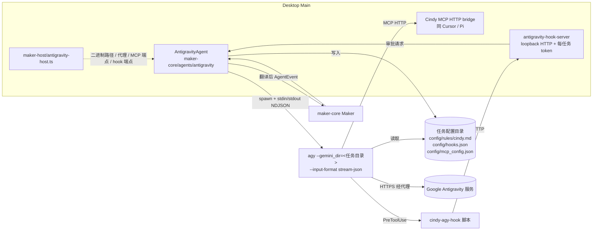

# Antigravity（agy）Agent 引擎接入方案

> 状态：方案稿（2026-11-19），尚未动代码。实测基于本机 `agy` 1.1.19（macOS arm64，已登录 Google
> AI 订阅）。工作分支 `feat/antigravity-harness`（独立 worktree），合入前不影响 `main`。
> 参考实现：本仓 Cursor 引擎（`packages/maker-core/src/agents/cursor/`、
> `apps/desktop/src/main/maker-host/cursor-*.ts`，提交 `a2714ccf10`）与
> [`cursor-agent-harness-plan.md`](cursor-agent-harness-plan.md)。

## 首版实现（macOS Desktop）

本机直接运行已安装并登录的 agy。Desktop 从 `agy models` 读取可用模型，每个任务使用独立的原生
历史目录。消息用官方 stream-json 接口发送。代理由启动环境提供，同一份环境用于模型发现和任务执行。

模型选择器用 `agy` 标记引擎。目录把 CLI 实际列出的推理变体归到同一模型，只显示该模型已有的档位。
换档或切模型后，下一轮用所选原生型号恢复同一段对话。已有任务的完整 CLI 型号仍可继续。

- `CINDY_AGY_PROXY` 可选，值为完整代理 URL，例如 `http://127.0.0.1:7890`。仅覆盖 agy 子进程的
  HTTP/HTTPS/ALL_PROXY 环境项。留空时继承常见代理环境项，并保留 `NO_PROXY` 中已有的豁免。
- `CINDY_AGY_BIN` 可选，值为本机可执行文件的绝对路径。省略时从 `~/.local/bin/agy` 和当前
  `PATH` 寻找。Desktop 不执行 shell alias。若代理只写在 alias 内，把相同地址通过
  `CINDY_AGY_PROXY` 随 Desktop 启动传入，再在终端使用 `agy` 完成登录。
- 审批沿用 agy 的原生默认权限。Headless 无法获取原生审批时，agy 会拒绝需要审批的操作。
  仅在明确选择「完全访问」时传入 agy 的允许全部工具选项。
- 下文保留全量方案。Cindy 审批卡、提示词注入、MCP、附件和跨设备执行属于后续阶段。

## 结论

1. **可以接，方式与 Claude Code 相同：Cindy 直接启动官方 `agy` CLI 子进程**，用
   `--input-format stream-json --output-format stream-json` 双向收发 NDJSON，不走 ACP，也不读取或
   转发 agy 的 OAuth 凭据。agy 的登录、模型请求、额度全部直连 Google，**不需要改 Cindy 服务端**。
2. **每个 Cindy 任务给 agy 一个独立配置目录（隐藏参数 `--gemini_dir`）**。Cindy 的规则、
   审批 hook、MCP 工具都写进这个目录，不改用户本机 agy 的全局配置，多个任务并发互不串台。
   已实测：登录态在新目录下仍然有效；规则、hook、MCP、工作目录全部正确（见 §1）。
3. **审批靠 agy 的 `PreToolUse` hook**：hook 进程阻塞，回调 Cindy 本机端点，等用户在 Cindy 里点
   允许或拒绝后再把结果交给 agy。这样「询问」权限档和 IM 里的权限确认都能做，比 Cursor 多一档。
4. **工作量主体仍是「引擎类型」的全仓登记**：Cursor 在本仓留下 258 个文件、743 处
   `'cursor'` 字面量（其中 213 处是纯枚举列表）。agy 照同样方法登记，另外新增约 15 个文件。
   全量对齐 Cursor 预计 7k–9k 行（含测试），分 4 期、每期一个 PR。
5. **几个依赖未公开的行为，必须先过 P0 验证再动手**：`--gemini_dir` 是未写进 `--help` 的参数；
   hook 失败时是否默认拒绝；SIGINT 中断后用 `--conversation` 恢复是否完整。任一项不成立，
   对应设计需要改（备选方案见 §9）。
6. **政策风险**：Google 没有明确说明第三方应用调用 agy 是否允许。本方案只运行未修改的官方程序、
   不碰 token，是风险最低的做法，但不是零风险；最坏情况是订阅账号被停用。

## 1. 实测事实（2026-11-19，agy 1.1.19）

所有结论均为本机实测，探针脚本留在会话临时目录，没有进仓库。

| 能力 | 结果 | 细节 |
| --- | --- | --- |
| 非交互运行 | ✅ | `-p ""` + `--input-format stream-json` 时从 stdin 读消息；`-p` 必须放在其他参数之后（否则把下一个参数当 prompt） |
| 输入消息 | ✅ | `{"event":"user","message":{"role":"user","content":"…"}}`，`content` 也接受 `[{type:"text",text}]`；一个进程多轮，同一 conversation |
| 图片输入 | ⚠️ | stdin 只收 `text` 块（`content block type "image" is not supported (only "text")`）；**把图片写成文件、在文本里给路径，agy 用 `read_file` 能看图**（实测识别出纯色图颜色） |
| 输出事件 | ✅ | `init`（conversation_id、model、cwd、tools、permission_mode）→ 若干 `step_update` → `result` |
| 流式文本 | ✅ | `step_type:"agent_response"` 带 `text_delta`，`state` 由 `ACTIVE` 到 `DONE` |
| 工具事件 | ✅ | `step_type:"tool"`，`tool_name`、`tool_info.parameters`；`DONE` 带 `output`，`ERROR` 带 `error{type,message}` |
| MCP 工具 | ✅ | 统一走 `call_mcp_tool`，参数 `ServerName` / `ToolName` / `Arguments`；schema 先用 `read_file` 读 `<gemini_dir>/…/mcp/<server>/<tool>.json` |
| 用量 | ✅ | 每个 `agent_response` 步骤带 `usage{input_tokens,output_tokens,thinking_tokens,cache_read_tokens,total_tokens}`；`result.usage` 为整轮合计 |
| 结束原因 | ✅ | `result.status` `SUCCESS/ERROR`；`finished_reason` `print_timeout` / `interrupted` / `error`；stderr 一行 `AGY_ERROR:{short_error,status,error_code,retryable,…}` |
| 会话恢复 | ✅ | `--conversation <id>` 接上历史（实测记得上一轮 MCP 返回值） |
| 中断 | ⚠️ | SIGINT → `finished_reason:"interrupted"`；stdin 的 `control_request` 返回 `not supported yet`，没有带内中断 |
| 权限：hook | ✅ | `PreToolUse` 返回 `allow` / `deny` 生效；**带 `--dangerously-skip-permissions` 时 hook 的 deny 仍然生效** |
| 权限：ask | ❌ | hook 返回 `ask` 时无界面模式直接自动拒绝（stderr：`headless mode cannot prompt … auto-denied`） |
| 规则（产品提示词载体） | ✅ | `rules/*.md` 需要 `trigger: always_on` frontmatter 才生效；工作目录的 `AGENTS.md` 也会读 |
| `--add-dir` | ❌ 不用 | 多个工作区按路径字母序，排第一的成为命令实际执行目录（`init.cwd` 仍报原目录）。Cindy 目录排在项目前面时命令跑错地方 |
| `--gemini_dir=<dir>` | ✅ | 新建空目录后 `agy models` 正常，登录态保留；`<dir>/config/{rules,hooks.json,mcp_config.json}` 全部生效；两个任务并发，hook 收到的环境变量、cwd、MCP 各自正确 |
| 环境变量继承 | ✅ | hook 进程和 stdio MCP 进程都继承 agy 进程的环境变量 |
| 网络 | ⚠️ | 直连返回 `User location is not supported for the API use.`；带 `HTTPS_PROXY` 等变量后正常。Go 程序，认标准代理变量 |
| 沙箱 | ❌ 不用 | 非 git 目录下 `sandbox configuration error: readonly .git/: non-absolute file path`，模型会重试一次浪费一轮 |
| 模型列表 | ⚠️ | `agy models` 输出 `id<TAB>显示名`；1.1.19 不支持 `--output-format`。**默认目录与新 `--gemini_dir` 返回的列表不同**（后者多出 Gemini 4 系列），原因待查 |

## 2. 选型

| 方案 | 结论 | 理由 |
| --- | --- | --- |
| **A. 官方 `agy` CLI 子进程 + stream-json** | **采用** | 与 Claude Code 接法一致；官方程序不改动；事件粒度足够；hook 提供审批 |
| B. ACP | 不采用 | 1.1.19 没有 ACP 入口；stream-json 已覆盖所需能力 |
| C. 取出 OAuth token 直连 Google 后端（接成 Pi provider） | 不采用 | 条款禁止；Pi 上游已删除 Antigravity 登录；封号风险 |
| D. 全局 agy 插件 + 环境变量开关 | 备选 | `--gemini_dir` 失效时的退路：插件里的 hook 和 MCP 只在 `CINDY_AGY_SESSION` 存在时生效（环境变量继承已实测），但要改用户全局配置 |

与 Cursor 的差异：Cursor 是 npm SDK，需要独立 utility process + 私有 RPC；agy 本身就是独立原生进程，
**不需要 utility process、不需要打包 SDK、不需要重签原生模块**，maker-core 直接 spawn。

## 3. 架构



### 3.1 新增模块

| 位置 | 内容 |
| --- | --- |
| `packages/maker-core/src/agents/antigravity/index.ts` | `AntigravityAgent extends BaseAgent`，`kind = 'antigravity'`；`ANTIGRAVITY_CAPABILITIES`；`startSession` 准备任务目录、拉起进程、返回 `AgentSessionHandle` |
| `.../antigravity/process.ts` | 启动与管理 `agy` 子进程：参数拼装、stdin 写消息、stdout 按行解析、stderr 收 `AGY_ERROR`、SIGINT 中断、退出屏障（照 `claude-code/local-process-spawn.ts` 的 `ProcessExitBarrier`） |
| `.../antigravity/protocol.ts` | stream-json 输入输出类型（`init` / `step_update` / `result` / 输入 `user`），只放 agy 实际输出过的字段 |
| `.../antigravity/translator.ts` | `step_update` → `AgentEvent`（见 §4.1），结构照 `CursorTranslator` |
| `.../antigravity/config-dir.ts` | 生成任务配置目录：`rules/cindy.md`（always_on）、`hooks.json`、`mcp_config.json`；文件 0600；关闭任务时清理凭据文件 |
| `.../antigravity/hook-broker.ts` | hook 请求 → Cindy 审批（`interaction_request`）→ allow/deny；权限档策略；fail-closed |
| `.../antigravity/model-config.ts` | 解析 `agy models`：按后缀 `-low/-medium/-high/-xhigh` 归并为「基础模型 + effort 档」；上下文窗口查模型注册表 |
| `.../antigravity/permission-policy.ts` | Cindy 权限档 → hook 策略与 `--mode`（见 §4.2） |
| `.../antigravity/errors.ts` | `AGY_ERROR` / `result.error` 分类：未登录、地区不支持、额度用尽、模型不可用、超时、中断 |
| `.../antigravity/customization-scanner.ts` | 列出项目 `.agents/skills`、`.agents/rules` 与 Cindy 托管 Skill |
| `apps/desktop/src/main/maker-host/antigravity-host.ts` | `buildAntigravityAgent()`：注入二进制路径、代理环境、MCP 端点、hook 端点、模型目录；找不到 `agy` 时返回 `null`，不影响其他引擎 |
| `apps/desktop/src/main/maker-host/antigravity-auth.ts` | 二进制发现（login shell PATH + `~/.local/bin`）、版本、登录检测（`agy --gemini_dir=<探测目录> models`）、模型目录缓存、代理设置 |
| `apps/desktop/src/main/maker-host/antigravity-hook-server.ts` | loopback HTTP 端点，按任务 token 路由到对应 `AntigravityAgent` 会话；只监听 127.0.0.1 |
| `apps/desktop/resources/antigravity/cindy-agy-hook.sh` | hook 可执行脚本：读 stdin，`curl` 到 hook 端点，原样输出决定；任何失败输出 deny |
| `apps/desktop/src/main/maker-host/antigravity-system-prompt.md` | 引擎补充提示词（预期为空或极短，需确认，见 §4.5） |
| `apps/desktop/src/renderer/components/icons/AntigravityMark.tsx` | 单色图标，`currentColor` |

### 3.2 引擎 ID

所有形态统一用 `antigravity`：Maker `AgentKind`、DB `agent_kind`、伙伴 `BotHarness`、`VendorKey`、事件
`source`。界面名称「Antigravity」，命令名 `agy` 只出现在设置的安装说明里。

- DB：`agent_kind` 等列是 drizzle 的 TypeScript `enum`，SQLite 没有 CHECK 约束（Cursor 接入时已核对
  `apps/desktop/drizzle/`），**不需要新 migration**，扩类型即可。
- `apps/desktop/src/shared/agentKindConversion.ts` 加恒等映射。

### 3.3 施工方法（沿用 Cursor 的做法）

1. 先改权威类型，靠编译错误驱动：`maker-core/src/types/common.ts`、`model-providers/src/types.ts`、
   `maker-scheduler/src/types.ts`、`lizi-mcps` 的 scheduler 枚举、`maker-shared/src/harnessPersonalization.ts`
   （`PersonalizationHarnessKind`，`personalization-support.ts` 的穷举断言会报错提醒）。
2. 编译器抓不到的三类人工扫：字面量数组与 `includes` 白名单、zod enum、三元兜底
   （`=== 'codex' ? … : 'claude-code'` 会把新引擎静默当成 Claude）。以 `'cursor'` 出现的 258 个文件为
   清单逐个过：Cursor 出现的地方 agy 基本都要出现，Cursor 专属功能（SDK 版本行、Cursor 额度）除外。
3. **跨端协议枚举不扩**：`device-link` 的 `REMOTE_AGENT_KINDS`、`ORCA_REMOTE_WORKER_AGENT_KINDS`、
   `maker-remote-ssh` 的 `RemoteAgentKind` 保持现状，agy 只在本机运行（与 Cursor 相同）。
4. P1 顺带把 `vite-env.d.ts`（52 处）和 `preload.ts`（35 处）里内联的引擎联合类型改成引用共享
   `AgentKind`，以后再加引擎不用再改这两处。这一步是纯类型重构，单独一个提交。

## 4. 关键设计

### 4.1 进程模型与事件翻译

**进程模型**：一个 Cindy 任务对应一个常驻 `agy` 进程，stdin 保持打开、每条消息一轮。以下情况结束
进程，下一条消息用 `--conversation <id>` 重启：中断、切换模型、切换权限档、进程意外退出、空闲回收。
启动参数：

```
agy --gemini_dir=<任务目录> --model <id> [--mode plan] --dangerously-skip-permissions \
    --input-format stream-json --output-format stream-json --print-timeout <上限> \
    [--conversation <id>] -p ""
```

- 始终带 `--dangerously-skip-permissions`，审批只由 Cindy hook 决定（§4.2），避开 agy 沙箱的 bug。
- `--print-timeout` 设为 Cindy 的单轮上限，`finished_reason:"print_timeout"` 映射为可重试错误。
- 环境变量：代理（§4.7）、`CINDY_AGY_HOOK_URL`、`CINDY_AGY_HOOK_TOKEN`、`CINDY_AGY_SESSION`。
- `init.conversation_id` → `session_id` 事件，存进 `sessions.sdk_session_id`，恢复用。

| agy 事件 | Cindy `AgentEvent` | 说明 |
| --- | --- | --- |
| `init` | `session_id`、`status` | 记录 `permission_mode` 与实际模型，模型不符时记日志 |
| `agent_response` + `text_delta` | `text`（增量） | 同一 `step_index` 累积；`DONE` 时 flush 成 `isFinal` |
| `agent_response` 的 `usage` | `status`（`UsageSnapshot`） | 上下文占用 = 最近一步 `input_tokens + cache_read_tokens + output_tokens`；花费只记 token |
| `tool` `ACTIVE` | `tool_use` | 名称映射表：`run_command`→`Bash`、`read_file`/`view_file`→`Read`、`write_file`→`Write`、编辑类→`Edit`/`file_change`、搜索类→`Grep`/`Glob` |
| `tool` `call_mcp_tool` | `tool_use` 名为 `mcp__<ServerName>__<ToolName>` | 与 Claude / Codex 的 MCP 卡一致；读 MCP schema 的 `read_file` 折叠，不单独出卡 |
| `tool` `DONE` / `ERROR` | `tool_result_full` + `tool_result` | `run_command` 的 output 去掉 `Created At/Completed At` 头；hook 拒绝显示为「已拒绝」 |
| `error_message` | `error`（非终止） | |
| `result` `SUCCESS` | `done` | 无流式文本但 `response` 有值时补一段（照 Cursor） |
| `result` `ERROR` | `error`（终止） | 按 `errors.ts` 分类；`interrupted` 映射为「已停止」 |
| 未知 `step_type` | 记 warn，不出卡 | 遵守 translator 不丢已知事件、不伪造未知事件 |

思考内容：本次用 `flash-low` 实测 `thinking_tokens` 为 0，没有看到思考增量字段。P0 用高 effort 模型录制
夹具确认；没有就不声明 `reasoningDisplay`。

### 4.2 权限档与审批

hook 配置（写进任务目录 `config/hooks.json`）对所有工具（`matcher: "*"`）调用 `cindy-agy-hook.sh`，
`timeout` 设为审批等待上限。hook 把 stdin 的 `{toolCall, cwd, conversationId, …}` 发给本机 hook 端点，
端点按 token 找到会话，由 `hook-broker.ts` 按权限档决定：

| Cindy 档 | 只读工具 | 文件写入 | 命令 / 浏览器 / 其他 | `--mode` |
| --- | --- | --- | --- | --- |
| 询问（`default` / `ask`） | allow | 发 `interaction_request`，等用户 | 发 `interaction_request`，等用户 | — |
| 接受编辑（`acceptEdits`） | allow | allow | 发 `interaction_request` | `accept-edits` |
| 自动（`auto`） | allow | allow | 交给 Cindy Auto 审核（`reviewAutoPermissionAction`，P2）；P1 先 allow | — |
| 完全访问（`bypassPermissions`） | allow | allow | allow | — |
| 计划（`plan`） | allow | deny | deny | `plan` |

- **fail-closed**：hook 端点不可达、token 不匹配、请求超时、脚本出错，一律输出 `deny` 并带原因。agy
  对 hook 非零退出或超时的处理（是放行还是拒绝）必须在 P0 实测；若默认放行，则在脚本里兜住所有异常。
- Cindy 自己的守卫（敏感凭据路径、桌面代输入 shell 守卫）也在 broker 里执行，与 Claude 的
  `claude-hooks/` 对齐，规则代码复用 `agents/shared/`。
- `ask_question` 工具：无界面模式下 agy 无法提问。broker 对它返回 deny，并提示模型直接在回复里提问；
  P2 评估改为 Cindy 原生提问卡。
- 切换权限档：下一条消息起生效（需重启进程，§4.1），运行中的一轮不变。

### 4.3 任务配置目录

路径：`<userData>/antigravity/<owner>/sessions/<sessionId>/`（按 owner 与任务隔离，不在项目里）。

```
config/rules/cindy.md       # trigger: always_on；产品提示词 + 共享记忆规则 + 个性化
config/hooks.json           # PreToolUse → cindy-agy-hook.sh
config/mcp_config.json      # Cindy MCP 端点（HTTP url + headers）
antigravity-cli/…           # agy 自己的会话历史、缓存（由 agy 写）
```

- 用户自己的 agy 全局配置（`~/.gemini/config` 下的 skills、rules、plugins、MCP）**不会加载**，这是隔离
  的代价。项目内 `.agents/`、`AGENTS.md`、`GEMINI.md` 照常生效。P2 提供「沿用我的 agy Skill 与规则」
  开关（复制 skills / rules，不复制 MCP 与插件）。
- `mcp_config.json` 含每任务 bearer token：文件 0600，进程退出时删除，每次启动重新生成。修改前读
  `credentials-and-local-storage.md` 核对落盘规则；P0 同时验证 headers 能否引用环境变量，能则不落盘。
- 会话历史在任务目录里，删除任务时一并清理；与用户在终端里用 agy 的历史互不可见。

### 4.4 Cindy 工具（MCP）

复用 Cursor 的做法：`getPiExtraSpawnConfig(providers, …, { agentKind: 'antigravity', allowedServerNames })`
拿到 Cindy MCP HTTP bridge 的端点与 token，写成 `mcp_config.json` 的 `{ url, headers }`。服务器集合：
`cindy_helper`、`cindy`、`cindy_computer`，开启记忆时加 `cindy_memory`。MCP 集合在会话开始时固定，不中途增删
（保护前缀缓存，见 `maker-core-and-agent-behavior.md` §3.1）。

2026-11-26，主人要求给本机 Agy 任务补上 `cindy_computer`（Cursor 不变）：没有它时 Agy 只能用 `cua-driver`
命令行操作桌面，绕过 Cindy 的电脑使用开关、目标窗口与安全守卫，也触发不了[锁屏后继续使用](product-rules/locked-use.md)。
在别的电脑上运行文件的任务（device-hosted）仍不挂本机任何 MCP。

### 4.5 产品提示词（需要维护者确认）

agy 没有 system prompt 参数。方案：把 `host-system-prompt.md` + `antigravity-system-prompt.md` + 共享记忆
规则与索引快照 + 用户个性化指令，按其他引擎相同的顺序写进 `config/rules/cindy.md`（always_on）。

- 优点：规则每轮都在，压缩后不丢；比 Cursor 的「附在首条消息末尾」更接近 system 段。
- 这属于 `maker-core-and-agent-behavior.md` §4 的 system prompt 门禁范围，实现前需要维护者确认措辞与
  注入方式。`antigravity-system-prompt.md` 预期只放引擎差异（例如图片附件以文件路径提供、不要调用
  `ask_question`），不复制共用正文。
- `harnessPersonalization.ts` 中 agy 登记为 `userPrompt: 'system-prompt'`、`makerMemory: true`、
  `nativeMemory: false`（agy 的 knowledge / memory 功能在隔离目录里不跨任务，暂不暴露开关）。

### 4.6 模型目录与 effort

- 来源：`agy --gemini_dir=<探测目录> models`，按连接缓存 30 分钟，设置页手动刷新。不写进 Cindy 服务端
  目录与离线目录。
- 归并：`gemini-3.8-flash-{low,medium,high}` → 模型 `gemini-3.8-flash`，effort `low/medium/high`；
  `claude-opus-5-5-high` 同理；无后缀的（如 `gemini-pro-orchestrator`）为单档模型。发送时拼回完整 id。
- 上下文窗口：按基础模型名查 `packages/model-providers/catalog/model-registry.json`；查不到时为 0，
  上下文环不显示百分比。
- 默认目录与 `--gemini_dir` 目录返回的模型列表不同（§1）。P0 查明原因（项目、账号层级或灰度），
  以 Cindy 实际运行时用的目录为准。

### 4.7 网络与代理

用户当前靠 shell alias 给 agy 设代理（局域网代理，非系统代理），Cindy 以 GUI 方式启动时拿不到。

1. 设置 · 供应商 · Antigravity 增加「网络代理」输入框（可空），支持 http/socks5，带「测试连接」。
2. 留空时用 Cindy 现有出站代理解析器（`outbound-proxy-resolver.ts`：先环境变量，后系统代理），解析
   Google 端点得到代理地址。
3. 注入 `HTTP_PROXY` / `HTTPS_PROXY` / `ALL_PROXY` 及小写版本，`NO_PROXY` 固定包含
   `localhost,127.0.0.1,::1`，**保证 hook 端点和 MCP bridge 不走代理**。
4. 检测到 `User location is not supported` 时给明确提示：需要可用的代理，并跳转设置。

### 4.8 二进制、登录与版本

- **不随 Cindy 分发 agy**（Google 专有软件）。设置页检测不到时显示安装说明与官方链接。
- 发现顺序：用户在设置里指定的路径 → login shell 的 `PATH` → `~/.local/bin/agy`。
- 登录检测：`agy --gemini_dir=<探测目录> models` 成功即视为已登录；失败按 `AGY_ERROR` 区分未登录、
  地区不支持、网络错误。未登录时提供「在终端中登录」按钮：打开终端运行 `agy`（交互式 OAuth）。
  Cindy 不保存、不读取任何 Google 凭据。
- 设置 · 关于 的 Harness 行显示 `agy --version`；「检查更新」调用 `agy update`，用户点击后才执行。

### 4.9 中断、插话、切换

| 能力 | 做法 |
| --- | --- |
| 停止 | SIGINT，等 `result`（`interrupted`）或进程退出；下一条消息带 `--conversation` 重启 |
| 插话 | 不支持同轮插话（`sameTurnSteer: missing`）；运行中的新消息进 Cindy 现有排队 |
| 切换模型 / effort | 下一条消息起生效：重启进程，`--conversation` + 新 `--model`（P0 验证跨模型恢复） |
| 图片附件 | 存到任务目录 `attachments/`，在消息里给绝对路径并提示用 `read_file` 查看 |
| 手动压缩 | 不支持（`/compact` 在 stream-json 输入下不可用）；agy 自己会自动压缩 |
| rewind / fork / 会话树 / HTML 导出 | 不支持，`capabilities` 不声明 |
| 换引擎续做 | 复用 `sessionAgentSwitchHandler` 的全量 / 增量交接（与 Cursor 相同） |

## 5. UI 与设计

所有新界面同时支持浅色与深色，颜色走语义 token；文案先查 `i18n/GLOSSARY.md`，术语沿用
「任务 / 对话 / 消息」。动手前按 `DESIGN.md` 开头的阅读路由读相关章节。

- **设置 · 供应商 · Antigravity**：未安装（安装说明）/ 未登录（「在终端中登录」）/ 网络不可达
  （代理输入框 + 测试）/ 已连接（Google 账号邮箱，若 agy 能给出）。
- **模型选择器**：新增来源分组「Antigravity」，模型按 §4.6 归并，effort 用现有下拉；未连接时显示
  「连接 Antigravity 后可用」。
- **权限档菜单**：五档全部可用（§4.2），这是相对 Cursor 的改进。
- **Harness 开关**：遵守 `harness-toggles.md`，默认开着，可在「关于」里隐藏。
- 不支持的入口靠 `capabilities` 隐藏，组件里不写 `=== 'antigravity'`。

## 6. 服务端与跨端兼容

| 面 | 涉及服务端 | 结论 |
| --- | --- | --- |
| 登录、模型、额度 | 否 | 直连 Google |
| Cindy 模型目录 / 计费 | 否 | agy 模型来自本机发现，用量不计入 Cindy 余额 |
| Device Link 中转 | 否 | 中转不解析载荷 |
| 手机 | 客户端 | 旧手机能看 agy 任务（`agentKind` 允许任意字符串），新建入口随 JS 热更新开放；改前读 `protocol-compatibility.md` 与 `remote-and-mobile-adaptation.md` |
| 远程 Agent / 供应商分享 / SSH | 客户端协议 | 不扩枚举，agy 只在本机运行 |

## 7. 分期（每期一个 PR）

| 阶段 | 范围 | 完成标志 |
| --- | --- | --- |
| **P0 验证**（约 0.5 天，不改产品代码） | 跑完 §8 全部待验证项；录制 stream-json 回放夹具（文本、工具成功/失败/拒绝、MCP、中断、错误、思考） | §8 每项有结论，失败项选定备选方案 |
| **P1 本机可用** | 引擎类型登记与联合类型收敛；`AntigravityAgent` + 进程 + translator + 配置目录；hook 审批五档；MCP；产品提示词（确认后）；设置页安装 / 登录 / 代理；模型选择器；图标与文案；个性化与记忆登记 | 桌面本机新建、继续、停止、审批 agy 任务全流程可用 |
| **P2 体验补齐** | Auto 档接 Cindy Auto 审核；伙伴 / 定时任务 / IM 默认引擎与 IM 权限确认；换引擎续做；手机新建与切换引擎；「沿用我的 agy 配置」开关；`ask_question` 映射 | 各入口都能选 agy，不支持的能力有明确说明 |
| **P3 用量与额度** | 任务与模型用量账本、今日花费（只计 token）；若能找到 agy 额度查询方式，接菜单栏与 Mac / iOS 猫猫 | 用量显示与其他引擎一致 |

工作量估计（含测试）：P1 约 4k–5k 行（新增模块约 1.5k + 测试约 1.2k + 全仓登记约 1.5k），P2 约 2k，
P3 约 1k–1.5k。

## 8. 待验证（P0）

| # | 问题 | 影响 | 不成立时 |
| --- | --- | --- | --- |
| 1 | `--gemini_dir` 在 `agy update` 后是否仍可用；目录里写的 `config/*` 是否会被 agy 改写 | 整体隔离方案 | 换方案 D（全局插件 + 环境变量开关） |
| 2 | hook 脚本非零退出、超时、输出非法 JSON 时 agy 是放行还是拒绝；`timeout` 上限 | 审批安全 | 脚本内兜底一律 deny；超时上限不够时审批卡加倒计时 |
| 3 | SIGINT 发生在工具执行中、文本输出中时，`--conversation` 恢复后历史是否完整 | 停止后继续 | 停止后提示「上一轮未完成部分已丢弃」 |
| 4 | 用不同 `--model` 恢复同一 conversation | 切换模型 | 切换模型改为开新 conversation + 交接摘要 |
| 5 | 默认目录与 `--gemini_dir` 模型列表不同的原因 | 模型目录 | 以运行目录为准并在设置页说明 |
| 6 | `mcp_config.json` 的 headers 能否引用环境变量 | token 是否落盘 | 保持 0600 文件 + 退出删除 |
| 7 | 思考增量、子 agent、`ask_question`、浏览器工具在 stream-json 里的形状 | translator 覆盖面 | 未知步骤只记日志 |
| 8 | 未登录时 `agy models` 的错误形状；终端登录完成后 Cindy 何时能感知 | 登录体验 | 设置页提供「重新检测」 |
| 9 | 长任务下 `--print-timeout` 上限与 stdin 多轮模式的交互 | 长任务 | 每轮重启进程 |
| 10 | 同一 Google 账号同时跑多个 agy 进程是否触发限流 | 并发任务 | 按账号限制并发并排队 |

## 9. 风险

| 风险 | 影响 | 缓解 |
| --- | --- | --- |
| 依赖未公开参数 `--gemini_dir` | 升级后整体失效 | 启动时探测；失效即退回方案 D 并提示；锁定已验证的 agy 版本范围 |
| Google 政策 | 账号被停用 | 只用官方程序与官方登录；不抽 token、不改二进制；设置页写明风险 |
| hook fail-open | 询问档下命令未经确认执行 | P0 验证 #2；脚本兜底 deny；端点不可用时整个任务暂停 |
| 三元兜底漏改 | 新引擎被当成 Claude | 穷举 `switch` + `assertNever`；按 `'cursor'` 清单逐项核对 |
| agy 版本变化快 | 事件形状变化 | 回放夹具；未知字段容忍；`init` 校验版本 |
| 代理配置 | 国内网络下不可用 | 设置页代理 + 地区错误专门提示 |
| 隔离目录不加载用户 agy 配置 | 用户以为自己的 Skill 失效 | 设置页说明；P2 提供沿用开关 |
| 每任务 token 落盘 | 凭据暴露面 | 0600、退出删除、只在 userData；P0 #6 争取不落盘 |
| agy 遥测 | 隐私口径 | 隐私说明列出；Cindy 不向 agy 注入用户日志 |

## 10. 验证计划

- **translator**：用 P0 录制的回放夹具驱动真实 `AntigravityAgent` 入口（注入假进程），覆盖文本、工具
  成功 / 失败 / 被拒、MCP、中断、`AGY_ERROR`、print_timeout。测试写法遵守
  `engineering-conventions.md` §3.2。
- **审批**：hook broker 单测覆盖五档矩阵与所有 fail-closed 路径；真实 agy 集成测（`*.integration.test.ts`，
  本机有 agy 时才跑）验证 allow / deny / 超时。
- **引擎登记**：现有按引擎参数化的测试加入 `antigravity`；`personalization-contract.test.ts` 自动覆盖。
- **类型与单测**：`pnpm --filter desktop typecheck`、maker-core / maker-shared `tsc`、
  `pnpm test:unit:related`；改到 Host 共用主体时跑 Host 测试。
- **真机**：`pnpm restart:desktop:remote -- --isolated=@worktree` 起本 worktree 实例，新建、继续、停止、
  审批、切模型各走一遍；设置页浅色 / 深色各截图目检。

## 11. 需要决策

1. 产品提示词放进 `rules/cindy.md`（§4.5），措辞与内容需要维护者确认。
2. 自动（`auto`）档在 P1 先直接放行、P2 再接 Cindy Auto 审核，是否接受。
3. 隔离目录默认不加载用户自己的 agy 全局配置（§4.3），是否接受。
4. 是否接受 §9 的政策风险，在设置页明确告知用户。
