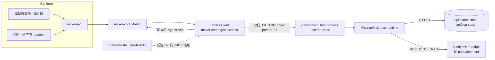

> **已退役（2026-11-05）**：维护者决定从所有客户端移除 Cursor 引擎。以下仅为历史调查和实测记录，不再描述当前能力或开发计划；所列运行时文件和探针已移除。其他引擎及通用体验优化保留。

## 退役实现与验证（2026-11-05）

2026-11-05 补充：维护者要求不保留旧任务兼容。已用一次性脚本清除本机 8 个 Cursor 任务及 911 条消息，执行前备份并核验其他引擎任务和消息无缺失；SDK 私有目录和加密登录配置移入备份。新版 Mac CN ARM64 Developer ID 包和 iOS 个人签名包已生成，均回读确认不含退役兼容及预热入口。iOS 设备连接返回 CoreDeviceError 4016，维护者明确选择暂缓 iOS 安装、先替换 Mac。

- 已移除 maker-core Cursor adapter、Desktop 登录和 utility worker、SDK 依赖及补丁、打包入口、各端模型选择、专用预热/远程通道和额度展示。独立 Mac / iOS 猫猫同步移除 Cursor 额度查询。
- 维护者随后明确取消历史兼容：已撤掉只读展示、退役身份判据及对应测试；一次性清理脚本按 Cursor 身份备份并删除本机实验任务、消息，隔离 Cindy 私有 SDK 状态与登录配置。其他引擎不变。
- 已逐文件核对保留 iOS 原生选择器、首页与偏好、通用任务创建/镜像修复、远程重启脚本等其他优化。通用 provisional 标记和重复提交保护继续保留。
- 类型检查：maker-core、Desktop、Mobile、独立 Mac / iOS 猫猫通过。锁文件冻结校验通过，没有引入 Expo / React Native 依赖漂移。
- 定向测试：核心 154 项；Desktop 创建/鉴权/目录/额度组 610 项，后续退役切换回归通过（切换文件 162 项）；模型和界面组 586 项通过、1 项既有失败；Mobile 410 项经修正测试断言后通过，另 65 项 transport 测试通过；模型目录 85 项、Device Link 59 项、共享协议 90 项、Mac 猫猫 29 项、iOS 猫猫 39 项通过。仅复跑了受修正影响的文件，计数不重复累加。
- 自建中转：隔离 loopback 的真实配对、调用和自动重连互通测试通过；没有修改服务端或连接恢复策略。
- 界面：真实模型选择器、供应商设置的 Light / Dark 共 4 个场景通过，已查看截图；没有 iOS / Android 真机目检。
- 未通过的既有检查：插件选择器取消测试仍查询旧统一面板的 `data-unified-anchor`，移除前 ModelSelector 的隔离对照也同样失败；全量 `ui:check --changed` 被 PDF worker 的 default export 错误挡住，改用上述定向场景；全仓 i18n 有既有键名缺失，比较 HEAD 与当前 key 集合确认未新增缺失。没有跳过断言或修改其他产品行为来制造通过。
- 文档检查与 `git diff --check` 通过。后续已完成 Mac 签名打包、覆盖安装并确认新版启动；iOS 安装包已生成，维护者决定继续使用现有远程客户端，暂不覆盖安装。

---

# Cursor Agent 引擎接入方案

> 状态：桌面本机实验版（2026-11-04）；此前已完成真实账号 Electron dev 联调及 CN macOS arm64 签名安装版验收，详见文末分项记录。本轮稳定性修正尚未重新打包安装；跨平台运行未验收。参考实现为本地 `t3code` 仓库
> `packages/provider-cursor`（`@cursor/sdk` 1.2.0）。Server 为独立仓库，本文的兼容结论
> 来自客户端代码核查，不代表已与 Server 侧确认。

下文保留早期方案与按时间追加的验证记录；当前修正范围和未完成项以文末「本轮 Review 修正」为准。

## 结论

1. **可以接，且第一期不需要改 Cindy 服务端。** Cursor 引擎的登录、模型目录、模型请求和
   用量全部直连 Cursor 自己的服务（`api.cursor.com` / `api2.cursor.sh` / `cursor.com`），不经过 Cindy 网关、
   不进服务端模型目录、不产生 Cindy 网关模型计费。首版仅启用本机运行；跨端执行仍按原有三引擎协议限制，不能据此推断所有同步载荷均与引擎类型无关。
2. **推荐沿用 t3code 的现行做法：用官方 `@cursor/sdk` 的本机运行时（local runtime）**，
   而不是 t3code 早期用过的 `cursor-agent` CLI + ACP。但 SDK 要放进**独立的 Node 子进程**
   运行，不要像 t3code 那样直接跑在宿主进程里。
3. **真正的工作量在客户端的「三引擎硬编码」。** 全仓约 150 处把引擎写死成
   `'claude-code' | 'codex' | 'pi'`，另有 `cc` / `claude` 两套别名；其中三元兜底
   （`=== 'codex' ? … : === 'pi' ? … : 'claude-code'`）会把新引擎静默当成 Claude，是最大的漏改风险。
4. **第一期只做本机。** 远程 Agent、供应商分享、供应商组、SSH、手机新建 Cursor 任务放到
   后续，因为 `REMOTE_AGENT_KINDS` 等跨端协议严格校验引擎值，旧端会拒绝。
5. **有两项产品限制必须对用户明说**：SDK 没有逐次工具审批回调，所以第一期没有「询问」
   权限档，IM 里的权限确认也不适用；SDK 不能原生回滚或分叉对话，所以 rewind / fork 不可用。

维护者已确认的取舍见文末「已决策」。

## 1. t3code 是怎么接的

t3code 前后接过两版：

| 版本 | 方式 | 现状 |
| --- | --- | --- |
| V1 | 启动 `cursor-agent` CLI，走 ACP（Agent Client Protocol）| 已被 V2 取代，设置里只保留旧字段 |
| V2 | 进程内加载 `@cursor/sdk`，`Agent.create / resume / send`，`runtime: "local"` | 现行 |

V2 的关键做法（文件均在 `t3code/packages/provider-cursor/src/server/`）：

| 能力 | t3code 做法 | 对应文件 |
| --- | --- | --- |
| 登录 | `Cursor.auth.login({ openBrowser: false, onLoginUrl })` 拿到授权链接，前端展示「打开登录页」；SDK 生成一把带名字的 API key，存进 t3 自己的凭证存储；也接受 `CURSOR_API_KEY` 覆盖 | `auth.ts`、`credentialStore.ts` |
| 模型目录 | 不初始化 agent 运行时，直接 `GET api.cursor.com/v1/models` 与 `/v1/me`，缓存 30 分钟；模型带 `parameters`（effort / context / fast）和 `variants`（含 Max Mode）| `CursorSdkCatalog.ts`、`status.ts`、`sdkModel.ts` |
| 会话 | 每个 t3 线程对应一个 Cursor agent（`agentId` 持久化，用于 resume）；同一时间一个 run | `CursorAgentSdk.ts`、`adapter.ts` |
| 流式事件 | `send(..., { onDelta })` 收到 `InteractionUpdate`：`text-delta`、`thinking-delta`、`tool-call-started/partial/completed`、`shell-output-delta`、`step-*`、`turn-ended` | `adapter.ts` 约 1990–2075 行 |
| 工具 | `shell/read/edit/write/delete/grep/glob/ls/semSearch/readLints/mcp` 映射成通用工具卡；`createPlan` → 计划，`updateTodos` → 待办，`task` → 只读子任务 | `adapter.ts` 约 400–820、1920–1975 行 |
| 宿主工具 | 把 t3 自己的 MCP（HTTP + Bearer）作为 `mcpServers` 每次 send 时传入；同时加载磁盘上的 `.cursor/mcp.json`、插件（`settingSources: project/user/team/mdm/plugins`）| `adapter.ts` `cursorMcpServers` |
| 权限 | 只有两个旋钮：`local.autoReview`（Cursor 自带分类器审阅）和 `local.sandboxOptions.enabled`。Full access = 关沙箱；其余档 = 开沙箱 + 自动审阅；Windows 无文件系统沙箱 | `adapter.ts` `cursorRuntimeAgentPolicy` |
| 计划模式 | `mode: "plan" \| "agent"` | `adapter.ts` |
| 压缩 | `/compress` → `agent.summarize()` | `adapter.ts` |
| 图片 | `SDKUserMessage { text, images: [{ data(base64), mimeType }] }` | `adapter.ts` |
| 产品提示词 | SDK 不接受 system / developer 段，t3 把编排说明拼在**用户消息末尾**，只在首轮或首次出现 MCP 时附加 | `adapter.ts` `resolveUserMessage` |
| 错误 | 429 / `*_usage_limit` → 用量上限；`Cannot use this model:` → 模型不可用；`plan_required` → 需要付费计划 | `CursorAgentSdk.ts`、`CursorSdkCatalog.ts` |
| 稳定性 | SDK 会留下未处理的 Promise 拒绝（shell spawn 失败、写已关闭的流），t3 在进程级 `unhandledRejection` 里专门吞掉这两类，否则整个服务器退出 | `CursorSdk.ts` |
| 用量 | 月度额度：Cursor dashboard 接口返回 `totalPercentUsed / autoPercentUsed / apiPercentUsed` 与 `billingCycleEnd`；逐条用量从 dashboard 事件接口分页拉 | `usageLimits.ts`、`accountUsage.ts` |

t3code 文档（`t3code/docs/user/cursor.md`）列过没有原生 fork、对话回滚、运行中插话和交互式审批回调，
但不能把参考客户端的能力缺口都视为 SDK 限制：安装的 1.2.0 已公开本地 `Run.steer()`，
`complete_delivered` 表示已交付，`revert_to_followup` 必须交回普通排队。Cindy 已在本轮后续修正接入。
`task` 子代理的 `agentId` 不能直接当作可恢复的主任务 ID。

我另外核对了 SDK 1.2.0 的类型声明（`@cursor/sdk/dist/esm/options.d.ts`），有几处 t3code 没用、
但对 Cindy 有价值的能力：

- `disallowedTools` / `tools`：按名字裁掉内置工具，可用来落实 Cindy 的能力路由（例如裁掉
  与 Cindy 重叠的 `webSearch`、`generateImage`）。
- `local.dirs`：多根工作区，可对应 Cindy 的附加目录。
- `local.customTools`：进程内回调工具，**不需要审批、在沙箱与 Auto-review 下也能跑**；
  注释说明普通 MCP 工具在这两种情况下可能「fail closed」。
- `local.resourceProviderOptions`：可替换工具执行器，SDK 已公开 `LocalToolExecutor` 类型。
  这不是审批的唯一候选：SDK 还会加载文件式 hooks（如 `preToolUse`、`beforeShellExecution`）。
  hooks 的超时、取消和与 Cindy 决定的关联仍需原型验证，不能据此声称已支持宿主审批。
- `systemPrompt`：**整段替换** Cursor 自带的系统提示词，且按账号由 Cursor 开通，未开通时首次
  send 直接报错。不能作为通用方案。
- run 结束会给累计 `TokenUsage`，可直接喂 Cindy 的用量快照。
- `agent.getUsage()` 支持本地 token 与计费明细；账期剩余额度仍是另一套接口。

## 2. 选型

| 方案 | 优点 | 缺点 | 结论 |
| --- | --- | --- | --- |
| A. SDK 跑在 Electron main 进程 | 最省事，和 t3code 一致 | SDK 约 20 MB、含 `.node` 原生模块（tree-sitter）和 `cursorsandbox`、`rg` 二进制；会产生未处理拒绝，曾导致 t3 服务器退出；Statsig 埋点跑在主进程 | 不采用 |
| **B. SDK 跑在独立 utility process，私有 RPC 对接** | 崩溃隔离；用 Electron `utilityProcess` 承载 Node 运行时免装（正式包禁用 `RunAsNode`，不能 spawn Electron 冒充 node）；入口脚本路径满足 `BaseAgent.binaryPath`；两端通过 `parentPort` 传 JSON 消息 | 多一层 RPC 和进程生命周期管理；SSH 需另配 transport，不能原样搬 utility process | **采用** |
| C. `cursor-agent` CLI + ACP | ACP 有 `session/request_permission`，能做真正的「询问」档和 IM 确认 | 要另行分发 CLI；t3code 已放弃；事件比 SDK 粗 | 只在「询问」档是硬需求时再评估 |

## 3. 架构



### 3.1 新增与改动的模块

| 位置 | 内容 |
| --- | --- |
| `packages/maker-core/src/agents/cursor/index.ts` | `CursorAgent extends BaseAgent`，`kind = 'cursor'`；声明 `capabilities`；`startSession` 拉起或复用 host 进程，`open(create\|resume)` |
| `.../agents/cursor/translator.ts` | `InteractionUpdate` → Cindy `AgentEvent`（见 §4）。必须无丢失、无错序，遵守 `maker-core-and-agent-behavior.md` |
| `.../agents/cursor/rpc-client.ts`、Desktop `maker-host/cursorUtilityTransport.ts` | 私有 JSON RPC；借用共享 transport 接口，双向走 `parentPort`，stdout / stderr 只排空，不使用 JSONL 帧长限制 |
| `.../agents/cursor/host-entry.ts`、`host-runtime.ts`（独立 bundle） | 加载 SDK、create／resume／send／cancel／summarize／close、登录和 Key 验证；未知 `unhandledRejection` 结束隔离进程，由退出确认和任务句柄重建收口，不吞掉未知失败 |
| `.../agents/cursor/permission-policy.ts` | 权限档 → `autoReview` / `sandboxOptions` / `mode`（见 §4.2） |
| `.../agents/cursor/errors.ts` | 用量上限、模型不可用、未登录、需付费计划、取消的分类（照 t3） |
| `agents/index.ts`、`capability-route-support.ts`、`credential-mode.ts` | 导出 `CursorAgent`；加 `cursor` 的能力路由 enforcer（用 `disallowedTools` 落实）；凭证形态固定为「Cursor 自有凭证」，不走网关 key |
| `apps/desktop/src/main/maker-host/cursor-host.ts` | 仿 `pi-host.ts` 的 `buildCursorAgent()`：解析 host 入口、注入凭证读取、MCP 端点；SDK 加载失败时返回 `null`，即可选注册，不影响其他引擎 |
| `apps/desktop/src/main/maker-host/cursor-host.ts` 与 `mcp-integrations/piEnvironment.ts` | 复用现有 Cindy MCP HTTP bridge，把端点组装成 SDK 的 `mcpServers`；没有独立 `cursorEnvironment.ts` |
| `apps/desktop/src/main/maker-host/cursor-auth.ts` | 登录、加密凭证、目录发现、账号隔离历史路径与用量；没有独立 `cursor-auth/` 目录 |
| `apps/desktop/forge-runtime-deps.ts` 等打包配置 | 把 `@cursor/sdk` 与当前平台的 `@cursor/sdk-<platform>` 解出 asar；`cursorsandbox`、`rg`、两个 `binding.node` 纳入 Developer ID 重签与 `codesign --verify --deep --strict` |

### 3.2 引擎 ID 与别名

建议所有形态都用同一个值 `cursor`：Maker、DB `agent_kind`、伙伴 `BotHarness`、二进制
`VendorKey`、事件 `source` 都写 `cursor`，不再引入第四套缩写。

- DB：`agent_kind` 列只有 TypeScript 层的 drizzle `enum`，SQLite 里没有 CHECK 约束
  （已核对 `apps/desktop/drizzle/`），**不需要新 migration**，扩类型即可。
- `apps/desktop/src/shared/agentKindConversion.ts` 的 `dbToMaker` / `makerToDb` 加一行恒等映射。

### 3.3 扩引擎的施工方法

1. 先改权威类型：`maker-core/src/types/common.ts`、`model-providers/src/types.ts`、
   `maker-scheduler/src/types.ts`、`lizi-mcps/src/scheduler/_enums.ts`，靠编译错误驱动修改。
2. 编译器抓不到的三类要人工扫：
   - 字面量数组和 `includes` 白名单（如 `providerHandlers.ts:124`、`sessionRuntimeHarnessSelection.ts:63`、
     `mcpHandlers.ts:60` 的 zod enum、Pi bridge 工具 schema `cindy-bridge-source.ts:4160`）；
   - 三元兜底，改成穷举 `switch` + `assertNever`；
   - 别名体系：`cc`、`claude`（`BotHarness`、`VendorKey`、`MonitoredAgentKind`）。
3. 新增一个只读检查脚本，列出仍写死三值的位置并纳入 CI。基线只减不增，做法同
   `check:test-hygiene`。
4. **跨端协议里的枚举第一期不扩**：`device-link` 的 `REMOTE_AGENT_KINDS`、
   `ORCA_REMOTE_WORKER_AGENT_KINDS`、`maker-remote-ssh` 的 `RemoteAgentKind`、
   `providerGroup.ts` 的 `REMOTE_AGENT_KINDS`、`dispatch.ts` 的 `PROVIDER_SHARE_AGENT_KINDS`
   保持三值，本机列表与远程列表从这里分叉。

## 4. 能力映射

### 4.1 事件翻译

| Cursor `InteractionUpdate` / 工具 | Cindy `AgentEvent` | 说明 |
| --- | --- | --- |
| `text-delta` | `text` | 按 assistant 段累积；run 结束若无流式文本、`RunResult.result` 有值，则补一段（照 t3） |
| `thinking-delta` / `thinking-completed` | `thinking` | |
| `tool-call-started/partial/completed`：`shell` | `tool_use` / `tool_result`（Bash 类卡片） | `shell-output-delta` 作为流式输出，设长度上限 |
| `read / edit / write / delete / grep / glob / ls / readLints / semSearch` | 复用现有文件 / 搜索工具卡 | 名称映射集中在一个表里 |
| `mcp` | `tool_use` 名为 `mcp__<server>__<tool>` | 与 Claude / Codex 的 MCP 卡一致 |
| `createPlan` | 计划卡（`plan_review` 不触发，只展示） | |
| `updateTodos` | 待办列表 | |
| `task` | `agent_task_update`（只读子任务卡） | 子任务不能 resume，不提供「继续」入口 |
| `turn-ended` + `run.wait()` | `done`；`finished / cancelled / error` → 完成 / 已停止 / 失败 | 照 t3 处理「resume 后无进展」的假失败 |
| run 的 `usage` | `UsageSnapshot` / `account_usage` | 只统计 token，不换算 Cindy 余额 |
| `agentId` | `session_id`（存进 `sessions.sdk_session_id`） | resume 用 |

### 4.2 权限档

| Cindy 档 | Cursor 设置 | 第一期 |
| --- | --- | --- |
| 自动（`auto`） | `autoReview: true`、沙箱开 | 支持；`getAutoReviewOwner()` 返回 `native` |
| 完全访问（`bypassPermissions`） | `autoReview: false`、沙箱关；首次打开前预热 `cursorsandbox`（照 t3） | 支持，沿用现有 Full access 确认 |
| 计划（`plan`） | `mode: 'plan'` | 支持 |
| 询问（`ask`） / `default` / `acceptEdits` | 无对应 | 不提供；`Capabilities` 不声明，UI 隐藏 |

- 所有平台 Auto／Plan 均请求 SDK 沙箱；SDK 判断环境不支持时会报 `ConfigurationError`，不会自动关沙箱。
  Windows 平台包存在 helper，不能仅由参考客户端推断「Windows 无沙箱」。现有 Windows 提示仍待实机核实和更正，未验收。
- Auto-review 取决于连接后端是否启用分类器，不是安全边界；未启用时会回到 SDK 默认行为。
  SDK 沙箱约束 shell 及其子进程，读权限不局限于项目，默认禁止出网；依赖安装可能被拒。
  以上口径来自[官方 SDK 文档](https://cursor.com/docs/sdk/typescript#sandbox-options)，不等同于 Cindy 宿主审批。
- 切档占用与发送相同的 busy 门。先成功 resume 候选 agent，再替换并关闭旧 agent；失败保留原权限和旧句柄。

### 4.3 其他能力

| 能力 | 第一期 | 做法 |
| --- | --- | --- |
| 新建 / 继续任务、重启后继续 | 支持 | `Agent.resume(agentId)`；已确认旧 worker 停止、且精确持久行含 `activeRunId` 时，仅首条普通发送带 `local.force`，正常恢复不带 |
| 停止 | 支持 | `run.cancel()` |
| 插话 / 排队 | 支持本地文本插话和排队 | `sameTurnSteer: true`；SDK 明确拒收时回普通排队，回执不确定时暂停队列；图片与显式 Skill 调用保留普通发送路径 |
| 运行中换模型 / effort | 支持（两轮之间） | 每次 `send` 带 `model: { id, params }` |
| 图片附件 | 支持 | base64 `images` |
| 文件附件 | 支持 | 路径拼进文本，同其他引擎 |
| 手动压缩 | 支持 | `agent.summarize()` → `compact_boundary` |
| Cindy 工具（MCP） | 支持 | `mcpServers` 每次 send 下发；需实测 Auto-review / 沙箱下 MCP 会不会被拒，若被拒改用 `customTools` 转发 |
| 用户自己的 Cursor 规则、Skill、MCP、插件 | 支持 | `settingSources: ['project','user','team','mdm','plugins']` |
| Cindy 托管 Skill | 第二期 | 与 Cursor 的 Skill 目录对齐后再做，避免两份来源 |
| rewind / fork / 会话树 / HTML 导出 | 不支持 | `Capabilities` 不声明 |
| 换引擎续做 | 已实现任务内交接，待真实模型验收 | 复用 `sessionAgentSwitchHandler` 的全量／增量交接，见文末 2026-11-05 实现；外部 IDE／CLI 历史导入仍是独立功能 |

### 4.4 产品提示词（需要你确认）

Cursor 的 `systemPrompt` 是整段替换、且要 Cursor 按账号开通，不能用。可行的只有 t3 的做法：
把 Cindy 的产品说明作为**合成的用户上下文**放在首轮用户消息里，MCP 首次出现时再补一次。
这会改变 Cursor 任务里模型收到的指令，属于 `maker-core-and-agent-behavior.md` §4 的
「system prompt 改动门禁」范围，动手前需要维护者确认措辞与注入时机。

## 5. UI 与设计

所有新界面同时实现浅色与深色两种模式，颜色一律走语义 token；文案先查 `i18n/GLOSSARY.md`，
术语沿用「任务 / 对话 / 消息」的现有边界。

### 5.1 设置 · 供应商 · Cursor

放在现有供应商列表里，作为一个订阅类连接，与 Claude、ChatGPT 订阅并列。

| 状态 | 卡片内容 | 操作 |
| --- | --- | --- |
| 未连接 | 「用你的 Cursor 账号运行任务。需要 Cursor 付费计划。」 | 主按钮「用 Cursor 登录」；次要入口「改用 API key」 |
| 等待浏览器 | 「在浏览器里完成登录，完成后这里会自动更新。」，显示剩余时间（5 分钟超时） | 「重新打开登录页」「取消」 |
| 验证中 | 进度指示 | — |
| 已连接 | 账号邮箱、计划名称、本月用量条（第二期） | 「切换账号」「退出登录」 |
| 失败 | 按错误给原因：需要付费计划、团队禁止、网络不可达、登录过期 | 「重新登录」 |

- 登录链接用 `shell.openExternal` 打开，`openBrowser: false`，链接也给「复制」按钮，方便在另一台设备上完成。
- 退出登录和切换账号前，先停掉正在使用这份凭证的 Cursor 任务、保留任务记录（照 t3 `withAccess` 的语义）。
  确认对话框里写明「正在运行的 N 个 Cursor 任务会停止」。
- API key 模式下禁止浏览器登录，避免两份凭证打架；界面上说明当前用的是哪一种。

### 5.2 模型选择器

- 新增来源分组「Cursor」，模型来自 `/v1/models`，按账号实际返回显示；「Auto」映射到 SDK 的 `default`。
- 模型参数沿用现有控件：`effort`/`reasoning` → 思考强度下拉；`context` → 上下文档位（含 Max Mode）；
  `fast` → Fast 开关。参数优先级照 t3 `cursorSdkParameterPriority`。
- Cursor 的模型只能在 Cursor 引擎上跑，其他引擎也不能选 Cursor 模型，引擎行只显示「Cursor」一项；
  不需要「兼容模式」标签。
- 未连接时分组显示一行「连接 Cursor 后可用」，点进 5.1；目录拉取失败时保留上次缓存并标「可能不是最新」。

### 5.3 输入框与任务视图

- 权限档菜单只列 Cursor 支持的三档（自动、完全访问、计划）。旧任务或 IM 默认值带进来「询问」时，
  按「自动」运行，并在任务里给一条说明，不静默降级。
- 工具卡、计划卡、待办、子任务卡全部复用现有组件，不为 Cursor 做专用样式。
- 不支持的入口（rewind、fork、会话树、HTML 导出）通过 `capabilities` 隐藏，不在组件里写 `=== 'cursor'`。

### 5.4 图标与品牌

- `VendorIcon` 增加 `cursor`，使用 Cursor 官方立方体标志的单色 SVG（t3 的 path 可参考：
  `t3code/packages/provider-cursor/src/client.ts`）。填充色用 `currentColor`，跟随语义前景色与选中态，
  不硬编码 t3 的 `#26251E / #EDECEC`。
- 对外名称统一写「Cursor」；Harness 筛选、Issue 元数据里的公开全名写「Cursor」，不用缩写。
- 「关于」页的 Harness 版本行显示 `@cursor/sdk` 版本；SDK 随应用发布，不提供单独更新按钮。

### 5.5 用量

- Mac 菜单栏面板已接入当前连接的 `GetCurrentPeriodUsage`：`autoPercentUsed` 与
  `apiPercentUsed` 是独立模型池，分别显示为「Cursor 模型」「其他模型」，不能相加、取最小值
  或把任一池用完解释为整个账号不可用。首页保留一个 Cursor 入口，详情展示各池环与重置时间。
  `totalPercentUsed` 只在没有分池数据时作服务端汇总的后备，不再当作第三个额度池。
- 直接采用接口百分比（含赠送额度），不按套餐价格反推；重置时间取 `billingCycleEnd`，
  未返回则显示未知，已过期读数丢弃。没有账期起点，不估算消耗速度。额外付费／预付余额暂未读取，
  明确提示查看 Cursor 账单，不据此触发「全部额度见底」。
- 读取复用 Cindy 当前 owner 的 Cursor API key；换取的短期 token 只在 Main 内存使用，
  不落盘、不进入面板协议。缓存按 owner、连接与授权代次隔离，切账号后的迟到结果丢弃。
- Mac 的任务和用量图单独统计 Cursor；手机小组件 v1 仍是三个引擎槽，不冒充 Claude，
  Cursor 分池余量与独立用量展示留待手机端协议和原生组件一起扩展。
- 撞到用量上限时按 `usage-limit-auto-continue.md` 处理：重置时刻取 Cursor 返回的账期结束时间；
  拿不到可靠时刻时不自动继续，只提示。
- 任务里的 token 统计只用于展示，不进入 Cindy 余额与计费口径。

## 6. 服务端兼容性

| 面 | 是否涉及服务端 | 依据 | 结论 |
| --- | --- | --- | --- |
| 模型调用、登录、模型目录、用量 | 否 | 全部直连 Cursor | 无影响 |
| Cindy 模型目录 `/api/model-catalog/catalog` | 否 | 目录按 `providers[].models.<引擎>` 分槽；Cursor 模型来自账号实时发现，服务端没有 `cursor` 槽不影响 | 无影响；也不需要写进客户端离线目录 |
| 伙伴云端（companion-cloud） | 否 | 只在本地读 `sessions.agentKind`，不上传 | 无影响；Cursor 伙伴第二期再接 |
| Device Link 中转（官方 / 自建） | 否 | 中转只转发，不解析载荷（`protocol-compatibility.md`）| 无影响 |
| 远程 Agent / 供应商分享 / 供应商组 | 客户端协议 | `REMOTE_AGENT_KINDS` 用 `oneOf` 严格校验 | 第一期不暴露；以后加能力协商位，旧端不声明时不提供 Cursor |
| 手机 | 客户端 | 多处写死三值；会话列表的 `agentKind` 允许任意字符串 | 旧手机能看 Cursor 任务、不能新建；新建入口随一次 JS 热更新开放 |
| 标题生成等辅助模型 | 现有服务端 | 仍走现有辅助模型路由，Cursor 任务不改变这条链路 | 无影响 |
| 计费 / 余额 | 否 | Cursor 用量不经过 Cindy | 无影响；界面上不要把它算进 Cindy 余额 |

结论：在不碰服务端的前提下，第一期（本机）和第二期都能完整交付；第三期的远程能力只涉及
客户端之间的协议，也不需要服务端改动。

## 7. 区域

- 按维护者的默认约定，按中国大陆版（`cn`）开发与打包；Cursor 引擎在两个版本里都可用，都不作为默认引擎。
- 中国大陆网络下 `api.cursor.com` 的可达性、以及 Cursor 是否按地区限制部分模型，需要实测；
  模型列表直接来自账号，受限的模型自然不会出现。
- 不新增按区域分支的逻辑；若以后要分区域，按 `region-and-editions.md` 让未指定区域落在 `global`。

## 8. 分期

| 阶段 | 范围 | 完成标志 |
| --- | --- | --- |
| P0 技术验证 | 在 Electron 自带 Node 子进程里加载 SDK；登录、列模型、跑一轮流式对话；打包后 `cursorsandbox` 与 `.node` 能运行，Developer ID 重签通过严格校验 | 打出来的签名包里能跑通一轮 |
| P1 本机可用 | 引擎类型扩展与检查脚本；`CursorAgent` + host 进程 + translator；设置页登录；模型选择器；三档权限；Cindy MCP 工具；图片；停止 / 排队 / 继续 / 压缩；图标与文案 | 桌面端本机新建、继续、停止 Cursor 任务全流程可用 |
| P2 体验补齐 | 用量额度与上限自动继续；托管 Skill；伙伴 / 定时任务 / IM 默认引擎；换引擎续做；手机端新建（JS 热更新） | 各入口都能选 Cursor，不支持的能力有明确说明 |
| P3 远程与审批 | 远程 Agent、供应商分享 / 组、SSH 远端 host（复用子进程入口）；评估「询问」档：执行器替换或改走 ACP | 跨端能力协商通过新旧端互通测试 |

## 9. 风险

| 风险 | 影响 | 缓解 |
| --- | --- | --- |
| 三元兜底漏改，新引擎被当成 Claude | 错误路由、错误 UI | 穷举 `switch` + `assertNever`；检查脚本 |
| SDK 未处理拒绝或原生模块崩溃 | 进程退出 | 独立子进程；未知拒绝结束 worker，确认退出后结束事件流，下次显式发送重建；不自动重放用户消息 |
| SDK 私有授权（© Anysphere，受 Cursor 服务条款约束） | 能否随开源包分发 | 本次未核验分发授权；正式分发或回馈 upstream 前确认条款 |
| SDK 版本变化快（t3 半年内升级多次，修过多个行为差异） | 回归 | 固定版本；为翻译层录 SDK 回放夹具（照 t3 的 replay） |
| 产品提示词只能放进用户消息 | 行为与其他引擎不一致 | 走 system prompt 门禁确认；实测评估 |
| 没有「询问」档与 IM 确认 | 用户期待落空 | 界面与 IM 回执写明「Cursor 由自己的自动审阅决定」 |
| Auto-review / 沙箱下 MCP 工具可能被拒 | Cindy 工具不可用 | P0 实测；必要时改用 `customTools` 转发 |
| Windows 沙箱实际支持情况未知 | 启用 Auto／Plan 可能报配置错误；现有提示可能不准确 | 保持沙箱启用，不自动扩大权限；补 Windows 实机验证 |
| SDK 自带 Statsig 埋点 | 隐私口径 | 在隐私说明里列出；不把 Cindy 日志写进 SDK |

## 10. 验证

- 翻译层：用 SDK 回放夹具驱动真实 `CursorAgent` 入口，覆盖文本、思考、工具成功 / 失败 / 未完成、
  子任务、取消、用量上限、resume 无进展。测试按 `engineering-conventions.md` §3.2 的价值门槛写。
- 引擎扩展：现有按引擎参数化的测试（如 `maker.test.ts` 的 `it.each`）加入 `cursor`；
  检查脚本在 CI 阻断新增的三值硬编码。
- 打包：`pnpm package -- --region cn` 后重签，`codesign --verify --deep --strict` 通过，并在
  签名包里实跑一轮。
- 双模式：设置卡、模型分组、图标在浅色和深色下各目检一次；做不到的如实记录。

## 已决策（2026-11-04，维护者确认）

1. 引擎 ID 用 `cursor`，所有形态统一。
2. 「询问」档不是硬需求，采用方案 B（SDK 子进程）；第一期只提供自动、完全访问、计划三档。
3. 同意按 §4.4 把产品说明作为合成用户上下文注入；具体措辞实现前另行确认。
4. 第一期只做桌面端本机，远程能力与手机新建入口放到后续阶段。

## 实施前 Review（2026-11-04）

以下以本仓实际合同和安装的 `@cursor/sdk@1.2.0` 声明为准；原方案是目标，不是验收记录。

- **P1：权限来源不能降级。** `SendOptions.turnPermissionPolicy` 和 `toolsDisabled` 是宿主
  执行边界，Cursor Auto-review 看不到 Cindy 的来源证明。首版必须在派发前拒绝无法落实
  的策略，不能把 IM／访客／受托任务的确认默默交给原生分类器。
- **P1：`local.dirs` 不等于只读授权。** 它是多根工作区，不能用来实现 `extraDirs` 的只读
  合同；首版只声明可写附加目录，收到只读目录要求时明确拒绝，不能扩大权限。
- **P1：计划模式合同不相同。** Cindy 的 `capabilities.planMode` 还包含 `plan_review` 审批
  和批准后执行。Cursor 的 `mode: 'plan'` 只能作为权限菜单的计划运行，不能虚报支持完整合同。
- **P1：参考代码不能替代 SDK 接口核查。** 1.2.0 的本地 `AgentOptions` 通过 `local`
  选择运行时，没有 `runtime: 'local'`；`onDelta` 参数是 `{ update }`；部分工具参数事件叫
  `partial-tool-call`，不是 `tool-call-partial`。模型 HTTP 返回 `{ items }`，不是 `{ models }`。
- **P1：运行时、存储与打包有额外前提。** SDK 要求 Node ≥22.13；进程隔离不等于文件隔离。
  显式传入 owner／账号／任务隔离的 store；登录使用 `store: null`，由宿主加密保存凭证。
  运行时依赖闭包与目标平台 optional package 都必须随包，原生模块必须放在 asar 外。
- **P1：跨端兼容结论需要缩小。** 第一版不扩远程枚举，也不向远端目录暴露 Cursor；
  “旧手机能看到字符串字段”不足以证明它能发送、停止、切模型或正确显示全部卡片。
- **P1：shell 流式输出缺少可靠调用 ID。** SDK 事件无法把输出定位到并行 shell 时，不能
  采用“最近一个 shell”猜配。保留有调用 ID 的完整工具结果；实时输出需要可靠关联后再做。
- **P1：不能无证据宣称自用分发合法或中国大陆必然可达。** SDK 授权、账号权限、网络、
  原生 MCP 在 Auto-review 下的实际行为以及签名包运行，均须分别核验。

提示词已由维护者在本次实施中确认：首轮原样追加现有 `host-system-prompt.md`，包在
`<cindy_context>` 内；恢复已有 Cursor 会话不重复注入，不改 Cursor 原生系统提示词。

官方接口参考：[TypeScript SDK](https://cursor.com/docs/sdk/typescript)、
[SDK release notes](https://cursor.com/docs/release-notes/sdk)。最新在线接口可能与固定版本不同，
本实现的编译合同仍以安装的 1.2.0 类型为准。


## 首版实现与验收记录（2026-11-04）

当前已交付 CN 本机 Cursor 引擎、Developer ID 签名包及本机安装替换；未做公开发布。
手机端已补已有 Cursor 任务的展示与缓存识别；手机创建、远程 Agent 分配、账号额度与 Cindy 私有 Skill 投影仍属于后续范围。

已实现：

- 固定 SDK 1.2.0；独立 Electron utility process、私有 JSON RPC、进程退出确认、取消与故障收口。
- 本机创建／恢复／连续轮次、图片与文件、原生工具及完整结果、思考、子任务只读卡、停止、手动压缩、空闲切模型与可写附加目录。
- SDK Auto／Full access／Plan；不声明宿主 Ask 或完整 plan-review。原生 `CreatePlan` 的正文直接呈现；不制造 SDK 没有的批准回调。
- 浏览器登录、取消、断开、当前授权链接的重开／复制，以及经原生 SDK 验证的 API Key 备用入口。新 Key 验证失败不替换现有连接；输入只暂存组件内存，结束后清空。
- 宿主加密凭证、owner／授权代次竞态隔离；SDK 历史按 owner／账号／任务隔离。模型目录具有同账号磁盘 last-good 缓存与发现失败状态；没有虚构模型 ID、价格或上下文长度。
- 依模型目录开放 effort／Fast／thinking／context 参数；下轮待发送模型意图能应用和恢复，拒绝未知档位不污染原有选择。
- 原生项目及用户 Skill 的发现与显式调用；自动调用交给 SDK。读取 Skill 的关联资源不需要把用户全局提示词重写成 Cindy 指令。
- 原生 `.cursor/mcp.json` 与 Cindy MCP 桥接共存；webSearch／generateImage 排除仍按原生能力边界处理。工具流与 delta 去重；文件修改卡使用原生完成结果里的真实 diff。
- 本机 Cursor 身份、图标、权限菜单、模型选择与历史持久化；远程执行及手机创建入口排除 Cursor，不扩大三引擎 wire 枚举。
- CN 未设置语言时固定中文，不跟随操作系统。修复预热辅助窗口广播旧语言并覆盖偏好的问题；显式语言设置仍保留。
- Forge worker 构建、SDK 依赖闭包、目标平台 optional 包复制与 asar 解包规则；同日已完成 macOS arm64 Developer ID 签名打包。

真实账号 dev 验证：

| 场景 | 已观察结果 |
| --- | --- |
| 浏览器连接与重启 | 账号连接成功，动态目录返回 47 个模型；重启后连接及模型保留 |
| 多轮与模型切换 | 普通模型连续轮次成功；Opus 的 High／Fast／1M 参数已从实际 SDK 派发配置核验 |
| 原生工具与改动展示 | shell、创建、读取、编辑成功；新建 +1/−0、编辑 +1/−1 的真实 diff 可展开 |
| Skill | 显式调用及全新任务自动发现均读到只存在于测试资源中的标记 |
| MCP | 原生项目 stdio MCP 与 Cindy HTTP MCP 桥接在同一轮成功调用，每次调用仅一张卡 |
| 图片 | 附件上传后正确识别合成红色图片 |
| 停止与继续 | 运行中的长 shell 被取消；下一轮可继续 |
| 压缩 | 原生 summarize 完成；后续仍能回答压缩前的测试标记 |
| 原生 Auto 拒绝 | 删除操作被原生自动审查拒绝，原因如实展示，没有绕过 |
| 计划模式 | 原生读取文件并生成计划，测试文件保持原内容；补齐无 text delta 时的正文展示后，实机重测三步计划正常显示 |
| 中文偏好 | 修复后重启仍保持中文；主窗口与辅助窗口的偏好覆盖回归通过 |

自动验证与实际限制：

- Cursor 生产适配入口回归 16 项通过；授权／凭证文件 12 项通过；授权 IPC 文件 65 项通过；供应商设置组件文件 71 项通过。新授权文件单独运行约 0.616 秒，其中测试执行约 0.114 秒；Cursor 文件单独运行约 1.31 秒。
- 中文默认值与窗口跟随 25 项通过（窗口回归新文件单独运行约 0.888 秒）；此前目录／路由／队列等相关回归通过。
- `model-providers` 全部 1,677 项、Mobile 四个定向文件 192 项、Device Link 收藏边界 5 项、共享子任务 76 项、Desktop 子任务状态 49 项与任务卡 33 项通过。
- Desktop、Mobile、maker-core／model-providers／mcps 的定向类型检查已有通过记录；最后 Desktop 与 maker-core 增量类型检查通过。新增 Cursor 代码 lint 通过。
- 实际 Electron 为 Node 24.19.0，SDK 1.2.0；真实账号本机运行已跑通。签名包实测见下方同日追加记录；Windows 尚未验收。
- UI 预览脚本仍被已有 `PdfPreview.tsx` 对 `pdf.worker.min.mjs?url` 的 default import 构建错误阻断。Light 已实机操作计划／工具／模型界面；Dark 已目检 Cursor 供应商设置及密钥输入区；测试后恢复原有跟随系统主题。
- 全仓现存门禁问题没有弱化：maker-shared 的 `botGroupProcess.ts` 使用 `findLastIndex`，但该 package 的 ES lib 不包含此 API；i18n 缺失 113 个 key（已在 HEAD 基线复现）；`GLOSSARY.md` 与术语 JSON 不同步；未修改的 `newMakerDraft.test.ts` resetModules 计数高于基线。早期完整 Desktop 检查曾在未修改的 `chatServerGroupOpen.test.ts:426` 报错，不把它声称为本次已修复。

保留的能力边界：

- 不开放 remote／cloud、伙伴、定时任务、IM、Orca、供应商组／分享、SSH、手机创建或跨引擎续做。
- 首版没有宿主逐次 Ask、原生 fork／rewind、只读附加目录；本地文本 steer 已在后续修正中接入，图片与显式 Skill 调用仍走普通排队。
- 原生后台子任务可展示运行信息，但没有独立恢复／控制能力；shell delta 无可靠调用 ID 时保留完整结果，不猜测并行调用归属。
- Cindy 托管／插件私有 Skill 的物理投影、账号剩余额度面板及上限自动继续没有实现；SDK 缺少的额度及重置时刻不会自行编造。
- 手工 API Key 使用假凭证隔离回归与实际入口目检；未读取、展示或重填真实账号 Key。Full access 未在实机启用；映射及失败边界由定向回归覆盖。
- CN macOS arm64 签名包已安装并实测；Windows／其它架构、离线首次启动及账号额度耗尽仍未实机验证。

登录联调根因：SDK 1.2.0 的 `/auth/poll` 与 API Key 签发使用 `https://api2.cursor.sh`，
不能复用模型目录的 `https://api.cursor.com`。此前地址配错导致浏览器显示完成、客户端轮询失败；
已修正 worker 配置并有登录路由回归覆盖。


正式包登录修正（2026-11-04）：首次签名安装版关闭 `RunAsNode` fuse，但 Cursor 登录与
任务执行误用 `process.execPath` + `ELECTRON_RUN_AS_NODE`，实际重启了 Cindy，未进入 SDK
worker。现统一改为 Electron `utilityProcess.fork`；私有输入经 parentPort，stdout 仍按有界
JSONL 解帧，SDK stderr 只排空不记录。就绪后才发请求；断链使 RPC 失败，但只有确认进程退出
才释放执行资源；正常终止不退出时升级 SIGKILL，确认失败保留写入栅栏并允许重试。
没有开启 RunAsNode、inspect 或其它 fuse，也没有增加 Renderer 的进程或凭证权限。
新生产 transport 的 3 项回归覆盖启动就绪、RPC 往返、断链和退出确认；与凭证回归共 16 项通过。


同日追加的正式包沙箱修正：SDK 从 `process.argv[1]` 向上查找平台包的可执行文件，
ASAR 虚拟路径不能作为原生 helper 的执行锚点。将 `cursorHostProcess.js`、SDK 和运行期 peer
依赖解包，正式版通过 `app.asar.unpacked/.vite/build/cursorHostProcess.js` 启动，供沙箱、rg
和 tree-sitter 使用真实物理路径。保持 Auto／Plan 的沙箱启用，不删除用户的 sandbox.json，
不将这个错误降级为完全访问。新增打包登录路径回归。实际 CN macOS arm64 Developer ID 签名包已安装替换，
界面确认 Cursor 已连接；自动审批模式下使用原生 shell 执行无文件写入的 printf 命令，
命令卡显示完成且回复与命令输出一致。保留沙箱和全部 fuse 设置。未重新演练浏览器 OAuth、
未做 Apple 公证；连接状态与登录流程重放分别记录，不以其中一项代替另一项。


手机已有任务展示修正（2026-11-04）：被控电脑已经返回 `agentKind: cursor`，但手机的
列表标题、引擎图标、筛选、缓存反序列化与 composer 映射仍把三引擎之外的值归为 Claude Code。
现补齐 Cursor 身份并保留到已有任务发送参数；Cursor 不再查询 Claude／ChatGPT／xAI 的
订阅余量。手机新建、模型配置与跨引擎切换仍沿用首版范围限制，不以显示修复扩大远程分配协议。

- Mobile 类型检查通过；列表、持久缓存、筛选、身份与订阅归属定向回归 160 项通过。
- 模型限制、传输、授权提示、原生配置和远控 smoke 等追加 192 项通过。
- 变更尚未发布到手机；没有把 Mac 安装成功或 JS 单测当作 iOS 真机验收。


恢复遗留运行记录修正（2026-11-04）：进程退出后，SDK 持久存储可能仍保留 `running` 的
run，下一次恢复发送会报 `already has active run`。在拥有当前任务 worker 且本地未运行的
前提下，恢复后的首条普通消息使用 SDK 1.2.0 的 `local.force` 恢复路径，将遗留 run 标为
过期并继续已有会话；SDK 接受发送后清除此标记。正常后续消息不启用 force，真正并发发送
仍由 busy 守卫拒绝。不删除历史、不自动重放失败消息，不重置设备连接或其它任务。
已有 runtime 测试补齐恢复后连续两轮与派发期间并发拒绝，Cursor 文件 17 项回归、
maker-core 类型检查及定向 lint 通过；安装后的原任务重试需另行验证。

该版对所有 resume 启用一次 force 的做法，已在下述本轮修正中收窄为持久行含 `activeRunId` 才启用。


已有任务模型选择入口修正（2026-11-04）：统一模型选择器即使同引擎也调用
`SWITCH_SESSION_AGENT`，宿主入口的旧三引擎校验因此提前拒绝 Cursor。现在允许
当前本机 Cursor 任务进入已有的同引擎模型选择路径，完整保留 model／provider／effort／
Fast 快照；涉及 Cursor 的跨引擎交接及跨电脑执行仍明确拒绝。通过真实注册 IPC 的
回归复现修复前失败，修复后模型入口、设置模型与运行时切换共 266 项通过，Desktop
类型检查通过。安装版 UI 验收需分别记录切换意图与下一轮真实 SDK 模型参数。


上述模型选择修正在 Developer ID 签名的 CN 安装版完成实机验证：独立测试任务先由
Grok 4.6（high、Fast=true）成功执行，再经选择器依次改成 Gemini 4 Argon、Claude Opus 5.5、
Grok 4.6（low、Fast=false），每轮均返回指定文本。SDK 原生 runs 记录确认三轮均为
finished，最后一轮确实使用 effort=low、fast=false；未在原用户任务中重发消息。
定向生产文件 lint 通过；既有大测试文件仍有两处未使用变量 `_omit` 的 lint 错误。


iOS 已有 Cursor 任务模型配置补齐（2026-11-04）：手机作为同账号控制端，
可以修改被控电脑上已有 Cursor 任务的模型、推理强度和 Fast；执行仍在原电脑，
不等同于远程 Agent 分配。已移除任务页的模型设置禁用，允许当前 Cursor 任务读取
Cursor 模型目录，并写回该任务的模型偏好。新建、插件请求、定时任务及跨引擎／
跨电脑分配继续按其现有支持范围准入。模型选项复用原生浅／深主题界面。

- 最小回归在旧限制下失败，修正后目录、配置写回与选择器组件均通过；
  包括相关回归共 356 项通过，Mobile 类型检查通过。
- 真机 Release 构建和严格签名校验通过，已覆盖安装同一独立 iOS 应用并确认
  新安装包进程启动；不清理应用数据。
- 当前工具未提供该 iPhone 的点击控制，本轮没有把安装／启动校验当作真机
  模型点选实测。真机选模型并发送后的实际行为仍需在手机上确认。

### iOS 目录与控制链复查（2026-11-04）

此前手机模型组件测试预先提供了 Cursor 目录，未覆盖宿主真实的 `PROVIDER_LIST`
响应；因此组件通过并不能证明手机实际能看到模型。这次补上生产入口回归：
同账号远控经过既有授权门后，由宿主 invoke context 标记账号范围，供应商处理器返回
脱敏的 Cursor 目录。裸 IPC、共享任务访客和供应商分享不因这次修复获得 Cursor 目录，
凭证与路由继续走原脱敏投影。

同时修复四类三引擎遗漏：Cursor 模型偏好推送被忽略、目录失效时不刷新 Cursor 能力、
排队消息／上下文读取误用 Claude 身份、子任务来源及待应用模型配置丢失 Cursor。
本机偏好保留 Cursor 收藏与引擎选择；旧选择器的兼容回调也允许已有 Cursor 任务原地换模。
手机协同入口与 Desktop 一致排除 Cursor，避免先误用 Claude 能力探测再进入必然失败的流程。
供应商身份后缀显示恢复到与 Desktop 相同的判据。

| 检查范围 | 本轮证据 |
| --- | --- |
| 目录与信任边界 | 真实供应商 IPC、远控分发及共享目录派生回归通过，覆盖同账号目录可见、凭证脱敏、访客不扩权及关闭远控后拒绝 |
| 手机模型控制 | 目录、完整配置选择、取消／错误保留、推理档位、Fast、收藏、镜像推送、失效刷新与兼容路径相关回归通过 |
| 手机已有任务 | 列表与缓存身份、队列、消息归一化、子任务来源、上下文、附件、发送及远控冒烟相关回归通过；冒烟不启动真实 Cursor SDK |
| 自动验证 | 首轮 Mobile 39 文件 948 项；Desktop 供应商、模型切换与远控分发 579 项；共享合同 10 项通过。随后追加剪贴板／邀请 92 项、摘要与模型 119 项通过（后者包含重复验证的文件，不累加计数）。Mobile 与 Desktop 类型检查通过 |
| 安装版 Mac | CN Developer ID 签名包替换成功；实际界面切换模型、推理档位与 Fast 成功，未出现参数无效。恢复原模型配置；本轮未重新发送真实模型请求 |
| iOS 真机包 | 设备恢复连接后已覆盖安装独立测试包并启动。通过镜像实际看到 Cursor 目录，完成 Grok、Gemini、Opus、Sonnet 切换并分别收到测试回复，历史中的模型切换标记与所选模型一致；修改 Grok 推理档位与 Fast，停止轮次后重新发送得到正常回复 |

没有新增 Device Link 帧、channel、relay 或自建中转协议。共享类型兼容读取宿主已有的
Cursor 同引擎待应用配置，不开放跨引擎／跨电脑分配；旧控制端仍需更新才能完整识别。
手机新建、SSH、伙伴、定时任务、IM、供应商分享／组继续遵循各自准入。
本轮真机还发现固定档位模型的摘要残留旧 effort：数据库为兼容保留历史值，摘要未按
当前模型能力过滤。现已修正并有先失败后通过的回归，不修改数据库枚举或历史 migration。
另复现空输入框展开后模型按钮的点击被编辑区接收，输入并删除文字后才恢复；尝试在原生
展开动画收尾同步玻璃 contentView 的最终 frame。原生 Release 构建与签名校验通过，
第一轮冷启动直接点开模型目录，但后续空输入框展开再次复现，不能视为已修复。
相关输入交互回归 35 项通过仍不足以覆盖 UIKit 命中区域，此次原生修改已撤回，避免
为未证实的修复引入冷更。现转模拟器继续定位；模拟器原生构建与另一通知任务共用生成
目录发生冲突，已停止这里的原生生成，待该任务的工程稳定后继续，不把旧包当成验收证据。
附件、真实网络断线恢复以及深色模式目检仍未完成真机验证，不宣布 iOS 全功能验收完成。
开发文档检查通过；定向 lint 仍有 7 处既有错误，位于未改动的 dispatch 分支和供应商
检测测试，均不在本轮新增行内，未通过关闭规则或删除断言放行。

### iOS 启动粘贴授权弹窗（2026-11-04）

群邀请检测曾在启动、登录就绪及回到前台时主动读取剪贴板正文，进程内变化计数不能
避免重开应用再次触发系统粘贴授权。现在 iOS 不再自动探测剪贴板，保留显式邀请链接
和首页手动加入的系统粘贴入口；Android 原有前台发现与去重继续生效。
规则同步见 `docs/product-rules/bot-group-chat.md`，无原生配置、权限或 fingerprint 变更。
回归通过真实 hook 与常驻邀请 Host 验证 iOS 不自动读取、手动／外链流程仍可用，
并保留 Android 发现、账号切换与迟到结果隔离。真机在 Safari 复制内容后分别冷启动及
再次切回 Cindy-Feige，两次均正常进入首页，未出现 Allow Paste；没有将系统粘贴权限
改成始终允许来隐藏问题。

### 已登录模拟器验收（2026-11-04，进行中）

使用系统 iPhone 17 Pro / iOS 26.5、中国大陆版及真实登录；先覆盖安装匹配原生包，
核对 `native-matched`、当前 checkout 的 Metro 源码身份及新的主 bundle 加载记录。
不清登录、不重置设备，不把此前实体 iPhone 的结果当成模拟器结果。

- Grok、Gemini、Opus、Sonnet 分别发送独立的 `SIM_CURSOR_*` 标记并收到对应回复，
  历史中的切换路由与选择一致。Grok 中档推理和 Fast 已实际应用。
- 模型搜索、清除搜索、Cursor 来源筛选正常；空输入框展开后的首次点击、后续坐标点击，
  以及深色中文模式重新进入后点开目录均通过。此前实体手机上的偶发失灵不能因此宣布已修复。
- 长回复停止于第 858 项，随后消息正常执行；展开工具记录确认实际运行了 `printf`，
  输出与回复中的测试标记一致，没有仅凭模型自述判定工具成功。
- 发现重新进入后的非选中模型预设回落：页面清空显示镜像后没有读取宿主全量预设。
  手机现复用既有只读默认值通道加载 `providerModelMemory`，保留读取期间的新编辑与推送，
  并等待宿主确认乐观写入，防止宿主缓存暂时落后时回滚。没有新增 wire 字段或本机持久真相。
  代码回归与类型检查通过；兼容原生包中实际复验退出重进和冷启动，非选中 Opus 的低档预设保留。
- 另捕获一次原生 `EXC_BAD_ACCESS`，栈经过 `NotificationCenterManager.addDelegate` / Expo
  `EmitterModule` 注册。重新启动后登录与任务历史仍在；触发原因尚未确认，通知相关代码由
  对应任务负责，不将此错误归为 Cursor 请求错误，也不以重启成功替代崩溃修复。

- 发现 Cursor 收藏保存失败：原收藏隧道解析器拒绝第四种引擎。新版手机显式请求
  `includeCursor: true`，宿主仅向已验证的同账号控制端或可信本机窗口返回 Cursor 收藏。
  未声明能力的旧读者仍收到三引擎列表，访客不能借请求参数扩权；存储与运行权限不变。
  实际验证保存、恢复推荐保留原收藏、从收藏应用 Grok 中档 + Fast 并收到回复，冷启动后收藏仍在。
- 已在模拟器仅授权一张合成蓝白棋盘图，完成选图、上传、Cursor 识别 4×4 格子与颜色、
  发送后取回原图预览。未读取其它照片；拒绝照片权限时有明确说明。
- 已用 Developer ID 签名的中国大陆版更新 Mac 宿主，安装器确认新版启动；模拟器自动恢复连接，
  收藏切换后真实收到 `SIM_CURSOR_FAVORITE_RECONNECT_OK`。本项是宿主重启恢复，不等同真实断网测试。
- 半屏模型详情曾在自动化操作时关闭，重新定位坐标后可正常编辑。尚不能区分应用与自动化时序，
  临时诊断代码已撤掉，不能标记为已修复。中文保留，深色测试后已恢复原自动外观。
- 最终定向回归：Desktop 收藏 18、Mobile 427、共享解析 5、Cursor 运行时 32 项通过；两端类型检查通过，
  自建中转真实 interop 通过。全仓测试卫生检查失败于非本次修改的 `newMakerDraft.test.ts`
  （56 次 resetModules，基线 54），没有调高基线。

- 普通文本文件通过系统文件选择器上传，Cursor 实际读取并返回文件第一行的唯一标记；
  重新打开预览可见完整两行文本。首次预览期间开发包重新加载，日志有新的主 bundle 加载，
  没有新增原生 crash 报告；此轮不能确认重载来源，不能当作预览稳定性完全通过。
- 已切横屏并恢复竖屏；横屏设备窗口超过宿主可见范围，未完成整个模型菜单的横屏目检。

仍未完成：真实断网、语音与相机硬件、完整横屏，以及上述原生崩溃、开发重载和半屏交互的稳定复现。
不能把本轮关键链路验收写成全部功能通过；推送功能继续由通知任务验收。

## 本轮 Review 修正（2026-11-04）

本轮修改留在当前工作区，未提交、打包或替换安装版。SDK 仍固定 1.2.0；没有把在线文档
当成已安装版本的验收记录，也没有修改已有产品提示词、沙箱权限档或跨设备协议。

已修复的行为：

- **worker 退出后可以重建句柄。** RPC 将已确认进程退出通知给 CursorAgent；活动发送先发布
  一次终态错误，再释放 MCP 上下文并结束事件队列。空闲退出同样结束队列，复用 Session 的
  自然关闭和 Maker 的下一次发送重建路径。仅 RPC 错误／发出 kill 不构成退出证明。
- **残留 run 恢复更精确。** 读取当前任务精确 store 的 agent 行；只有该行含 `activeRunId`
  才让恢复后首条普通消息带 `local.force`。正常 resume、后续发送和真正并发都不强行覆盖。
  未自动重放失败消息，也不重置其它任务或设备连接。
- **失效历史不再无限重复恢复。** 仅 SDK 明确返回 `agent_not_found` 时，经 Maker 现有 CAS
  清除匹配的旧 SDK ID，并给出已本地化的错误说明；本次发送仍失败，再次显式发送使用新的
  Cursor 上下文，原任务消息保留。鉴权、网络故障不清 ID；CAS 不匹配、无回调和本机应用
  自管历史的任务不授权新上下文。原生历史未删除，换账号后也不自动复制到新账号。
- **权限／可写目录变更不会暴露半开会话。** adapter 和 runtime 都占用 busy 门；先成功
  创建候选 agent 再替换旧 agent。失败保留原 agent 及设置，关闭期间到达的候选会被释放。
- **通信不再解析 SDK stdout。** 请求与响应都经 utility process 的 `parentPort`，SDK 的
  stdout／stderr 仅排空。删掉 Cursor 的 stdio／RunAsNode fallback、`nodePath` 和无人使用
  的 probe 分支，不再继承 JSONL 16 MiB 帧长上限。没有放宽正式包 fuse 或 Renderer 权限。
- **上下文用量不会因下一轮缺少 token 事件而清零。** 新 translator 保留上一轮已知的上下文
  占用，收到新 usage 后再更新；新一轮输出 token／用量从零开始，不继承上一轮的计量。
- **无邮箱的手工 API Key 有稳定历史目录。** 新匿名连接以不可逆 Key 指纹作为绑定；同一
  Key 重连恢复同一路径，不同 Key 隔离。仍连接着的旧随机 binding 在重验时原样保留，
  不移动已有历史。已经断开且失去旧随机 binding 的历史无法据此自动找回；浏览器每次生成
  新 Key 且无身份的情况仍待处理。
- **修复两处身份兜底。** 菜单栏动态、恢复的后台子任务快照复用已有引擎映射，不再把 Cursor
  显示成 Claude。其它硬编码尚未做全仓注册表迁移；调度／Orca 等未开放入口不能仅为了消除
  三值判断而扩大准入。

本轮验证：

- Cursor 生产适配回归 27 项、Maker 生命周期／持久化 150 项、Cursor 授权 16 项、utility
  transport 3 项、菜单栏所在 Agent Island 文件 178 项、子任务 store 文件 51 项，共 425 项通过。
  覆盖空闲／活动 worker 退出、重建发送、精确 force、缺失历史 CAS、网络／鉴权不清历史、
  权限重建失败及并发、上下文读数保留和匿名 Key 重连。真实流式事件／翻译器保持生产入口回放。
- Desktop 和 maker-core 类型检查通过；本轮生产文件定向 lint 通过。Cursor 回归文件独立
  运行约 0.5～1.1 秒，授权约 0.3 秒，utility transport 约 2.2 秒；均在单文件 5 秒预算内。
- 开发文档合同检查通过。新增两条历史恢复错误提示已补齐 12 种语言；i18n 检查仍被工作区
  既有缺失 key 阻断（本次运行 135 处，移除本轮新增 key 后缺口不变），术语检查新增违规为 0，
  但 `GLOSSARY.md` 与 JSON 的既有不同步使门禁失败。单页 Light／Dark 预览仍被
  `PdfPreview.tsx:38` 的 `pdf.worker.min.mjs?url` default import 构建错误阻断；本轮没有完成
  两种模式的实际错误提示目检，不能把复用既有错误组件当作视觉验收。
  `check:test-hygiene` 仍被未修改的 `newMakerDraft.test.ts` 阻断：56 次无理由 resetModules，
  基线允许 54 次；未调整基线或弱化门禁。
- 隔离 Electron 42.11.12／Node 24.19.0 探针实际加载 SDK 1.2.0，验证双向 `parentPort`
  错误回包、`SIGKILL` 确认和替换 worker 再次回包。仅使用临时 userData、空 HOME 和假 Key，
  临时目录已清理。假 Key 按预期被拒绝，**没有验证真实模型发送后崩溃再继续的完整流程**；
  发送和 store 遗留状态的组合仍由进程内回归覆盖，不冒充真实账号端到端验收。
- 四项核心指标：未改变产品 prompt 内容、顺序或 MCP 定义；回放验证文本／思考／工具／终态
  顺序与去重，未增加热路径 I/O 或发送前网络请求；上下文读数修正有先失败后通过的回归。
  真实模型缓存命中率和延迟未重新测量，不以单测时长代表模型性能。

仍需推进的项目：

| 项目 | 当前证据与下一步 |
| --- | --- |
| 产品上下文与压缩后补注入 | 当前仍仅首轮原样追加 `host-system-prompt.md`。建议复用现有回答投递说明、host 产品段、插件花名册、按现有开关决定的记忆规则／索引和用户自定义指令，顺序与 Pi 普通本机任务一致；不复制 Pi 专属目录／伙伴规则。会话启动时冻结稳定快照，成功发送后才确认交付，成功压缩后在下一条消息补一次。涉及 §4 门禁，具体组装与注入时机待维护者确认，尚未动手 |
| Windows 沙箱 | 保持现有启用策略；实测 SDK helper 是否可用，再决定兼容路径及修正提示，不能静默退到无沙箱 |
| 系统代理 | worker 尚未接 Cindy 系统代理；需要在只有系统代理、没有 TUN 的网络下验证登录及模型调用，再选择复用入口 |
| hooks 审批 | SDK 提供文件式 hooks；需验证超时、取消、身份和本地 socket 桥接，避免写入／污染用户项目配置，尚未开放 Ask／IM／调度 |
| SDK 升级、计费明细与计划执行入口 | 文本 steer 已接入；getUsage、升级与计划执行入口仍待完成，升级需独立对比类型与运行行为，本轮未升级 |
| 任务删除与凭证生命周期 | Cursor 原生目录尚未随任务删除回收；登录过期提示、服务端 Key 吊销和无身份浏览器重登仍未完成，不把只删本地凭证称为服务端吊销 |
| 后台子任务 | SDK 的后台运行结束事件及最终收口仍需实测；不能将“已启动后台任务”伪装成实际完成 |
| 全仓硬编码与夹具 | 注册表及阻断三引擎误兜底的脚本待做；现有测试是合成 SDK 契约回放，尚无真实账号事件录制夹具 |

接口依据：[官方 TypeScript SDK](https://cursor.com/docs/sdk/typescript) 与本机安装的 1.2.0
声明。在线页面只用于接口复核，不代表 Windows、系统代理、签名安装版或真实账号恢复已验收。

### 后续核查：插话与逐轮计量（2026-11-04）

- 接入本地 `Run.steer(text)` 并声明 `sameTurnSteer`。只有 `complete_delivered` 才确认交付；
  `revert_to_followup` 用私有错误标记 `[STEER_FOLLOWUP_REQUIRED]` 交回现有输入队列。
  原生 run 可能仍在执行，因此该标记与 `NO_ACTIVE_TURN` 分开处理，不合成假的 done。
- 插话超时、断线或非预期回执按 `delivery uncertain` 进入已有暂停队列，避免重复投递。
  图片及显式 `/Skill` 调用不经文本 steer 丢弃内容，而是留到普通发送处理。
  异步准备后再次核对当前轮次、凭证和来源策略，运行中的权限／计划模式保持原请求语义。
  私有 RPC 同时传递 worker 内的轮次代号，worker 拒绝投向已结束轮次的迟到插话。
- 队列接回拒收消息时保留暂停锁；清空／停止后迟到的拒收不复活消息，`fallbackToTurn: false`
  也不会被覆盖。原生取消后不再接收 steer，正在运行的普通发送不因插话重新初始化状态。
- 修正上一轮用量快照保留范围：只保留 `contextTokens`。新一轮最早的 Working 状态即把
  输出 token 和逐轮用量归零；未产生 usage 就取消时，不再把上轮输出记成这一轮。
- 系统代理仍未接入。SDK 有 `Cursor.configure({ local: { useHttp1ForAgent } })`，但此开关只
  选择 HTTP 版本，不能代替 Cindy 的系统代理／PAC 路由；需进一步验证登录与运行两条请求链。

本次未改产品 prompt、SDK 版本、沙箱权限策略或跨设备协议；文本／工具事件回放与上下文
读数回归用于检查事件准确性，未在 token 热路径增加 I/O。真实账号插话、模型延迟与缓存率
尚未实测，不能以模拟 SDK 的确认回执代替生产网络验收。

验证记录：Cursor 文件 32 项与输入队列完整文件 625 项通过；maker-core 与 Desktop 类型
检查通过，生产代码定向 lint 通过。新增场景先复现旧行为失败，再通过修正。Cursor 文件约
0.8 秒；输入队列既有大文件完整运行约 17.5 秒（625 项，采集约 5.6 秒），新增 4 条队列用例
单独运行约 4.9 秒、执行 7 毫秒，未增加真实等待或重复加载模块。该大测试文件仍有 5 处
既有 lint 错误，位于本次新增用例以外；未为此修改无关测试或弱化规则。


## 任务内跨 Harness 上下文交接（2026-11-05）

### 使用方式与范围

在已有普通任务的模型选择器里选择另一 Harness 的模型，沿用原来的切换确认。
选择仅登记意图；下一条消息发送、当前轮次结束后才实际切换。支持 Cursor 与 Claude Code、
Codex、Pi 双向交接，任务 ID、消息历史和工作目录保持不变。手机是控制端，执行仍在被控电脑。

这里接的是 Cindy 内管理的 Cursor SDK 任务，不复制 Cursor IDE、CLI 的私有数据库，
也不把一种 Harness 的原生 transcript 冒充另一种 Harness 的记录。无新设置、依赖或数据库迁移。
本节取代本文较早阶段“跨引擎交接未开放”的现状描述；那些段落保留为历史验证记录。

### 实现方案

1. **首次切入：新原生会话 + 有界历史。** 使用现有 `buildHandoffText`，从已过滤 clear／rewind
   的 Cindy 消息构建交接：近期用户与助手文本、工具调用及有界结果、工作状态、早期索引和
   按需检索指引。最多查询最近 400 条素材；近期逐字区默认四个用户轮次，单条文本上限
   2,000 字符，最终交接最多 16,000 字符。这里的“全量交接”指覆盖所取素材的摘要模式，
   **不表示完整无损迁移全部上下文**。图片原始数据、模型隐藏推理与运行中进程状态不迁移。
2. **切回：恢复原生会话 + 增量。** 边界记录离场原生 ID 与消息水位。回到同一电脑的已有
   Harness 时恢复停泊会话，只补离开期间的消息；工作状态仍参照完整素材。Cursor 原生存储
   仍按现有账号、凭证与 Cindy 任务隔离，不复制或改写 SDK 历史。
3. **恢复失败：使用现有原子回退。** 原生恢复失败后，清除目标绑定与更新边界为全量交接
   同成同败，再尝试新原生会话；回退落库失败保留恢复意图，发送事务阻止错误派发。
   这只用于显式切换事务，普通 Cursor 原生 resume 的错误策略未修改。
4. **只给下一条实际发送的输入加前缀。** 交接放入 user wire 消息，界面／持久化的用户消息
   保持原文。只有 vendor accepted 才消费交接；发送前失败保留供重试，重启可从边界重建。
   沿用 clear 纪元与回退过滤，避免已清空历史被迟到结果重新注入。没有改 system prompt，
   没有新增模型总结请求，也没有增加每一轮的固定前缀。
5. **入口一致。** Desktop 解开 Cursor 任务的引擎浏览限制并正确显示切换卡的 Cursor 名称。
   手机读取被控端 Cursor 切换能力，旧 Host 缺失／false 时不提供该选项；选择仍复用原有
   确认、意图推送和发送事务，不在手机保存另一套交接状态。

### 准入边界

宿主在关旧会话和改路由之前拒绝：SSH、跨电脑执行、Orca 与远端 Worker、伙伴、IM、调度、
插件等非普通任务来源、共享访客／未验证同账号控制端，以及目标任务仍带只读引用目录的情况。
Cursor 目标须显式选择 Cursor 连接。切入前权限必须已是 Auto、Full access 或 Plan；Ask、
acceptEdits、default 或未知旧档位拒绝切入，用户可先按原有权限入口显式改选，交接不代改权限。
可写目录继续走已有运行时配置，未扩大权限档支持。
同引擎原地改模型维持已有行为；新增准入限制只针对首次切入 Cursor。

核心代码：`apps/desktop/src/main/maker-ipc/sessionAgentSwitchHandler.ts`、`register.ts`，
发送复用 `makerSendTransaction.ts` 与 `agentHandoffPendingSingleton.ts`；没有另造迁移状态机。

### 验证与限制

- 真实 handler／发送事务的依赖注入回归覆盖六个方向、运行中延后、停泊恢复、恢复失败全量回退、
  控制端身份、任务类型与只读引用目录拒绝，以及交接到达 Cursor 首条 wire 而不污染用户原文。
- 切换 handler 与交接生成共 265 项；发送事务和切换确认 298 项；SQLite 历史／停泊等 74 项；
  手机切换与 Orca 回归 56 项；Cursor adapter／runtime 契约回放 35 项通过。
  SQLite 测试首次因 Node ABI 不匹配失败，改用本机 Node 22 后全部通过；没有重编译共享依赖。
  手机原有 AST 夹具遗漏 `modelSheetApprovedAgentRef`，补齐依赖后原断言通过。
- Desktop 与 Mobile 类型检查通过。新增测试并入原文件，无网络、真实凭证或真实模型调用。
  handler 测试执行约 45ms；这只表示合成回归，不代表模型延迟。
- 性能影响：首次交接增加一次有界输入，回切用增量减少重复输入；摘要构造无 LLM 请求。
  未改工具列表、translator 或既有 system 前缀。真实缓存命中率、首 token 延迟、上下文用量
  与回答完整性尚未在实际账号双向切换中测量，不能据单测声称模型质量或缓存表现已验证。
- Windows、iOS 真机、实际模型双向续做和异常断电仍待验收。代码未打包、未替换当前运行的应用。
  已有交接机制在边界插入失败时只以内存保住本进程交接，进程同时退出仍有丢交接风险；
  本次沿用并明确记录该既有限制，没有宣称切换和边界写入是单个原子事务。

- 界面专项预览：`legacy-model-selector` 的 Cursor 案例在 760px／390px、Light／Dark 四个
  组合通过，实际点击 Cursor 标签、模型行并核对目标 provider；已查看截图总览，未发现本次
  四标签新增导致的重叠或横向溢出。生产选择器未替换模块。`ui:check --changed` 的整组选页
  仍受现有 `PdfPreview.tsx` 的 `pdf.worker.min.mjs?url` 默认导出错误阻断；专项预览不代表
  整个任务页、切换卡或手机真机都完成了视觉验收。

- 定向 lint 仍有 19 个已有未使用变量错误：`register.ts` 17 个、`ChatInput.tsx` 与
  `ModelSelector.tsx` 各 1 个；对 HEAD 原文件通过 eslint stdin 复跑得到相同错误，未改门禁或
  清理无关代码。交接 handler 与切换卡文件的该次 lint 无报错。
- 测试卫生门禁未通过：未修改的 `newMakerDraft.test.ts` 有 56 处未说明的 `resetModules`，
  超过基线 54；已确认该文件与基线文件均和 HEAD 一致。本次未改基线或扩大修复范围。

### 安装版验收准备（2026-11-05）

用户要求拉取代码、替换本机中国大陆包并跑真实模型交接。`git pull --ff-only` 显示已是
跟踪分支最新；交接改动保留在工作区。初次隔离开发实例没有 Cursor 登录；经用户授权
复用现有登录后，Cursor 连接检查成功，但被动共库 Codex 启动被全局 Skill 投影只读保护
阻断，没有发出成功的模型轮次，也未修改这道保护。用户随后明确选择先替换正式包再验收。

实际准备中修正了开发重启脚本的 Terminal 清理无限等待：清理 Apple Event 最多等 3 秒，
失败记录警告并继续。91 项启动脚本回归通过。新增
`apps/desktop/scripts/cursor-handoff-e2e.mjs` 可对核对过身份的开发实例执行真实队列／切换
验收；只读预检已运行，完整模型流程尚未通过，不能把脚本存在当成验收成功。
安装版后续验收必须使用实际应用，逐项记录模型回复、历史交接和回切；签名构建成功本身不代表通过。

首轮中国大陆 Developer ID 包已安装并启动，正式版 Codex 真实调用返回预置验收标记。
实际打开已有任务的模型菜单后发现 Cursor 标签仍缺失：`ChatInput` 的运行时列表候选常量
只枚举三种引擎，专项选择器夹具没有经过这层父组件。已补上 Cursor，并修正 Desktop
远控 roster 的 Cursor 解析遗漏；既有 hook 回归扩展为远端重连后返回 Cursor，7 项用例
通过（单文件 1.05 秒）。这次失败说明选择器单独预览不足以代替整个任务页验收。
修复包已再次完成中国大陆 ARM64 构建、Developer ID 重签、严格签名与 ZIP 校验；
安装器确认新版启动，Desktop 类型检查也通过。随后前台操作连续被实际键鼠活动保护
（`USER_INPUT_ACTIVE`）拒绝，等待电脑空闲继续双向模型测试；目前不计为交接通过。

### 安装版人工双向验收（2026-11-05）

用户在已有普通任务中手动完成 Cursor（Grok 4.6）→ Codex（GPT-6-Astra）→ Cursor，
随后授权核对该任务记录。以下结论来自实际本地切换边界、执行模型元数据和完成回复，
不是仅依据模型自述“记得上下文”：

- 首次切入 Codex：边界 `resumed=false`、`consumed=true`，交接文本 14,988 字符；
  Codex 实际完成回复，能够承接此前 Cursor 使用说明。
- 切回 Cursor：边界 `resumed=true`、`consumed=true`，交接文本缩为 2,102 字符，
  包含刚才 Codex 的新增回复；当前 Cursor 原生会话 ID 与切出前一致。
  Cursor 随后实际完成回复并继续调用工具，恢复链路正常。
- 因此可确认这条已安装版本的 Cursor ↔ Codex 人工双向流程通过，且回切确实走了
  原生会话恢复和增量交接。用户消息未被交接文本覆盖。

本次未设置仅在中间引擎出现的新随机标记，因此不能单凭回答证明所有增量事实均被模型
正确使用；也不等于完整、无损复制隐藏状态。Claude Code ↔ Cursor、Pi ↔ Cursor、
Codex 原生会话再次恢复、异常中断恢复与跨端实机仍未完成真实模型验收。

### 人工交接的耗时诊断（2026-11-05）

对上一节人工流程只读核对本机 main 日志、任务事件、持久消息与 Cursor 原生 run events。
两次切换均无 resume 失败、全量回退或重发证据。模型菜单登记意图与发送之间的用户停顿
不计入引擎启动时间。以下是单次样本，不是相同模型／历史长度下的性能对照。

| 阶段 | 切入 Codex | 切回 Cursor |
| --- | ---: | ---: |
| 边界写入至引擎就绪（近似，不含写入前准备） | 1.00 秒 | 2.66 秒 |
| 用户消息落库至首段文字入库 | 4.78 秒 | 18.96 秒 |
| 用户消息落库至宿主轮次结束 | 10.36 秒 | 28.64 秒 |
| 交接文本 | 14,988 字符 | 2,102 字符 |
| 模型参数 | GPT-6-Astra，medium | Grok 4.6，high，Fast=true |

Cursor 原生 run 在开始后约 26 毫秒报告 RUNNING，17.333 秒出现首个模型思考增量，
18.934 秒出现首段文字；对应文字约 5 毫秒后进入 Cindy 消息记录。不能把 RUNNING 当作
模型已经开始生成，也不能由这个区间区分 SDK 的工具初始化、网络、排队和模型预填充。
文字已由 translator 逐段推送，未发现 Cindy 等整轮完成才显示的缓冲证据。

同任务此前两轮普通 Cursor 续聊（同模型与参数）的首个模型增量分别在 11.788、12.099 秒，
整轮分别为 21.519、12.640 秒。因此慢启动并非交接独有，交接样本比最近一轮额外等待
约 5.2 秒，但单样本无法证明这部分由交接造成。

回切之后还发生 4 个工具调用（检查仓库和读取方案），首段文字到结束又约 9.7 秒；
Codex 该轮没有工具调用。原生 Cursor 前一轮已有约 74k 输入 token；本轮 SDK 汇总输入
230,913、其中 cache read 151,936，属于整轮多个推理步骤的累计量，不是一次上下文
暴增到 231k。不能用该累计值认定重复注入。回切只补增量且未重新附加首轮产品说明。
运行期间控制端另有断线重连记录，可能额外影响手机看到输出的时刻；现有日志无法量化
客户端展示延迟，以上数字仅代表宿主和 SDK。

优化优先级：

1. 先补分段性能观测：auth、MCP bridge、worker ready、native resume、send、SDK RUNNING、
   首个模型增量、首个文本、结束，分别计时。只记耗时／阶段／结果，不记输入、工具参数、
   凭证或 SDK 原始诊断。当前约 17 秒区间内部不可分辨，不能先宣称是模型服务端慢。
2. 在专用验收任务做同 Cursor 模型、同参数、同等历史的普通续聊与回切对照，使用无工具
   随机标记；原来的 high/Fast 保持不变。中推理或较短历史作为单独变量，再由用户决定
   是否改变日常配置，不静默降低推理或自动压缩原生历史。
3. 优先解决被计时证实的 SDK 准备或工具发现阻塞。当前 MCP bridge 已是单例，不能把
   每次建桥当作既定原因，也不能为提速删掉原生规则／Skills／MCP 或权限校验。
4. worker 预热、只读查找并行、避免重复解析历史属于次级候选：当前本地恢复仅约 2.66 秒，
   即使消除整个已测区间，也解释不了后面的 17 秒。预热只可加载进程，不提前执行模型、
   注入任务凭证或抢占会话；必须保留 owner generation、取消及同任务唯一执行的约束。

本轮仅完成诊断与优化排序，未修改运行时、提示词、账号参数或安装包；尚无优化前后实测收益。

### JSONL 与工作区初始化实测（2026-11-05）

**结论：当前任务规模的 JSONL 全量逐点读取约 0.82 秒，工作区全来源冷预热约 1.33～1.74 秒；
两者都是可优化成本，但尚不能解释之前 17.3 秒的首个模型增量等待。** 以下为组件级探针，
不是生产发送链路的完整分段追踪，不能将这些耗时直接相加再从 17.3 秒中相减。

环境：本机 macOS ARM64、Node v22.22.2，直接加载已安装签名包内的 `@cursor/sdk` 1.2.0。
全部调用真实 SDK 公共接口，没有复制 store 实现；没有调用 `Agent.send`、模型或 MCP 工具。
原始计时数据文件 `benchmarks/cursor-handoff-2026-11-05.json` 当前未保存在仓库中；
以下保留当时的测量摘要，原始数值与测量边界无法从该文件复核。

#### JSONL 离线读写

仅复制用户指定任务的四个 NDJSON 文件到 `mkdtemp` 临时目录（目录 0700、文件 0600）；
所有写入都作用于副本。测量前后核对原文件 SHA256，四个文件均未变化；结束删除副本。
原 checkpoint 文件 4,009,624 字节、348 条，run events 992,762 字节。

| 操作 | 次数／输入 | 实测 |
| --- | --- | --- |
| `checkpoints.get` 逐个读取全部 348 条 | 顺序扫描 3 遍 | 每遍 812.24／832.76／812.25 ms |
| 单条 checkpoint 读取 | 每遍 348 次 | 每遍中位数 2.34／2.36／2.31 ms |
| `checkpoints.create` | 副本上新增 20 条，每条 1 KiB | 中位数 18.79 ms，范围 17.71～20.83 ms |
| `runEvents.append` | 副本上新增 30 条，每条含 100 字符正文 | 中位数 10.00 ms，范围 9.08～11.07 ms |

读取同时检查返回 blob 的字节长度与快照一致。SDK 源码仍逐次整文件读取、解析和查找，
新增记录仍整文件序列化并原子替换，因此增长风险成立；本机当前 4 MB 规模并没有复现
社区案例中单次恢复耗费十几秒的量级。三遍全部读取并不表示真实恢复需要读取所有 348 条，
也未清空 OS 文件缓存。写入尺寸是明确的微基准输入，不代表每个生产 checkpoint 或事件大小。

#### 工作区预热与原生 MCP

每种来源启动 3 个全新 Node 进程，顺序执行 `createAgentPlatform({localStore, workspaceRef})`
与 `platform.prewarmLocalWorkspace(options)`；先计冷预热，再保留 release 引用、用完全相同
options 再次预热以测复用。每次释放引用并清理临时 SDK 状态。SDK 模块加载另计约 79～95 ms，
不包含在下表。这里“冷”指 SDK 新进程，不是冷磁盘、首次下载或操作系统重启。

| 来源配置 | 3 次冷预热（ms） | 中位数（ms） | 同进程保留引用后的再次预热（ms） |
| --- | --- | ---: | --- |
| `[]` | 724.03／726.88／709.40 | 724.03 | 0.063～0.080 |
| `[project]` | 732.05／720.79／725.81 | 725.81 | 0.079～0.092 |
| `[project,user,team,mdm,plugins]` | 1333.27／1334.06／1736.66 | 1334.06 | 0.057～0.060 |

三个变体均保持 `autoReview=true` 和 `sandboxOptions.enabled=true`。首次脚本从临时目录
启动时 SDK 找不到沙箱辅助程序，返回 ConfigurationError；将探针 `argv[1]` 的辅助程序
定位锚点设为正式包物理 worker 入口后成功，未修改应用、二进制或关闭沙箱。失败探测不计入表内。

全来源配置启动了当前用户配置中的 3 个 stdio MCP。探针只观察子进程 stdin/stdout 中的
JSON-RPC 方法、请求 ID 对应关系和时间，输出不含正文、命令参数、地址或凭证：

- 一个服务器三次 `initialize` 分别耗时 1118.10／1162.83／1082.63 ms；随后 `tools/list`
  耗时 1.66／1.61／1.70 ms，均返回 25 个工具。没有调用这些工具。
- 另两个服务器三次均在发出 `initialize` 后以退出码 1 结束，未取得初始化回复。
  只确认失败状态，未定位失败原因；本轮未修改用户 MCP 配置。**预热返回成功不等于所有 MCP 成功。**
- MCP 连接可能并行，单个握手耗时不能与完整预热时间再次相加。

重要限制：使用显式无效占位 API key，未提取真实凭证，因此未验证已登录的 team／dashboard
配置路径；虽然来源枚举与宿主一致，并不代表取得了全部生产配置。没有注入 Cindy 的
per-session HTTP MCP 映射，也未运行真实 Electron utility process。测量到的是真实 SDK
对本仓工作区与当前可发现原生配置的预热，不是完整正式版首轮初始化。SDK 状态隔离到临时目录，
用户 MCP 自身仍按既有配置启动；无模型费用。

#### 调整优化顺序

1. 优先给真实正式版发送链路补阶段计时，覆盖 SDK 初始化、checkpoint 访问、Cindy HTTP MCP
   握手与首个增量，定位本轮组件探针没有覆盖的等待。未认证探针不能排除认证、网络或后端成本。
2. 工作区预热能避开本次测到的约 1.3 秒初始化，但必须在同一进程保留相同 options 的引用；
   另起预热进程再退出不会给正式 worker 留下 executor 缓存。不得承诺省掉全部 17 秒。
3. JSONL 向索引存储迁移是长历史增长治理候选，当前规模优先级低于定位主要等待。迁移前必须
   单独设计现有 agent ID、checkpoint、run events 的兼容与回滚，不能直接换 store 丢掉旧历史。
4. 两个 MCP 的退出失败需要单独排查；本轮没有观察到它们等待 10／60 秒超时，不能把它们
   当作此前长等待的已确认原因。

本轮只增加诊断数据与文档，没有修改运行时、真实存储、模型参数或安装包。

### MCP 连接复用与分段计时（2026-11-05）

本节修正上文两处判断。历史记录里 Codex→Cursor 只有一条，走的是恢复原生会话加增量交接；
全量首次切入 Cursor 至今没有真实样本。

- **“比普通续聊多等 5.2 秒”不能归因于交接。** 上一轮 Cursor 在 16.9 小时前，缓存已冷；
  相近条件下首响本身在 6.6～12.9 秒之间波动。20 轮 4 种模型最快 6.1 秒、中位 9.5 秒，
  与未命中缓存的 token 数几乎无关（R²=0.15）。样本来自同一仓库的两个任务，不代表其他环境。
- **“MCP bridge 是单例，所以不是原因”不成立。** 桥是单例，但 `agent.send` 的 `mcpServers`
  让 SDK 每轮新建一套 MCP lease。

无模型探针（假后端、假 MCP、占位 key）对真实 SDK 1.2.0 与 `CursorHostRuntime` 的结果：

| 场景 | 改动前：`send` 传参 | 改动后：`open` 传参 |
| --- | --- | --- |
| 第二轮 HTTP MCP 重连 | 全部（3 个） | 0 |
| 第二轮用户 stdio 进程 | 重新启动 1 个 | 0 |
| 首轮 stdio 进程 | 2 个 | 1 个 |

workspace 级与 send 级走 SDK 同一份 MCP 加载配置，工具来源不变。原生 reopen 带同一份配置，
其后首轮会重连，再下一轮恢复复用。桥的代际由会话 lease 固定、地址不变，MCP 会话没有闲置
过期；用户 stdio 服务器中途退出不再被下一轮顺带拉起，这一点依赖 SDK 自身处理，尚未验证。

计时写入 main 日志，只含耗时、阶段与标识，不含输入、工具数据或 SDK 原始诊断：

- `agent-switch: switched`：`prepareMs`（读历史与拼交接）、`commitMs`（关旧会话到写完边界）、
  `bootstrapMs`（启动目标引擎）。
- `Cursor session timing`：`authMs`、`mcpBridgeMs`、`workerOpenMs`、`agentOpenMs`；
  前两个 open 字段的差是进程启动、SDK 加载与 RPC。
- `Cursor run timing`：`preSendMs`、`sendReturnedMs`、`firstThinkingMs`、`firstTextMs`、
  `firstToolMs`、`endMs`、`runInWorker`；`runInWorker=1` 包含 SDK 懒启动 executor。
- `Cursor SDK timing`：`cursorUtilityTransport.ts` 白名单只放行 SDK 的上下文变慢与限流等待
  记录，且只取已知数字字段；其余输出继续丢弃。没有上下文变慢记录、`firstThinkingMs` 仍高，
  说明等待在请求发出之后。

真实账号的首响收益尚未测量，代码未打包、未替换安装版。剩余约 6 秒固定开销的归属要靠上述
日志判断，不能据此次探针声称已解决。下一候选是选模型时预热目标引擎，它依赖本次的 Agent 级
配置，因为 executor 缓存键包含 `mcpServers`。

### 2026-11-05 保留能力的启动优化

维护者补充要求：优化启动时需要保留 hooks、MCP 与 skills 后续可用性，参考 Cursor App
提前准备并复用环境的方式。因此本轮保留 `project/user/team/mdm/plugins` 全部来源，
没有把 `settingSources` 改为仅 project，也没有改写用户的 `uv`／`npx` 配置或全局提示词。
SDK 的来源开关按整层生效，hooks 仅支持文件配置；直接关闭 user 并不能实现
「保留用户 hooks、只延迟 MCP」。官方契约见 [TypeScript SDK](https://cursor.com/docs/sdk/typescript)。

- `CursorHostRuntime.open` 在实际发送所用的同一个 worker 内启动原生工作区预热，
  使用与 agent 完全相同的 options，并持有 release 引用。已有输入时预建任务流程因此
  能提前解析环境，不发空 prompt、不创建模型 run。首次发送与在途预热共享 SDK 缓存；
  失败由正常发送路径重新初始化。关闭与替换会回收引用，包括关闭后才完成的预热。
- 新建页 Cursor 草稿只换模型、深度或 Fast 时保留任务与 worker，借现有 `setModel`
  事务登记选择，在真实发送时应用。发送抢在新建页 debounce 前也走同一逻辑。
  引擎、来源、目录、权限、计划模式改变仍按原流程重建；切账号或宿主拒绝选择时不误提交。
- 已有 Cursor handle 本来就通过每轮 `send.model` 切模型；本次修复的重复创建位于
  `provisionalDraftTask.ts`，不是新增一套模型路由。

真实 SDK 1.2.0 的隔离探针（macOS ARM64、Node 22，假 agent、一个 loopback HTTP MCP、
临时项目和 JSONL store、无效 key、仅 project 来源、沙箱开启、不调用模型）：生产 runtime
启动预热，打开返回 1.79 ms，预热返回 1305.74 ms，MCP tools/list 到达 1314.39 ms；
同 options 只换模型再次预热为 0.048 ms，initialize 与 tools/list 各一次。
这是机制探针，agent 创建为 fake，不能用打开耗时代表真实启动，也不能推出线上节省比例。
SDK 仍扫描了其可发现的 skills；此探针不是空白用户环境或全部生产能力验收。
**预热返回早于 MCP 握手完成，不等于全部 MCP 已就绪。** 探针结束关闭服务并删除临时目录。

定向回归：Cursor adapter/runtime 40 条；Desktop 草稿、预热、模型切换与发送事务
423 条。新增用例先红后绿；Cursor 测试单文件 0.68 秒，草稿单文件 0.88 秒。
重点保护同配置复用、晚到 lease 回收、失败后正常发送、草稿立即发送、权限／目录／来源变化
仍重建、切账号拒绝接管。未修改模型事件翻译与 token 计量，现有顺序和用量回归通过。
没有真实模型请求，故 prompt cache 命中率、回答质量与真实首字耗时尚未实测。
maker-core 与 Desktop 类型检查、文档检查通过。全仓 `check:test-hygiene` 未通过：
未修改的 `renderer/__tests__/newMakerDraft.test.ts` 有 56 处未注明理由的模块重载，
基线允许 54；本轮未修改该文件或放宽基线。未做真实 UI／Windows 验收。

按仓库常驻 worker 尚未实现。Cindy MCP URL 与 token 绑定 session 身份，SDK 缓存键包含
这份 MCP 配置；只共用 cwd 或进程并不能保证 executor 命中，更不能串用任务权限。
后续需分别设计进程复用和任务工具上下文隔离。当前改动只覆盖本机 Cursor；手机／设备互联
控制该本机任务时共用 runtime 预热，SSH／另一台电脑执行 Cursor 的能力范围不变。
原生 `RUNNING` 也不等于模型网络请求已经发出；现有 6–17 秒样本不能证明 SDK 固定下限。
代码尚未打包、安装或通过真实账号测量，不能承诺达到 Cursor App 的 2–3 秒。

### 2026-11-05 跨任务工作区 worker 与 MCP 身份隔离

维护者继续要求按仓库常驻 worker，先确定 MCP 身份隔离再实现。本轮共享的是 **SDK 进程**，
不是跨任务合并原生 agent 或 executor。工作区以 `fs.realpath(workingDir)` 为边界，子目录／
不同 worktree 保持各自边界，不为了命中率猜测或上移 Git 根目录。

| 对象 | 共享／隔离规则 |
| --- | --- |
| utility worker | 同 Cindy owner 代次、同 Cursor 凭证代次／binding、同 canonical 工作目录复用；模型不参与 key |
| SDK 模块与进程内缓存 | 同 worker 复用；最后一个任务关闭后保留空进程 10 分钟，新任务取消回收计时 |
| agent、run、JSONL store | 每个任务独立的 `CursorHostRuntime`；保留原 stateDir 与原生会话 ID，不迁移历史 |
| Cindy MCP | 保留原 URL 的 session／instance、HMAC token、toolset 和代际注销；池不改写或共用这些配置 |
| 原生 executor／用户 MCP | 按 SDK 原始 options 缓存键分开。不同任务的 Cindy MCP 配置不同，仍各自初始化；不伪装成一份全局凭证 |
| 内部 RPC | Main 分配不可复用的 lane UUID；一个物理 `CursorRpcClient` 分配全局 request ID，事件沿该请求返回 |
| 登录／key 校验 | 继续专用短寿命进程；任务 lane 不允许登录或 key 校验 |

**关闭证明改变**：独占进程退出曾是唯一证明；现在正常任务关闭以 worker 的已排空 ACK 为证明。
Router 先关闭该 lane 的准入、取消本轮，再等待已接收的 open/send/steer 等全部结束，最后
等待 SDK `Symbol.asyncDispose` 和预热引用释放。收到 ACK 后，Main 才触发该任务的 onClose、
撤销 MCP 身份和释放宿主工作目录 lease。关闭前到达、尚未执行的 send 不得越过取消开始运行；
已关闭 lane 的迟到 open 不得复活任务。旧 native agent 的异步 disposal 也纳入关闭等待。

**故障半径**：普通取消／关闭仅作用于本任务；进程崩溃、私有 RPC 失联，或关闭超时／失败而
无法证明任务停止时，才终止整台 worker。其余同 worker 任务明确失败、不自动重放；其它工作区
不受影响。终止未获 exit 确认时，旧 worker 留在受监督集合，允许再次关闭，不能提前撤销其
MCP／文件租约。失联 worker 立即退出可复用池，新的任务不再取得它。

**账号边界**：owner invalidation 同步封住所有旧 lane，再终止含空闲进程的整个池。
Cursor 登录替换／断开在写入或删除凭证前等待任务和池退出；目录解析跨 await 后重新核对 owner、
凭证代次和提交边界。App 通过既有 onQuit post-async 阶段，在任务退出后回收空闲 worker，
不另挂 fire-and-forget 的 before-quit。池 key 不含 raw key，池状态不落盘；
SDK 数字诊断不再归给某一任务，任务启动日志另带 `workerPid`／`workerReused`。

实现入口：`maker-host/cursorWorkerPool.ts`、`cursor-auth.ts`；共享端为
`agents/cursor/host-router.ts`、`host-runtime.ts`、`rpc-client.ts`（相对 maker-core/src）。
现有 MCP 网关与授权逻辑保持不变，未新增 Renderer／Device Link 通道；手机控制本机任务时
复用同一池，Cursor 的 SSH、跨电脑执行、伙伴／协同限制仍沿原规则。

手动隔离探针：

```bash
node apps/desktop/scripts/cursor-worker-pool-probe.mjs --dedicated
node apps/desktop/scripts/cursor-worker-pool-probe.mjs
```

使用 Node >=22.13、真实 SDK、生产 worker entry/router/pool/transport，只有 Electron parentPort
以 Node IPC 适配；用假 model catalog、无效 key、三个 loopback MCP 身份和临时 project 来源，
沙箱保持开启、不发 prompt。独立组用不同池 key 强制每任务一个进程；两组均验证不同原生 agent、
三份 MCP URL/token、关闭 A 后 B 仍可操作、连续任务复用与最终确认进程退出。临时目录、子进程和
监听端口在 finally 中清理。不是完整 Electron、真实账号、工具执行或 Windows 验收。

本机 macOS ARM64、Node 22、SDK 1.2.0 单次对照：

| 配置 | 进程数 | A：打开至假 MCP ready | B | C |
| --- | ---: | ---: | ---: | ---: |
| 每任务独立进程 | 3 | 1601 ms | 1535 ms | 1512 ms |
| 同工作区共享进程 | 1 | 1525 ms | 449 ms | 471 ms |

每组的三个 MCP initialize 各一次；共享组保留三个身份，未以跨任务合并连接换取速度。
以上是机制与启动成本样本，不是线上 SLA，不包含模型首字；不能承诺把真实 18–48 秒全部削掉。
没有改变提示词、工具定义或 token 计量；缓存率、模型输出质量和真实首字仍须安装后实测。

回归覆盖多任务输出／取消、存储与 MCP 参数隔离、异步 native disposal、关闭期间迟到 send、
错误 cwd／key、关闭未确认重试、进程失联／崩溃、空闲回收、目录别名、owner 与凭证代次。
新 router 与 pool 测试单文件均约 0.27 秒；原 MCP 网关及身份接线 54 条通过。
本轮相关回归合计 158 条通过（Cursor 运行时／路由 46、进程池／账号／transport 30、
MCP 桥 54、退出生命周期 28）；maker-core／Desktop 类型检查及文档检查通过。
`check:test-hygiene` 仍仅报告前述未修改的 `newMakerDraft.test.ts` 56／54 基线问题，
未修改基线。未打包、未替换应用，真实账号、完整 Electron 与 Windows 仍未验收。

### 2026-11-05 安装后首轮复核与 queued 口径纠正

新版安装器在 13:26:38 返回成功。随后同一工作目录的新 Grok 4.6（High、Fast）任务来自
iPhone；这次是重启后的首个 Cursor worker，启动日志已含新增字段，`workerReused=false`。
安装版 SDK 1.2.0 的 CJS 入口与 checkout 哈希相同，未发现仍在使用旧包的证据。

| 本机阶段 | 耗时／时间 |
| --- | --- |
| 宿主开始创建（由 timing 反推） | 13:27:52.897 |
| 整体创建 | 2701 ms |
| MCP 桥配置装配 | 18 ms，15 个 server；不代表握手完成 |
| worker open / SDK Agent.create | 2681 / 2559 ms；差 122 ms 是其余进程／加载／RPC 成本 |
| 用户消息落库 / 原生 run 开始 | 13:27:55.888 / 13:27:55.903 |
| 首个非空思考 / 正文 | 13:28:03.161 / 13:28:04.358 |
| run 开始至思考 / 正文 | 7258 / 8455 ms |
| 本机创建开始至正文 | 11461 ms；不包含手机按钮至本机开始处理的未知区间 |

**纠正早前讨论中的 18–48 秒归因**：SDK `Agent.create` 会先创建一个 `queued` 的占位 run，
尚未接收 prompt。隔离运行真实 SDK、零次 send，仍得到 1 条 queued run、startedAt=null。
因此 `runs.createdAt → startedAt` 不能作为「点击发送后启动等待」的计时。
旧 Grok 样本在 12:27:25.064 已完成 agent 预建，12:27:42.912 才提交草稿，
用户消息在 12:27:43.027 落库，原生 run 12:27:43.042 开始，12:27:53.978 出正文：
消息落库至正文为 10951 ms，不能据占位 run 时间写成约 29 秒。
旧 Opus 样本同样在 12:29:13.797 预建完成，12:30:01.253 提交草稿，
12:30:01.351 消息落库，12:30:01.366 开始，12:30:13.202 出正文；落库至正文 11851 ms，
不能据占位 run 写成约 60 秒。发送前区间不等于 SDK 执行等待；缺少真实按钮时间，
也不能反向断言那段一定是用户打字。此前对该区间的启动耗时归因不成立。

旧 Grok 与新 Grok 的同口径「消息落库至正文」为 10.951 → 8.470 秒，但只有两个样本，
不能把差值全归功于改动。旧桌面样本的 agent 创建发生在草稿阶段；这次手机新建先创建
再发送，约 2.7 秒未被输入时间覆盖，因而本机整体仍约 11.5 秒。代码核对发现 Mobile
现有任务页已接 `prewarmSession`，新建页／创建管线没有同样的输入时预建流程；此前不能
把「手机可调用预热 RPC」等同于「手机新建首条消息已提前预热」。重启后首任务也没有可复用进程，
本样本无法验证跨任务池命中收益；并且任务专属 executor/MCP 仍分别初始化。

剩余瓶颈在 Agent.create 的 2.559 秒及 run 开始至正文的 8.455 秒。
SDK 的 create 路径包含模型目录校验，不能用假 model catalog 探针的 15–19 ms 代替真实账号
创建成本；当前计时尚不足以把 2.559 秒进一步归因。`RUNNING` 也早于部分本地准备，
剩余 8.455 秒不能直接全称为服务端模型等待。未采集 prewarm 完成／失败和真实模型请求
开始／首响应的分段数据，缺少日志不等于已排除 hooks、MCP 或网络。

本轮只读核对安装回执、主日志、任务日志、原生 JSONL 的类型／时间以及数据库的消息元数据，
没有修改用户任务、取消在跑工作或请求真实模型；没有向仓库保存原文、账号、设备或任务标识。
下一次优化应先补齐手机新建的提前准备，并补可区分预热、目录校验、请求及首输出的计时，
按同入口／同模型／相近 prompt 比较冷任务和同工作区第二任务，不再使用 queued 占位时刻作发送基准。

### 2026-11-05 同工作区第二任务复核

随后同工作区、同模型／High／Fast 的第二个任务实际命中进程池：两条日志的 worker PID
相同，第二条 `workerReused=true`。但用户报告更慢与本机计时一致：

| 阶段 | 重启后第一任务 | 同工作区第二任务 |
| --- | --- | --- |
| 宿主整体创建 | 2701 ms | 2296 ms |
| SDK Agent.create | 2559 ms | 2294 ms |
| 发送至首思考 | 约 7258 ms（原生 run 起点） | 40723 ms（宿主 send 起点） |
| 发送至首正文 | 约 8455 ms（原生 run 起点） | 44104 ms（宿主 send 起点） |

两种发送起点相差毫秒级，不能当成严格控制变量实验；第二条宿主 send 在
13:32:34.228 左右，SDK send 返回耗时 3104 ms，首正文原生事件在 13:33:18.332。
创建开始至首正文约 46.8 秒，不包含手机按钮至本机开始的未知区间。
`sendReturnedMs` 仅表示拿到 Run；SDK 在后台的 `done` 路径仍会执行 sessionStart／
beforeSubmitPrompt hooks 及后续请求，不能据此把剩余 41 秒全部判为远端模型等待。

读取安装所用 SDK 1.2.0 的 CJS 实现，确认以下边界：

- `prewarmLocalWorkspace` 与 agent `getExecutor` 都走模块级 executor Map；不同 platform
  实例本身不导致缓存失效。缓存键包含完整 `mcpServers`，任务专属身份导致跨任务不命中
  是既定隔离行为，进程复用不等于 workspace executor／MCP 复用。
- 显式传入 localStore 时每次创建新的 platform，模型目录缓存为 platform 实例成员；
  不能期待仅复用进程就消除每个任务的目录校验。真实耗时还需分段记录。
- `JsonlLocalAgentStore` 的所有实例共用一个模块级写 Promise 链；事件追加会整文件读取、
  解析、序列化并原子重写。不同目录不隔离写入调度。独立 Node 进程中用真实 SDK 创建
  两个临时 store，只拦住 A 的事件文件读取：B 的 append 在释放 A 前既未开始读盘也未完成，
  释放后两者完成。实验不发送 prompt，不读取真实任务内容，并清理临时目录。
  这确认共享 worker 引入了跨任务写盘排队，但没有证明本次 44 秒来自该队列。

现有日志缺少 hooks、模型请求／首响应、JSONL 队列等待和事件循环延迟的关联计时。
首任务在第二任务期间仍未结束，也不能仅凭并发关系认定因果。后续需要先补上述观测，
并处理共享 JSONL 队列对其它任务的影响，再衡量继续共享进程的收益；不能据进程池命中
就宣称已实现 Cursor App 式的热运行时。

用户要求的 Claude CLI 独立只读复核已完成。它直接核对本仓代码及 SDK 源码，确认
executor 缓存键、不同 platform 可共享预热、模型目录缓存按实例以及 Mobile 新建缺口，
未把 44 秒归为某个已确定原因；其分析使用上面的脱敏计时输入，不是另一组性能实验。
另两项经主审回查代码成立：`CursorRpcClient.request` 默认 30 秒超时调用 `stop` 关闭物理
transport，池化后单任务 open／cancel／steer 超时会波及同 worker 其它任务；共享 worker
的 `createCursorRpc()` 未传 sessionId，SDK slow timing 当前缺少任务归属。前者本次未见
触发（第二任务正常完成），后者是诊断缺口。JSONL 全局队列的隔离实验为主审另行验证，
不能写成独立 reviewer 已运行。后续应先收敛故障范围和补计时，再评估 executor 级共享；
不采用去掉任务 MCP 身份的方式强行命中缓存。

### 2026-11-05 第二轮优化实现与已有任务样本

复核期间同一个已打开的 Grok 任务出现第二轮：消息在 14:20:16.189 落库，原生 run 在
14:20:16.213 开始，14:20:24.397 首思考、14:20:29.112 首正文；约 8.2／12.9 秒。
没有新的 agent 创建记录。这证明等待并不限于首次创建；不能只优化预热就宣称问题解决。
该样本仍来自上一安装版，不是下面新实现的性能验收。

本轮实现：

- `host-runtime` 同时进行 workspace 预热和 agent 创建；失败回收新 lease，替换时新预热
  取得引用后才释放旧引用。`settingSources`、每任务 MCP 身份及原有工具集合保持一致。
- `platform-factory` 使用 SDK 公开 platform API，独立 store／agent，通过公开模型校验
  方法缓存同凭据、团队和完整参数的成功结果 5 分钟，合并在途校验、失败移除、返回副本。
  缓存随账号／凭据代次对应的 worker 回收，不写盘，不注入假目录或跳过原生校验。
- `store-worker` 每个任务一个存储线程，执行原 SDK `JsonlLocalAgentStore`。旧目录、文件格式、
  加密 metadata 与 checkpoint 原样保留，无历史迁移；JSONL 全局队列和同步解析移出共享
  agent 事件循环。关闭先停止接收操作、排空在途写入，再终止线程。指标为调用数、耗时总和
  与窗口最大值；总和可能包含重叠调用，不能当作阻塞墙钟时间。
- pool 请求超时不再直接触发物理 RPC timeout，而是先封住对应 lane 并请求关闭。
  close ACK 仍须证明已排空和 dispose；8 秒内无法确认时仍终止整个 worker。这是保留
  执行／MCP 租约安全的兜底，不是彻底隔离任意原生卡死。SDK 的 open 没有可用中止接口，
  不能假装单任务已停或提前释放其工具身份。
- `network-timing` 使用 AsyncLocalStorage 和 Node diagnostics_channel 关联每轮已知
  AgentService Run／RunSSE／RunPoll 的请求建立和响应头到达，绝不读取／记录 URL、头、
  prompt 或正文，也不消费响应流。未观察到事件不能当作没有请求；响应头不等于模型 token。
  run 实时记录开始、send 返回、首非空思考／正文／工具，不必等整个任务结束；最终记录
  同 worker 活跃 run 数、事件循环最大延迟和存储指标。请求前仍包含未细分的 hooks／MCP
  准备，暂未侵入 SDK 私有 hook 调度去打点。
- 手机普通项目 Cursor 新建页按能力预建未发送任务；发送只接管已就绪、配置一致的 ID，
  在途预建直接让正常发送走新 ID，避免可选优化变成前台等待。清理失败保留控制器责任；
  后台管线接管后页面不得再删除。重试探测区分 provisional 行。协议与兼容边界见
  [手机预建契约](dev-rules/protocol-compatibility.md#手机在受控电脑新建-cursor-任务)。

独立 Claude CLI 只读复核发现的手机交接、等待和回执判据问题已修正并增加生产入口回归；
其指出的无法确认原生结束后整 worker 退出是上述有意保留的兜底。真实 SDK 1.2.0 的生产
pool／router／transport 探针仍通过三个任务、三个 MCP 身份和单进程复用；新存储探针
证明旧数据可读、旧 SDK 可读回新写入、checkpoint 字节不变，以及 A 的真实 JSONL 读被
拦住时 B 仍能写。探针没有发送模型 prompt。跨任务共享 executor 仍未启用：现有 per-send
MCP override 会建立新的 session MCP lease，不能仅靠该 API 就承诺复用全部 MCP 或身份隔离。

这轮修改尚未打包安装，手机提前准备也需要新版手机 JS。真实账号首字改善、缓存命中率、
Windows 和打包后的 asar 路径仍待安装验收；不能把单测或 fake catalog 探针当作 44 秒已修复。


本轮验证结果：核心 Cursor 51 条、Desktop 池／鉴权／传输／创建门禁 35 条；Mobile
创建／持久恢复／传输与草稿控制器分别通过，其中复核修正后的创建及控制器 86 条、约
2.5 秒。新增服务单测单文件预算内，无真实模型请求。真实 Electron 42.11.12 / Node 24.19.0
utility process 中的存储线程读写、关闭也通过（临时 fixture app，无 Cindy 登录／任务）。
自建中转沿真实加入流程生成临时设备身份，新增草稿 invoke／回执与签名、重连互通通过。
复验入口：`node apps/desktop/scripts/cursor-store-worker-probe.mjs --electron`、
`node apps/desktop/scripts/cursor-worker-pool-probe.mjs` 和既有 relay `interop` 脚本。
这些验证仍不覆盖正式签名包中的 asar 布局、Windows 或真实账号首字延迟。

Desktop、Mobile、maker-core、device-link 的类型检查通过，文档检查 10 条通过。
maker-shared 单包默认 `tsc --noEmit` 未通过：未改动的 `botGroupProcess.ts:95` 使用
`findLastIndex`，当前 lib 不含 ES2023，报 TS2550／TS7006；HEAD 同样包含该行，未修改
该文件或 tsconfig 来绕过。相关能力归一化 14 条、远程 allowlist 56 条通过。


### 2026-11-05 14:49 安装后真实补充消息复核

安装器 14:49:10 返回 ok。14:51 的既有 Grok 4.6 / High / Fast 任务恢复后首轮日志含新
计时字段，说明新包已经运行。它是原任务第三轮、但当前 worker 第一轮（应用重启后恢复），
不能称为同一进程内的热第二轮。

| 从 worker 本轮 send 起点计时 | 耗时 |
| --- | --- |
| SDK send 返回 Run | 1016 ms |
| AgentService 模型请求建立 | 1644 ms |
| 首响应头 | 1871 ms |
| 首非空思考 | 31250 ms |
| 首非空正文 | 53210 ms |
| 整轮结束 | 98066 ms |

本轮最终事件循环最大延迟 58 ms，存储调用 616 次、耗时总和 4592 ms、单次最大 64 ms。
这些指标不支持「共享 JS 事件循环／单次 JSONL 写入卡住几十秒」的解释，但不是所有本地异步
准备已排除的证据。响应头到首思考相隔 29379 ms；首思考到正文 21960 ms，期间已有思考输出。
AgentService 使用双向通信，响应头不等于全部历史／请求上下文已上传，更不等于模型开始推理；
仍不能把 29 秒全部归给远端排队或模型。请求建立前约 1.6 秒也不是纯 TCP 建连时间。

随后同 worker、同模型／High／Fast 的新任务：创建总计 111 ms（agentCreate 109 ms），
发送时预热 ready；send 返回 26 ms、模型请求建立 1065 ms、响应头 1291 ms、首思考 4826 ms、
首正文 5499 ms。两任务输入和历史不同，不是受控 A/B；至少表明该请求路径并非固定要等待
30–50 秒，也证明进程／模型校验复用已经命中。

既有任务此前最近记录的上下文约 137252 tokens；本轮原生汇总 inputTokens 178455、
cacheReadTokens 87488（约 49%），上一轮为 807792／723072（约 90%）。这是整轮多步的
累计统计，不是首请求 cache hit 证据，不能直接推出因果。下一步应对同一短输入做长历史／
新任务对照，并在需要时测 AgentService 上下文交接和首原生响应；不靠清空用户历史或降低
High 来伪装性能修复。本轮只读日志和时间／用量元数据，未修改或取消用户运行中的任务。

### 2026-11-05 本机 SDK 内部执行链复核

核对安装包和 checkout 的 `@cursor/sdk` 1.2.0，CJS `index.js` 与 `336.js` 分别一致。
以下是实际发布代码的静态执行链，不是对 Cursor App 实现的推测，也不代表已经量出每段
在上述 29 秒中的占比。定位标记使用函数名和字符串；发布代码经过压缩，行号不稳定。

1. `sendImpl` 先进入 RUNNING，再读取 checkpoint、取得 executor；返回 Run 不代表
   上下文已准备或模型已开始生成。local executor 后台 runner 先执行 `onSessionStart`、
   `onBeforeSubmitPrompt`，再进入内部 `AgentClient.run`。因此上述首请求之前约 1.6 秒
   包含首轮提交 hook，不能把这个 hook 的首次执行放到响应头之后的 29 秒里。
2. `AgentClient.runInternal` 的 `requestContextBlobTransportMode` 默认 `legacy`；
   `qo` 在该模式直接返回，不走 `dual`／`ref_only` 的上下文拆分预构建流程。当前 SDK
   local adapter 的 `runOptions` 没有覆盖这个选项。运行流仍注册 `requestContextArgs`
   本地执行器；服务端可以在连接建立后请求上下文，所以响应头不是准备结束的边界。
3. `LocalRequestContextExecutor.computeCachedRequestContext` 并行取规则／子 Agent
   缓存、MCP 状态、环境、Git、notes、skills 等；命中全局缓存不等于整份请求上下文
   直接复用。resource provider 外层成功后还会再次取 session MCP 状态并重写工具／说明，
   保持当前 session 的工具上下文。尚未证明这些操作在该慢轮实际耗时很高。
4. 同一双向流拆成 interaction、exec、checkpoint、KV 四条处理链。
   `ControlledKvManager` 收到 `getBlobArgs` 后读本地 blob 并写回 `getBlobResult`，
   多个收到的请求并发处理；不能只见多个 blob 就认定本地串行，也不能把磁盘读取时间
   当作包括服务端请求往返在内的总交接时间。
5. **内部已有更有价值的首字诊断入口，但 SDK local adapter 没有接出来。**
   收到可选 `ttftBreakdown` 时，内部 splitter 可经 `onTtftBreakdown` 回调提供
   `serverFirstTokenMs`、`preStreamSetupMs`、`waitForFirstEventMs`、`providerTtftMs`、
   `slowPoolWaitMs` 以及可选 `clientPrepMs`／`preHandlerMs`；还可补充 transit 计时。
   local adapter 的 `runOptions` 只传请求 ID、模型、重试、headers 与自定义 system prompt，
   未接该回调；公开 `.d.ts` 也未暴露它。不是 Cindy 漏开一个公开开关。只有服务端实际
   发送该字段才有数据，不能从旧 JSONL 恢复之前被丢弃的分段，字段也不能未经口径确认
   就相加为总时间。

下一步诊断应同时记录上下文执行起止、首思考前 KV 交接次数／字节数／时间，以及服务端
实际返回的首字分段。优先争取 SDK 公开诊断回调；本地验证若需插桩，使用隔离的版本固定
副本，只输出白名单数值和事件类型，不开启全量 DEBUG、不记录 prompt／blob／headers／
密钥，不修改运行中安装包。不能先把私有 `ref_only` 选项强开为生产性能修复。上述检查
未修改 SDK 或产品运行行为；确认的是诊断盲区，尚未确定该慢轮的最终原因。

### 2026-11-05 第二轮重复准备优化（源码已实现，未安装）

这次沿实际 SDK 执行链收敛到两项可以明确验证的重复工作，没有整份缓存动态上下文，
没有跳过 hooks、权限检查或 Git 状态更新，也没有启用私有 `ref_only` 传输模式。

- **历史恢复**：SDK local checkpoint loader 在每次 `loadLatest` 中分页列举该 agent 的
  全部历史 blob，逐个 `get` 并经 base64 bundle 重建内存存储，即便同一 worker 已成功
  保存了最新 checkpoint。`checkpoint-cache.ts` 在原生保存成功后只记住 root、原生
  blob store 的对象身份与 protobuf decoder；下一次加载先读取 agent 行核对 cwd／root，
  再从原生内存 blob 解码一个新状态。不会直接复用上一轮可变的 conversation 对象。
  首次恢复、root 变化、原生 store 被替换、数据缺失、未知 codec、保存失败均回原生路径。
  不改持久格式、加密 metadata 或服务端 blob 缓存协议；仅适用于 Cindy 独占任务租约。
- **上下文内 MCP 快照**：原生请求上下文 executor 内取一次 MCP 状态，resource provider
  外层又取一次。现在同一个 context execution 的 accessor 共用一次结果；边界由
  AsyncLocalStorage 定义，完成即清空，不跨请求、不跨任务，不复用权限判断。失败查询
  不缓存；显式 `refreshNow` 清除本次快照并保留原方法接收者。工具执行路径和下一次
  上下文请求仍读原生状态。rules／skills 继续走 SDK 已有缓存，动态环境及 Git 保持原生更新。
- **内部计时**：版本固定的 pnpm 补丁只改 SDK CJS `336.js` 五处，连接 worker 内的
  `sdk-runtime.ts`，接出请求上下文各部分耗时、MCP 实际读取／复用次数、首原生消息、首非
  heartbeat，以及服务端可选 TTFT 分段。只保留本轮首次收到的 TTFT 对象，避免把后续
  模型步骤的缺省字段补进首请求；重试 attempt 不覆盖首次计时。section 耗时可重叠，
  不能相加当墙钟耗时。只记录白名单数值与 clock 枚举，不记录原始消息、参数、blob 或头。

宿主仅在 dedicated utility worker 中安装版本化扩展。ESM／Bun 路径不改，未装扩展的
CJS 调用保留原状态查询行为；补丁维护见 `dependency-patches/README.md`。这些指标随
原有私有 `phase`／`timing` 回包进入本机日志，不新增 Device Link 通道或手机 JS 依赖；
安装新版受控 Desktop 后，本机和手机发来的后续消息都会走同一优化。Cursor 的 SSH
工作区仍按原有不支持边界处理。

原生探针 `node apps/desktop/scripts/cursor-followup-probe.mjs` 使用真实 SDK、临时 JSONL、
真实 send／checkpoint 生命周期和 128 个模拟历史 blob（executor 替身，不请求真实模型）：
原生加载 129 次 blob get、3 次 list，本机约 18–26 ms；命中后 0 次 blob get／list、
不足 1 ms（仍有 agent 行校验）。checkpoint 字节相同，重开原生 platform 可恢复；原生
blob handle 被替换时回退。随后在同一 fixture 进程只暴露已安装 SDK 的内部类、替换
workspace bootstrap 防止网络和 hooks，直接执行真实 `LocalResourceProvider` 请求上下文：
MCP 状态查询由 2 次降至 1 次，下一次请求重新取数。该探针没有改写 SDK 文件。

核心 Cursor 定向单测 63 条通过（约 0.54 秒）；原生 pool 探针仍通过单进程、三个 agent、
三个不同 MCP 身份、关闭一个不影响另一个。maker-core、Desktop 类型检查通过。pnpm frozen install
验证补丁可以应用，锁文件仅保留 Cursor 补丁相关三处变更，没有升级其他依赖。
尚未打包安装，真实账号 TTFT 分段尚未采到，不能把模拟样本的毫秒改善称为 29 秒已修复。


### 2026-11-05 安装实测发现的启动参数兼容问题

首个签名包安装成功，但真实旧任务冷恢复被 SDK 拒绝：Desktop 现有能力配置把 IDE 专用
`rename_chat`／`renameChat` 当作 SDK 的 `disallowedTools` 传入，原生 SDK 1.2.0 并无
这两个工具名。消息停留在宿主队列，没有发出模型请求，不能计为首字等待；本次未执行的
测试消息已通过宿主工具撤回，避免重试后重复。SDK index 与上一安装版哈希相同，非 SDK
升级引入；此前已打开的 agent 热轮不重新校验 open，因此旧版基线仍能执行。

修复把实际 Desktop 禁用策略集中为 `cursor-tool-policy.ts`，按 SDK `ToolName` 做类型
约束，只保留原有 `webSearch`／`generateImage` 禁用项。不存在的 IDE 名称从错误命名空间
移除，不恢复任何实际存在的受禁工具；Cindy 自己的标题流程、权限档和模型设置不变。
原生 follow-up 探针现在读取生产 Desktop 策略并交给真实 SDK create，覆盖此前只用 fake SDK
而遗漏的入口校验；真实探针与 42 条 Cursor adapter 定向回归通过。修复后重新打包安装
再测，不用直接改写已签名安装包的方法临时绕过。

### 2026-11-05 16:24 修正版安装后的真实对照结果

Developer ID 中国大陆版 ARM64 安装器在 16:24:15 返回 ok，安装后的 ASAR 和 SDK chunk
均与构建产物哈希一致。使用同一已有 Grok 4.6 / High / Fast 任务、同一条只要求回复
「收到」且禁止工具的短消息，旧版 3 轮、新版冷恢复 1 轮 + 热后续 3 轮，全部测试成功结束。
首个包的无效工具名失败没有发出模型请求，排除于计时样本。一次性重启跟进已清理。

| 样本 | worker 开始 send 到首思考 | 到首正文 | 响应头到首思考 | 本轮 cache read / input |
| --- | ---: | ---: | ---: | ---: |
| 旧版 1（无缓存命中，与构建重叠） | 11243 ms | 11492 ms | 9617 ms | 0 / 93106 |
| 旧版 2（缓存命中） | 3835 ms | 4250 ms | 2770 ms | 93056 / 93434 |
| 旧版 3（缓存命中） | 3437 ms | 3625 ms | 2423 ms | 93376 / 93710 |
| 新版冷恢复（无缓存命中） | 10545 ms | 10693 ms | 8536 ms | 0 / 93987 |
| 新版热后续 1 | 3481 ms | 3632 ms | 2787 ms | 93952 / 94127 |
| 新版热后续 2 | 3198 ms | 3617 ms | 2502 ms | 94080 / 94269 |
| 新版热后续 3 | 3376 ms | 3656 ms | 2672 ms | 94208 / 94412 |

这些时间起点是 worker 的本轮 send，不是点击发送；不含 UI／宿主排队及新建 agent。
新版冷恢复另有 session open 2736 ms，其中 agentCreate 2491 ms、15 个 MCP bridge 22 ms。
所有测试 run 的 modelRequests=1，没有模型发起的工具调用。cache read 为 SDK 整轮用量，
不是独立逐请求缓存 trace；本次短回复样本结构相同，但不能回推原来长回答的缓存因果。

对比两组均有模型缓存命中的热轮（旧 n=2，新 n=3）的中位数：

- `sendReturnedMs`：386 → 50 ms，减少 336 ms。
- `firstModelRequestMs`：803.5 → 464 ms，减少 339.5 ms。
- 响应头到首思考：2596.5 → 2672 ms，增加 75.5 ms，属于相近的观察值，未见这一段明显改善。
- worker send 到首正文：3937.5 → 3632 ms，减少 305.5 ms（约 0.31 秒）。

新增内部计时证明两项优化生效：三轮热消息 checkpointCacheHits 均为 1，checkpointLoadMs
为 0／0／1 ms（毫秒取整），冷恢复为 385 ms；存储调用由旧版热轮 359／367 次降至
57／58／57 次。每轮请求上下文内 MCP 状态均读取 1 次、复用 1 次。热轮整个上下文收集
32／44／42 ms，其中 MCP 4／5／7 ms、Git 23／34／29 ms；冷恢复上下文为 233 ms，MCP
218 ms。原生规则、skills、环境与 Git 更新路径保留。

服务端首字分段首次取得真实值（clock=server）：冷恢复 serverFirstTokenMs=8543、
providerTtftMs=6408；三轮热消息分别为 2796/691、2518/686、2681/690 ms。四轮
slowPoolWaitMs 均为 0。总首字与 provider 首字的数值差仍约 1.8–2.1 秒，当前字段不能
进一步分解这段，也不能把存在重叠口径的字段直接相加。冷／热用量与 provider 首字差异
提示模型缓存状态值得继续追踪，但尚未证明此前 29 秒的唯一原因。

**本次结论**：热后续的本地重复准备减少约 0.3 秒，未证明省掉几十秒；原来那次
29379 ms 的响应头后等待在这组短消息里未复现。此前原问题不同、历史逐轮增长、前后
非随机顺序、冷恢复与热轮不等价且样本少，不能把 29 秒减去新热轮 2.67 秒称为优化收益。
当前可观察到的主要波动在模型／SDK 请求路径，本地规则和 MCP 汇总已不是这些热轮的
秒级瓶颈。安装、签名、真实首字与缓存命中均已验证；Windows 未实测。
