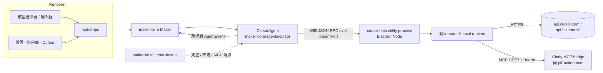

# Cursor Agent 引擎接入方案

> 状态：桌面本机实验版（2026-11-04）；此前已完成真实账号 Electron dev 联调及 CN macOS arm64 签名安装版验收，详见文末分项记录。本轮稳定性修正尚未重新打包安装；跨平台运行未验收。参考实现为本地 `t3code` 仓库
> `packages/provider-cursor`（`@cursor/sdk` 1.2.0）。Server 为独立仓库，本文的兼容结论
> 来自客户端代码核查，不代表已与 Server 侧确认。

下文保留早期方案与按时间追加的验证记录；当前修正范围和未完成项以文末「本轮 Review 修正」为准。

## 结论

1. **可以接，且第一期不需要改 Cindy 服务端。** Cursor 引擎的登录、模型目录、模型请求和
   用量全部直连 Cursor 自己的服务（`api.cursor.com` / `api2.cursor.sh` / `cursor.com`），不经过 Cindy 网关、
   不进服务端模型目录、不产生 Cindy 网关模型计费。首版仅启用本机运行；跨端执行仍按原有三引擎协议限制，不能据此推断所有同步载荷均与引擎类型无关。
2. **推荐沿用 t3code 的现行做法：用官方 `@cursor/sdk` 的本机运行时（local runtime）**，
   而不是 t3code 早期用过的 `cursor-agent` CLI + ACP。但 SDK 要放进**独立的 Node 子进程**
   运行，不要像 t3code 那样直接跑在宿主进程里。
3. **真正的工作量在客户端的「三引擎硬编码」。** 全仓约 150 处把引擎写死成
   `'claude-code' | 'codex' | 'pi'`，另有 `cc` / `claude` 两套别名；其中三元兜底
   （`=== 'codex' ? … : === 'pi' ? … : 'claude-code'`）会把新引擎静默当成 Claude，是最大的漏改风险。
4. **第一期只做本机。** 远程 Agent、供应商分享、供应商组、SSH、手机新建 Cursor 任务放到
   后续，因为 `REMOTE_AGENT_KINDS` 等跨端协议严格校验引擎值，旧端会拒绝。
5. **有两项产品限制必须对用户明说**：SDK 没有逐次工具审批回调，所以第一期没有「询问」
   权限档，IM 里的权限确认也不适用；SDK 不能原生回滚或分叉对话，所以 rewind / fork 不可用。

维护者已确认的取舍见文末「已决策」。

## 1. t3code 是怎么接的

t3code 前后接过两版：

| 版本 | 方式 | 现状 |
| --- | --- | --- |
| V1 | 启动 `cursor-agent` CLI，走 ACP（Agent Client Protocol）| 已被 V2 取代，设置里只保留旧字段 |
| V2 | 进程内加载 `@cursor/sdk`，`Agent.create / resume / send`，`runtime: "local"` | 现行 |

V2 的关键做法（文件均在 `t3code/packages/provider-cursor/src/server/`）：

| 能力 | t3code 做法 | 对应文件 |
| --- | --- | --- |
| 登录 | `Cursor.auth.login({ openBrowser: false, onLoginUrl })` 拿到授权链接，前端展示「打开登录页」；SDK 生成一把带名字的 API key，存进 t3 自己的凭证存储；也接受 `CURSOR_API_KEY` 覆盖 | `auth.ts`、`credentialStore.ts` |
| 模型目录 | 不初始化 agent 运行时，直接 `GET api.cursor.com/v1/models` 与 `/v1/me`，缓存 30 分钟；模型带 `parameters`（effort / context / fast）和 `variants`（含 Max Mode）| `CursorSdkCatalog.ts`、`status.ts`、`sdkModel.ts` |
| 会话 | 每个 t3 线程对应一个 Cursor agent（`agentId` 持久化，用于 resume）；同一时间一个 run | `CursorAgentSdk.ts`、`adapter.ts` |
| 流式事件 | `send(..., { onDelta })` 收到 `InteractionUpdate`：`text-delta`、`thinking-delta`、`tool-call-started/partial/completed`、`shell-output-delta`、`step-*`、`turn-ended` | `adapter.ts` 约 1990–2075 行 |
| 工具 | `shell/read/edit/write/delete/grep/glob/ls/semSearch/readLints/mcp` 映射成通用工具卡；`createPlan` → 计划，`updateTodos` → 待办，`task` → 只读子任务 | `adapter.ts` 约 400–820、1920–1975 行 |
| 宿主工具 | 把 t3 自己的 MCP（HTTP + Bearer）作为 `mcpServers` 每次 send 时传入；同时加载磁盘上的 `.cursor/mcp.json`、插件（`settingSources: project/user/team/mdm/plugins`）| `adapter.ts` `cursorMcpServers` |
| 权限 | 只有两个旋钮：`local.autoReview`（Cursor 自带分类器审阅）和 `local.sandboxOptions.enabled`。Full access = 关沙箱；其余档 = 开沙箱 + 自动审阅；Windows 无文件系统沙箱 | `adapter.ts` `cursorRuntimeAgentPolicy` |
| 计划模式 | `mode: "plan" \| "agent"` | `adapter.ts` |
| 压缩 | `/compress` → `agent.summarize()` | `adapter.ts` |
| 图片 | `SDKUserMessage { text, images: [{ data(base64), mimeType }] }` | `adapter.ts` |
| 产品提示词 | SDK 不接受 system / developer 段，t3 把编排说明拼在**用户消息末尾**，只在首轮或首次出现 MCP 时附加 | `adapter.ts` `resolveUserMessage` |
| 错误 | 429 / `*_usage_limit` → 用量上限；`Cannot use this model:` → 模型不可用；`plan_required` → 需要付费计划 | `CursorAgentSdk.ts`、`CursorSdkCatalog.ts` |
| 稳定性 | SDK 会留下未处理的 Promise 拒绝（shell spawn 失败、写已关闭的流），t3 在进程级 `unhandledRejection` 里专门吞掉这两类，否则整个服务器退出 | `CursorSdk.ts` |
| 用量 | 月度额度：Cursor dashboard 接口返回 `totalPercentUsed / autoPercentUsed / apiPercentUsed` 与 `billingCycleEnd`；逐条用量从 dashboard 事件接口分页拉 | `usageLimits.ts`、`accountUsage.ts` |

t3code 文档（`t3code/docs/user/cursor.md`）列过没有原生 fork、对话回滚、运行中插话和交互式审批回调，
但不能把参考客户端的能力缺口都视为 SDK 限制：安装的 1.2.0 已公开本地 `Run.steer()`，
`complete_delivered` 表示已交付，`revert_to_followup` 必须交回普通排队。Cindy 已在本轮后续修正接入。
`task` 子代理的 `agentId` 不能直接当作可恢复的主任务 ID。

我另外核对了 SDK 1.2.0 的类型声明（`@cursor/sdk/dist/esm/options.d.ts`），有几处 t3code 没用、
但对 Cindy 有价值的能力：

- `disallowedTools` / `tools`：按名字裁掉内置工具，可用来落实 Cindy 的能力路由（例如裁掉
  与 Cindy 重叠的 `webSearch`、`generateImage`）。
- `local.dirs`：多根工作区，可对应 Cindy 的附加目录。
- `local.customTools`：进程内回调工具，**不需要审批、在沙箱与 Auto-review 下也能跑**；
  注释说明普通 MCP 工具在这两种情况下可能「fail closed」。
- `local.resourceProviderOptions`：可替换工具执行器，SDK 已公开 `LocalToolExecutor` 类型。
  这不是审批的唯一候选：SDK 还会加载文件式 hooks（如 `preToolUse`、`beforeShellExecution`）。
  hooks 的超时、取消和与 Cindy 决定的关联仍需原型验证，不能据此声称已支持宿主审批。
- `systemPrompt`：**整段替换** Cursor 自带的系统提示词，且按账号由 Cursor 开通，未开通时首次
  send 直接报错。不能作为通用方案。
- run 结束会给累计 `TokenUsage`，可直接喂 Cindy 的用量快照。
- `agent.getUsage()` 支持本地 token 与计费明细；账期剩余额度仍是另一套接口。

## 2. 选型

| 方案 | 优点 | 缺点 | 结论 |
| --- | --- | --- | --- |
| A. SDK 跑在 Electron main 进程 | 最省事，和 t3code 一致 | SDK 约 20 MB、含 `.node` 原生模块（tree-sitter）和 `cursorsandbox`、`rg` 二进制；会产生未处理拒绝，曾导致 t3 服务器退出；Statsig 埋点跑在主进程 | 不采用 |
| **B. SDK 跑在独立 utility process，私有 RPC 对接** | 崩溃隔离；用 Electron `utilityProcess` 承载 Node 运行时免装（正式包禁用 `RunAsNode`，不能 spawn Electron 冒充 node）；入口脚本路径满足 `BaseAgent.binaryPath`；两端通过 `parentPort` 传 JSON 消息 | 多一层 RPC 和进程生命周期管理；SSH 需另配 transport，不能原样搬 utility process | **采用** |
| C. `cursor-agent` CLI + ACP | ACP 有 `session/request_permission`，能做真正的「询问」档和 IM 确认 | 要另行分发 CLI；t3code 已放弃；事件比 SDK 粗 | 只在「询问」档是硬需求时再评估 |

## 3. 架构

### 3.1 新增与改动的模块

| 位置 | 内容 |
| --- | --- |
| `packages/maker-core/src/agents/cursor/index.ts` | `CursorAgent extends BaseAgent`，`kind = 'cursor'`；声明 `capabilities`；`startSession` 拉起或复用 host 进程，`open(create\|resume)` |
| `.../agents/cursor/translator.ts` | `InteractionUpdate` → Cindy `AgentEvent`（见 §4）。必须无丢失、无错序，遵守 `maker-core-and-agent-behavior.md` |
| `.../agents/cursor/rpc-client.ts`、Desktop `maker-host/cursorUtilityTransport.ts` | 私有 JSON RPC；借用共享 transport 接口，双向走 `parentPort`，stdout / stderr 只排空，不使用 JSONL 帧长限制 |
| `.../agents/cursor/host-entry.ts`、`host-runtime.ts`（独立 bundle） | 加载 SDK、create／resume／send／cancel／summarize／close、登录和 Key 验证；未知 `unhandledRejection` 结束隔离进程，由退出确认和任务句柄重建收口，不吞掉未知失败 |
| `.../agents/cursor/permission-policy.ts` | 权限档 → `autoReview` / `sandboxOptions` / `mode`（见 §4.2） |
| `.../agents/cursor/errors.ts` | 用量上限、模型不可用、未登录、需付费计划、取消的分类（照 t3） |
| `agents/index.ts`、`capability-route-support.ts`、`credential-mode.ts` | 导出 `CursorAgent`；加 `cursor` 的能力路由 enforcer（用 `disallowedTools` 落实）；凭证形态固定为「Cursor 自有凭证」，不走网关 key |
| `apps/desktop/src/main/maker-host/cursor-host.ts` | 仿 `pi-host.ts` 的 `buildCursorAgent()`：解析 host 入口、注入凭证读取、MCP 端点；SDK 加载失败时返回 `null`，即可选注册，不影响其他引擎 |
| `apps/desktop/src/main/maker-host/cursor-host.ts` 与 `mcp-integrations/piEnvironment.ts` | 复用现有 Cindy MCP HTTP bridge，把端点组装成 SDK 的 `mcpServers`；没有独立 `cursorEnvironment.ts` |
| `apps/desktop/src/main/maker-host/cursor-auth.ts` | 登录、加密凭证、目录发现、账号隔离历史路径与用量；没有独立 `cursor-auth/` 目录 |
| `apps/desktop/forge-runtime-deps.ts` 等打包配置 | 把 `@cursor/sdk` 与当前平台的 `@cursor/sdk-<platform>` 解出 asar；`cursorsandbox`、`rg`、两个 `binding.node` 纳入 Developer ID 重签与 `codesign --verify --deep --strict` |

### 3.2 引擎 ID 与别名

建议所有形态都用同一个值 `cursor`：Maker、DB `agent_kind`、伙伴 `BotHarness`、二进制
`VendorKey`、事件 `source` 都写 `cursor`，不再引入第四套缩写。

- DB：`agent_kind` 列只有 TypeScript 层的 drizzle `enum`，SQLite 里没有 CHECK 约束
  （已核对 `apps/desktop/drizzle/`），**不需要新 migration**，扩类型即可。
- `apps/desktop/src/shared/agentKindConversion.ts` 的 `dbToMaker` / `makerToDb` 加一行恒等映射。

### 3.3 扩引擎的施工方法

1. 先改权威类型：`maker-core/src/types/common.ts`、`model-providers/src/types.ts`、
   `maker-scheduler/src/types.ts`、`lizi-mcps/src/scheduler/_enums.ts`，靠编译错误驱动修改。
2. 编译器抓不到的三类要人工扫：
   - 字面量数组和 `includes` 白名单（如 `providerHandlers.ts:124`、`sessionRuntimeHarnessSelection.ts:63`、
     `mcpHandlers.ts:60` 的 zod enum、Pi bridge 工具 schema `cindy-bridge-source.ts:4160`）；
   - 三元兜底，改成穷举 `switch` + `assertNever`；
   - 别名体系：`cc`、`claude`（`BotHarness`、`VendorKey`、`MonitoredAgentKind`）。
3. 新增一个只读检查脚本，列出仍写死三值的位置并纳入 CI。基线只减不增，做法同
   `check:test-hygiene`。
4. **跨端协议里的枚举第一期不扩**：`device-link` 的 `REMOTE_AGENT_KINDS`、
   `ORCA_REMOTE_WORKER_AGENT_KINDS`、`maker-remote-ssh` 的 `RemoteAgentKind`、
   `providerGroup.ts` 的 `REMOTE_AGENT_KINDS`、`dispatch.ts` 的 `PROVIDER_SHARE_AGENT_KINDS`
   保持三值，本机列表与远程列表从这里分叉。

## 4. 能力映射

### 4.1 事件翻译

| Cursor `InteractionUpdate` / 工具 | Cindy `AgentEvent` | 说明 |
| --- | --- | --- |
| `text-delta` | `text` | 按 assistant 段累积；run 结束若无流式文本、`RunResult.result` 有值，则补一段（照 t3） |
| `thinking-delta` / `thinking-completed` | `thinking` | |
| `tool-call-started/partial/completed`：`shell` | `tool_use` / `tool_result`（Bash 类卡片） | `shell-output-delta` 作为流式输出，设长度上限 |
| `read / edit / write / delete / grep / glob / ls / readLints / semSearch` | 复用现有文件 / 搜索工具卡 | 名称映射集中在一个表里 |
| `mcp` | `tool_use` 名为 `mcp__<server>__<tool>` | 与 Claude / Codex 的 MCP 卡一致 |
| `createPlan` | 计划卡（`plan_review` 不触发，只展示） | |
| `updateTodos` | 待办列表 | |
| `task` | `agent_task_update`（只读子任务卡） | 子任务不能 resume，不提供「继续」入口 |
| `turn-ended` + `run.wait()` | `done`；`finished / cancelled / error` → 完成 / 已停止 / 失败 | 照 t3 处理「resume 后无进展」的假失败 |
| run 的 `usage` | `UsageSnapshot` / `account_usage` | 只统计 token，不换算 Cindy 余额 |
| `agentId` | `session_id`（存进 `sessions.sdk_session_id`） | resume 用 |

### 4.2 权限档

| Cindy 档 | Cursor 设置 | 第一期 |
| --- | --- | --- |
| 自动（`auto`） | `autoReview: true`、沙箱开 | 支持；`getAutoReviewOwner()` 返回 `native` |
| 完全访问（`bypassPermissions`） | `autoReview: false`、沙箱关；首次打开前预热 `cursorsandbox`（照 t3） | 支持，沿用现有 Full access 确认 |
| 计划（`plan`） | `mode: 'plan'` | 支持 |
| 询问（`ask`） / `default` / `acceptEdits` | 无对应 | 不提供；`Capabilities` 不声明，UI 隐藏 |

- 所有平台 Auto／Plan 均请求 SDK 沙箱；SDK 判断环境不支持时会报 `ConfigurationError`，不会自动关沙箱。
  Windows 平台包存在 helper，不能仅由参考客户端推断「Windows 无沙箱」。现有 Windows 提示仍待实机核实和更正，未验收。
- Auto-review 取决于连接后端是否启用分类器，不是安全边界；未启用时会回到 SDK 默认行为。
  SDK 沙箱约束 shell 及其子进程，读权限不局限于项目，默认禁止出网；依赖安装可能被拒。
  以上口径来自[官方 SDK 文档](https://cursor.com/docs/sdk/typescript#sandbox-options)，不等同于 Cindy 宿主审批。
- 切档占用与发送相同的 busy 门。先成功 resume 候选 agent，再替换并关闭旧 agent；失败保留原权限和旧句柄。

### 4.3 其他能力

| 能力 | 第一期 | 做法 |
| --- | --- | --- |
| 新建 / 继续任务、重启后继续 | 支持 | `Agent.resume(agentId)`；已确认旧 worker 停止、且精确持久行含 `activeRunId` 时，仅首条普通发送带 `local.force`，正常恢复不带 |
| 停止 | 支持 | `run.cancel()` |
| 插话 / 排队 | 支持本地文本插话和排队 | `sameTurnSteer: true`；SDK 明确拒收时回普通排队，回执不确定时暂停队列；图片与显式 Skill 调用保留普通发送路径 |
| 运行中换模型 / effort | 支持（两轮之间） | 每次 `send` 带 `model: { id, params }` |
| 图片附件 | 支持 | base64 `images` |
| 文件附件 | 支持 | 路径拼进文本，同其他引擎 |
| 手动压缩 | 支持 | `agent.summarize()` → `compact_boundary` |
| Cindy 工具（MCP） | 支持 | `mcpServers` 每次 send 下发；需实测 Auto-review / 沙箱下 MCP 会不会被拒，若被拒改用 `customTools` 转发 |
| 用户自己的 Cursor 规则、Skill、MCP、插件 | 支持 | `settingSources: ['project','user','team','mdm','plugins']` |
| Cindy 托管 Skill | 第二期 | 与 Cursor 的 Skill 目录对齐后再做，避免两份来源 |
| rewind / fork / 会话树 / HTML 导出 | 不支持 | `Capabilities` 不声明 |
| 换引擎续做 | 第二期 | 复用 `cross-agent-convert`；转入 Cursor 时以交接摘要作为首条消息。现有 `session-import/sources/cursor.ts` 已能读 Cursor CLI 的本地记录 |

### 4.4 产品提示词（需要你确认）

Cursor 的 `systemPrompt` 是整段替换、且要 Cursor 按账号开通，不能用。可行的只有 t3 的做法：
把 Cindy 的产品说明作为**合成的用户上下文**放在首轮用户消息里，MCP 首次出现时再补一次。
这会改变 Cursor 任务里模型收到的指令，属于 `maker-core-and-agent-behavior.md` §4 的
「system prompt 改动门禁」范围，动手前需要维护者确认措辞与注入时机。

## 5. UI 与设计

所有新界面同时实现浅色与深色两种模式，颜色一律走语义 token；文案先查 `i18n/GLOSSARY.md`，
术语沿用「任务 / 对话 / 消息」的现有边界。

### 5.1 设置 · 供应商 · Cursor

放在现有供应商列表里，作为一个订阅类连接，与 Claude、ChatGPT 订阅并列。

| 状态 | 卡片内容 | 操作 |
| --- | --- | --- |
| 未连接 | 「用你的 Cursor 账号运行任务。需要 Cursor 付费计划。」 | 主按钮「用 Cursor 登录」；次要入口「改用 API key」 |
| 等待浏览器 | 「在浏览器里完成登录，完成后这里会自动更新。」，显示剩余时间（5 分钟超时） | 「重新打开登录页」「取消」 |
| 验证中 | 进度指示 | — |
| 已连接 | 账号邮箱、计划名称、本月用量条（第二期） | 「切换账号」「退出登录」 |
| 失败 | 按错误给原因：需要付费计划、团队禁止、网络不可达、登录过期 | 「重新登录」 |

- 登录链接用 `shell.openExternal` 打开，`openBrowser: false`，链接也给「复制」按钮，方便在另一台设备上完成。
- 退出登录和切换账号前，先停掉正在使用这份凭证的 Cursor 任务、保留任务记录（照 t3 `withAccess` 的语义）。
  确认对话框里写明「正在运行的 N 个 Cursor 任务会停止」。
- API key 模式下禁止浏览器登录，避免两份凭证打架；界面上说明当前用的是哪一种。

### 5.2 模型选择器

- 新增来源分组「Cursor」，模型来自 `/v1/models`，按账号实际返回显示；「Auto」映射到 SDK 的 `default`。
- 模型参数沿用现有控件：`effort`/`reasoning` → 思考强度下拉；`context` → 上下文档位（含 Max Mode）；
  `fast` → Fast 开关。参数优先级照 t3 `cursorSdkParameterPriority`。
- Cursor 的模型只能在 Cursor 引擎上跑，其他引擎也不能选 Cursor 模型，引擎行只显示「Cursor」一项；
  不需要「兼容模式」标签。
- 未连接时分组显示一行「连接 Cursor 后可用」，点进 5.1；目录拉取失败时保留上次缓存并标「可能不是最新」。

### 5.3 输入框与任务视图

- 权限档菜单只列 Cursor 支持的三档（自动、完全访问、计划）。旧任务或 IM 默认值带进来「询问」时，
  按「自动」运行，并在任务里给一条说明，不静默降级。
- 工具卡、计划卡、待办、子任务卡全部复用现有组件，不为 Cursor 做专用样式。
- 不支持的入口（rewind、fork、会话树、HTML 导出）通过 `capabilities` 隐藏，不在组件里写 `=== 'cursor'`。

### 5.4 图标与品牌

- `VendorIcon` 增加 `cursor`，使用 Cursor 官方立方体标志的单色 SVG（t3 的 path 可参考：
  `t3code/packages/provider-cursor/src/client.ts`）。填充色用 `currentColor`，跟随语义前景色与选中态，
  不硬编码 t3 的 `#26251E / #EDECEC`。
- 对外名称统一写「Cursor」；Harness 筛选、Issue 元数据里的公开全名写「Cursor」，不用缩写。
- 「关于」页的 Harness 版本行显示 `@cursor/sdk` 版本；SDK 随应用发布，不提供单独更新按钮。

### 5.5 用量

- Mac 菜单栏面板已接入当前连接的 `GetCurrentPeriodUsage`：`autoPercentUsed` 与
  `apiPercentUsed` 是独立模型池，分别显示为「Cursor 模型」「其他模型」，不能相加、取最小值
  或把任一池用完解释为整个账号不可用。首页保留一个 Cursor 入口，详情展示各池环与重置时间。
  `totalPercentUsed` 只在没有分池数据时作服务端汇总的后备，不再当作第三个额度池。
- 直接采用接口百分比（含赠送额度），不按套餐价格反推；重置时间取 `billingCycleEnd`，
  未返回则显示未知，已过期读数丢弃。没有账期起点，不估算消耗速度。额外付费／预付余额暂未读取，
  明确提示查看 Cursor 账单，不据此触发「全部额度见底」。
- 读取复用 Cindy 当前 owner 的 Cursor API key；换取的短期 token 只在 Main 内存使用，
  不落盘、不进入面板协议。缓存按 owner、连接与授权代次隔离，切账号后的迟到结果丢弃。
- Mac 的任务和用量图单独统计 Cursor；手机小组件 v1 仍是三个引擎槽，不冒充 Claude，
  Cursor 分池余量与独立用量展示留待手机端协议和原生组件一起扩展。
- 撞到用量上限时按 `usage-limit-auto-continue.md` 处理：重置时刻取 Cursor 返回的账期结束时间；
  拿不到可靠时刻时不自动继续，只提示。
- 任务里的 token 统计只用于展示，不进入 Cindy 余额与计费口径。

## 6. 服务端兼容性

| 面 | 是否涉及服务端 | 依据 | 结论 |
| --- | --- | --- | --- |
| 模型调用、登录、模型目录、用量 | 否 | 全部直连 Cursor | 无影响 |
| Cindy 模型目录 `/api/model-catalog/catalog` | 否 | 目录按 `providers[].models.<引擎>` 分槽；Cursor 模型来自账号实时发现，服务端没有 `cursor` 槽不影响 | 无影响；也不需要写进客户端离线目录 |
| 伙伴云端（companion-cloud） | 否 | 只在本地读 `sessions.agentKind`，不上传 | 无影响；Cursor 伙伴第二期再接 |
| Device Link 中转（官方 / 自建） | 否 | 中转只转发，不解析载荷（`protocol-compatibility.md`）| 无影响 |
| 远程 Agent / 供应商分享 / 供应商组 | 客户端协议 | `REMOTE_AGENT_KINDS` 用 `oneOf` 严格校验 | 第一期不暴露；以后加能力协商位，旧端不声明时不提供 Cursor |
| 手机 | 客户端 | 多处写死三值；会话列表的 `agentKind` 允许任意字符串 | 旧手机能看 Cursor 任务、不能新建；新建入口随一次 JS 热更新开放 |
| 标题生成等辅助模型 | 现有服务端 | 仍走现有辅助模型路由，Cursor 任务不改变这条链路 | 无影响 |
| 计费 / 余额 | 否 | Cursor 用量不经过 Cindy | 无影响；界面上不要把它算进 Cindy 余额 |

结论：在不碰服务端的前提下，第一期（本机）和第二期都能完整交付；第三期的远程能力只涉及
客户端之间的协议，也不需要服务端改动。

## 7. 区域

- 按维护者的默认约定，按中国大陆版（`cn`）开发与打包；Cursor 引擎在两个版本里都可用，都不作为默认引擎。
- 中国大陆网络下 `api.cursor.com` 的可达性、以及 Cursor 是否按地区限制部分模型，需要实测；
  模型列表直接来自账号，受限的模型自然不会出现。
- 不新增按区域分支的逻辑；若以后要分区域，按 `region-and-editions.md` 让未指定区域落在 `global`。

## 8. 分期

| 阶段 | 范围 | 完成标志 |
| --- | --- | --- |
| P0 技术验证 | 在 Electron 自带 Node 子进程里加载 SDK；登录、列模型、跑一轮流式对话；打包后 `cursorsandbox` 与 `.node` 能运行，Developer ID 重签通过严格校验 | 打出来的签名包里能跑通一轮 |
| P1 本机可用 | 引擎类型扩展与检查脚本；`CursorAgent` + host 进程 + translator；设置页登录；模型选择器；三档权限；Cindy MCP 工具；图片；停止 / 排队 / 继续 / 压缩；图标与文案 | 桌面端本机新建、继续、停止 Cursor 任务全流程可用 |
| P2 体验补齐 | 用量额度与上限自动继续；托管 Skill；伙伴 / 定时任务 / IM 默认引擎；换引擎续做；手机端新建（JS 热更新） | 各入口都能选 Cursor，不支持的能力有明确说明 |
| P3 远程与审批 | 远程 Agent、供应商分享 / 组、SSH 远端 host（复用子进程入口）；评估「询问」档：执行器替换或改走 ACP | 跨端能力协商通过新旧端互通测试 |

## 9. 风险

| 风险 | 影响 | 缓解 |
| --- | --- | --- |
| 三元兜底漏改，新引擎被当成 Claude | 错误路由、错误 UI | 穷举 `switch` + `assertNever`；检查脚本 |
| SDK 未处理拒绝或原生模块崩溃 | 进程退出 | 独立子进程；未知拒绝结束 worker，确认退出后结束事件流，下次显式发送重建；不自动重放用户消息 |
| SDK 私有授权（© Anysphere，受 Cursor 服务条款约束） | 能否随开源包分发 | 本次未核验分发授权；正式分发或回馈 upstream 前确认条款 |
| SDK 版本变化快（t3 半年内升级多次，修过多个行为差异） | 回归 | 固定版本；为翻译层录 SDK 回放夹具（照 t3 的 replay） |
| 产品提示词只能放进用户消息 | 行为与其他引擎不一致 | 走 system prompt 门禁确认；实测评估 |
| 没有「询问」档与 IM 确认 | 用户期待落空 | 界面与 IM 回执写明「Cursor 由自己的自动审阅决定」 |
| Auto-review / 沙箱下 MCP 工具可能被拒 | Cindy 工具不可用 | P0 实测；必要时改用 `customTools` 转发 |
| Windows 沙箱实际支持情况未知 | 启用 Auto／Plan 可能报配置错误；现有提示可能不准确 | 保持沙箱启用，不自动扩大权限；补 Windows 实机验证 |
| SDK 自带 Statsig 埋点 | 隐私口径 | 在隐私说明里列出；不把 Cindy 日志写进 SDK |

## 10. 验证

- 翻译层：用 SDK 回放夹具驱动真实 `CursorAgent` 入口，覆盖文本、思考、工具成功 / 失败 / 未完成、
  子任务、取消、用量上限、resume 无进展。测试按 `engineering-conventions.md` §3.2 的价值门槛写。
- 引擎扩展：现有按引擎参数化的测试（如 `maker.test.ts` 的 `it.each`）加入 `cursor`；
  检查脚本在 CI 阻断新增的三值硬编码。
- 打包：`pnpm package -- --region cn` 后重签，`codesign --verify --deep --strict` 通过，并在
  签名包里实跑一轮。
- 双模式：设置卡、模型分组、图标在浅色和深色下各目检一次；做不到的如实记录。

## 已决策（2026-11-04，维护者确认）

1. 引擎 ID 用 `cursor`，所有形态统一。
2. 「询问」档不是硬需求，采用方案 B（SDK 子进程）；第一期只提供自动、完全访问、计划三档。
3. 同意按 §4.4 把产品说明作为合成用户上下文注入；具体措辞实现前另行确认。
4. 第一期只做桌面端本机，远程能力与手机新建入口放到后续阶段。

## 实施前 Review（2026-11-04）

以下以本仓实际合同和安装的 `@cursor/sdk@1.2.0` 声明为准；原方案是目标，不是验收记录。

- **P1：权限来源不能降级。** `SendOptions.turnPermissionPolicy` 和 `toolsDisabled` 是宿主
  执行边界，Cursor Auto-review 看不到 Cindy 的来源证明。首版必须在派发前拒绝无法落实
  的策略，不能把 IM／访客／受托任务的确认默默交给原生分类器。
- **P1：`local.dirs` 不等于只读授权。** 它是多根工作区，不能用来实现 `extraDirs` 的只读
  合同；首版只声明可写附加目录，收到只读目录要求时明确拒绝，不能扩大权限。
- **P1：计划模式合同不相同。** Cindy 的 `capabilities.planMode` 还包含 `plan_review` 审批
  和批准后执行。Cursor 的 `mode: 'plan'` 只能作为权限菜单的计划运行，不能虚报支持完整合同。
- **P1：参考代码不能替代 SDK 接口核查。** 1.2.0 的本地 `AgentOptions` 通过 `local`
  选择运行时，没有 `runtime: 'local'`；`onDelta` 参数是 `{ update }`；部分工具参数事件叫
  `partial-tool-call`，不是 `tool-call-partial`。模型 HTTP 返回 `{ items }`，不是 `{ models }`。
- **P1：运行时、存储与打包有额外前提。** SDK 要求 Node ≥22.13；进程隔离不等于文件隔离。
  显式传入 owner／账号／任务隔离的 store；登录使用 `store: null`，由宿主加密保存凭证。
  运行时依赖闭包与目标平台 optional package 都必须随包，原生模块必须放在 asar 外。
- **P1：跨端兼容结论需要缩小。** 第一版不扩远程枚举，也不向远端目录暴露 Cursor；
  “旧手机能看到字符串字段”不足以证明它能发送、停止、切模型或正确显示全部卡片。
- **P1：shell 流式输出缺少可靠调用 ID。** SDK 事件无法把输出定位到并行 shell 时，不能
  采用“最近一个 shell”猜配。保留有调用 ID 的完整工具结果；实时输出需要可靠关联后再做。
- **P1：不能无证据宣称自用分发合法或中国大陆必然可达。** SDK 授权、账号权限、网络、
  原生 MCP 在 Auto-review 下的实际行为以及签名包运行，均须分别核验。

提示词已由维护者在本次实施中确认：首轮原样追加现有 `host-system-prompt.md`，包在
`<cindy_context>` 内；恢复已有 Cursor 会话不重复注入，不改 Cursor 原生系统提示词。

官方接口参考：[TypeScript SDK](https://cursor.com/docs/sdk/typescript)、
[SDK release notes](https://cursor.com/docs/release-notes/sdk)。最新在线接口可能与固定版本不同，
本实现的编译合同仍以安装的 1.2.0 类型为准。

## 首版实现与验收记录（2026-11-04）

当前已交付 CN 本机 Cursor 引擎、Developer ID 签名包及本机安装替换；未做公开发布。
手机端已补已有 Cursor 任务的展示与缓存识别；手机创建、远程 Agent 分配、账号额度与 Cindy 私有 Skill 投影仍属于后续范围。

已实现：

- 固定 SDK 1.2.0；独立 Electron utility process、私有 JSON RPC、进程退出确认、取消与故障收口。
- 本机创建／恢复／连续轮次、图片与文件、原生工具及完整结果、思考、子任务只读卡、停止、手动压缩、空闲切模型与可写附加目录。
- SDK Auto／Full access／Plan；不声明宿主 Ask 或完整 plan-review。原生 `CreatePlan` 的正文直接呈现；不制造 SDK 没有的批准回调。
- 浏览器登录、取消、断开、当前授权链接的重开／复制，以及经原生 SDK 验证的 API Key 备用入口。新 Key 验证失败不替换现有连接；输入只暂存组件内存，结束后清空。
- 宿主加密凭证、owner／授权代次竞态隔离；SDK 历史按 owner／账号／任务隔离。模型目录具有同账号磁盘 last-good 缓存与发现失败状态；没有虚构模型 ID、价格或上下文长度。
- 依模型目录开放 effort／Fast／thinking／context 参数；下轮待发送模型意图能应用和恢复，拒绝未知档位不污染原有选择。
- 原生项目及用户 Skill 的发现与显式调用；自动调用交给 SDK。读取 Skill 的关联资源不需要把用户全局提示词重写成 Cindy 指令。
- 原生 `.cursor/mcp.json` 与 Cindy MCP 桥接共存；webSearch／generateImage 排除仍按原生能力边界处理。工具流与 delta 去重；文件修改卡使用原生完成结果里的真实 diff。
- 本机 Cursor 身份、图标、权限菜单、模型选择与历史持久化；远程执行及手机创建入口排除 Cursor，不扩大三引擎 wire 枚举。
- CN 未设置语言时固定中文，不跟随操作系统。修复预热辅助窗口广播旧语言并覆盖偏好的问题；显式语言设置仍保留。
- Forge worker 构建、SDK 依赖闭包、目标平台 optional 包复制与 asar 解包规则；同日已完成 macOS arm64 Developer ID 签名打包。

真实账号 dev 验证：

| 场景 | 已观察结果 |
| --- | --- |
| 浏览器连接与重启 | 账号连接成功，动态目录返回 47 个模型；重启后连接及模型保留 |
| 多轮与模型切换 | 普通模型连续轮次成功；Opus 的 High／Fast／1M 参数已从实际 SDK 派发配置核验 |
| 原生工具与改动展示 | shell、创建、读取、编辑成功；新建 +1/−0、编辑 +1/−1 的真实 diff 可展开 |
| Skill | 显式调用及全新任务自动发现均读到只存在于测试资源中的标记 |
| MCP | 原生项目 stdio MCP 与 Cindy HTTP MCP 桥接在同一轮成功调用，每次调用仅一张卡 |
| 图片 | 附件上传后正确识别合成红色图片 |
| 停止与继续 | 运行中的长 shell 被取消；下一轮可继续 |
| 压缩 | 原生 summarize 完成；后续仍能回答压缩前的测试标记 |
| 原生 Auto 拒绝 | 删除操作被原生自动审查拒绝，原因如实展示，没有绕过 |
| 计划模式 | 原生读取文件并生成计划，测试文件保持原内容；补齐无 text delta 时的正文展示后，实机重测三步计划正常显示 |
| 中文偏好 | 修复后重启仍保持中文；主窗口与辅助窗口的偏好覆盖回归通过 |

自动验证与实际限制：

- Cursor 生产适配入口回归 16 项通过；授权／凭证文件 12 项通过；授权 IPC 文件 65 项通过；供应商设置组件文件 71 项通过。新授权文件单独运行约 0.616 秒，其中测试执行约 0.114 秒；Cursor 文件单独运行约 1.31 秒。
- 中文默认值与窗口跟随 25 项通过（窗口回归新文件单独运行约 0.888 秒）；此前目录／路由／队列等相关回归通过。
- `model-providers` 全部 1,677 项、Mobile 四个定向文件 192 项、Device Link 收藏边界 5 项、共享子任务 76 项、Desktop 子任务状态 49 项与任务卡 33 项通过。
- Desktop、Mobile、maker-core／model-providers／mcps 的定向类型检查已有通过记录；最后 Desktop 与 maker-core 增量类型检查通过。新增 Cursor 代码 lint 通过。
- 实际 Electron 为 Node 24.19.0，SDK 1.2.0；真实账号本机运行已跑通。签名包实测见下方同日追加记录；Windows 尚未验收。
- UI 预览脚本仍被已有 `PdfPreview.tsx` 对 `pdf.worker.min.mjs?url` 的 default import 构建错误阻断。Light 已实机操作计划／工具／模型界面；Dark 已目检 Cursor 供应商设置及密钥输入区；测试后恢复原有跟随系统主题。
- 全仓现存门禁问题没有弱化：maker-shared 的 `botGroupProcess.ts` 使用 `findLastIndex`，但该 package 的 ES lib 不包含此 API；i18n 缺失 113 个 key（已在 HEAD 基线复现）；`GLOSSARY.md` 与术语 JSON 不同步；未修改的 `newMakerDraft.test.ts` resetModules 计数高于基线。早期完整 Desktop 检查曾在未修改的 `chatServerGroupOpen.test.ts:426` 报错，不把它声称为本次已修复。

保留的能力边界：

- 不开放 remote／cloud、伙伴、定时任务、IM、Orca、供应商组／分享、SSH、手机创建或跨引擎续做。
- 首版没有宿主逐次 Ask、原生 fork／rewind、只读附加目录；本地文本 steer 已在后续修正中接入，图片与显式 Skill 调用仍走普通排队。
- 原生后台子任务可展示运行信息，但没有独立恢复／控制能力；shell delta 无可靠调用 ID 时保留完整结果，不猜测并行调用归属。
- Cindy 托管／插件私有 Skill 的物理投影、账号剩余额度面板及上限自动继续没有实现；SDK 缺少的额度及重置时刻不会自行编造。
- 手工 API Key 使用假凭证隔离回归与实际入口目检；未读取、展示或重填真实账号 Key。Full access 未在实机启用；映射及失败边界由定向回归覆盖。
- CN macOS arm64 签名包已安装并实测；Windows／其它架构、离线首次启动及账号额度耗尽仍未实机验证。

登录联调根因：SDK 1.2.0 的 `/auth/poll` 与 API Key 签发使用 `https://api2.cursor.sh`，
不能复用模型目录的 `https://api.cursor.com`。此前地址配错导致浏览器显示完成、客户端轮询失败；
已修正 worker 配置并有登录路由回归覆盖。

正式包登录修正（2026-11-04）：首次签名安装版关闭 `RunAsNode` fuse，但 Cursor 登录与
任务执行误用 `process.execPath` + `ELECTRON_RUN_AS_NODE`，实际重启了 Cindy，未进入 SDK
worker。现统一改为 Electron `utilityProcess.fork`；私有输入经 parentPort，stdout 仍按有界
JSONL 解帧，SDK stderr 只排空不记录。就绪后才发请求；断链使 RPC 失败，但只有确认进程退出
才释放执行资源；正常终止不退出时升级 SIGKILL，确认失败保留写入栅栏并允许重试。
没有开启 RunAsNode、inspect 或其它 fuse，也没有增加 Renderer 的进程或凭证权限。
新生产 transport 的 3 项回归覆盖启动就绪、RPC 往返、断链和退出确认；与凭证回归共 16 项通过。

同日追加的正式包沙箱修正：SDK 从 `process.argv[1]` 向上查找平台包的可执行文件，
ASAR 虚拟路径不能作为原生 helper 的执行锚点。将 `cursorHostProcess.js`、SDK 和运行期 peer
依赖解包，正式版通过 `app.asar.unpacked/.vite/build/cursorHostProcess.js` 启动，供沙箱、rg
和 tree-sitter 使用真实物理路径。保持 Auto／Plan 的沙箱启用，不删除用户的 sandbox.json，
不将这个错误降级为完全访问。新增打包登录路径回归。实际 CN macOS arm64 Developer ID 签名包已安装替换，
界面确认 Cursor 已连接；自动审批模式下使用原生 shell 执行无文件写入的 printf 命令，
命令卡显示完成且回复与命令输出一致。保留沙箱和全部 fuse 设置。未重新演练浏览器 OAuth、
未做 Apple 公证；连接状态与登录流程重放分别记录，不以其中一项代替另一项。

手机已有任务展示修正（2026-11-04）：被控电脑已经返回 `agentKind: cursor`，但手机的
列表标题、引擎图标、筛选、缓存反序列化与 composer 映射仍把三引擎之外的值归为 Claude Code。
现补齐 Cursor 身份并保留到已有任务发送参数；Cursor 不再查询 Claude／ChatGPT／xAI 的
订阅余量。手机新建、模型配置与跨引擎切换仍沿用首版范围限制，不以显示修复扩大远程分配协议。

- Mobile 类型检查通过；列表、持久缓存、筛选、身份与订阅归属定向回归 160 项通过。
- 模型限制、传输、授权提示、原生配置和远控 smoke 等追加 192 项通过。
- 变更尚未发布到手机；没有把 Mac 安装成功或 JS 单测当作 iOS 真机验收。

恢复遗留运行记录修正（2026-11-04）：进程退出后，SDK 持久存储可能仍保留 `running` 的
run，下一次恢复发送会报 `already has active run`。在拥有当前任务 worker 且本地未运行的
前提下，恢复后的首条普通消息使用 SDK 1.2.0 的 `local.force` 恢复路径，将遗留 run 标为
过期并继续已有会话；SDK 接受发送后清除此标记。正常后续消息不启用 force，真正并发发送
仍由 busy 守卫拒绝。不删除历史、不自动重放失败消息，不重置设备连接或其它任务。
已有 runtime 测试补齐恢复后连续两轮与派发期间并发拒绝，Cursor 文件 17 项回归、
maker-core 类型检查及定向 lint 通过；安装后的原任务重试需另行验证。

该版对所有 resume 启用一次 force 的做法，已在下述本轮修正中收窄为持久行含 `activeRunId` 才启用。

已有任务模型选择入口修正（2026-11-04）：统一模型选择器即使同引擎也调用
`SWITCH_SESSION_AGENT`，宿主入口的旧三引擎校验因此提前拒绝 Cursor。现在允许
当前本机 Cursor 任务进入已有的同引擎模型选择路径，完整保留 model／provider／effort／
Fast 快照；涉及 Cursor 的跨引擎交接及跨电脑执行仍明确拒绝。通过真实注册 IPC 的
回归复现修复前失败，修复后模型入口、设置模型与运行时切换共 266 项通过，Desktop
类型检查通过。安装版 UI 验收需分别记录切换意图与下一轮真实 SDK 模型参数。

上述模型选择修正在 Developer ID 签名的 CN 安装版完成实机验证：独立测试任务先由
Grok 4.6（high、Fast=true）成功执行，再经选择器依次改成 Gemini 4 Argon、Claude Opus 5.5、
Grok 4.6（low、Fast=false），每轮均返回指定文本。SDK 原生 runs 记录确认三轮均为
finished，最后一轮确实使用 effort=low、fast=false；未在原用户任务中重发消息。
定向生产文件 lint 通过；既有大测试文件仍有两处未使用变量 `_omit` 的 lint 错误。

iOS 已有 Cursor 任务模型配置补齐（2026-11-04）：手机作为同账号控制端，
可以修改被控电脑上已有 Cursor 任务的模型、推理强度和 Fast；执行仍在原电脑，
不等同于远程 Agent 分配。已移除任务页的模型设置禁用，允许当前 Cursor 任务读取
Cursor 模型目录，并写回该任务的模型偏好。新建、插件请求、定时任务及跨引擎／
跨电脑分配继续按其现有支持范围准入。模型选项复用原生浅／深主题界面。

- 最小回归在旧限制下失败，修正后目录、配置写回与选择器组件均通过；
  包括相关回归共 356 项通过，Mobile 类型检查通过。
- 真机 Release 构建和严格签名校验通过，已覆盖安装同一独立 iOS 应用并确认
  新安装包进程启动；不清理应用数据。
- 当前工具未提供该 iPhone 的点击控制，本轮没有把安装／启动校验当作真机
  模型点选实测。真机选模型并发送后的实际行为仍需在手机上确认。

### iOS 目录与控制链复查（2026-11-04）

此前手机模型组件测试预先提供了 Cursor 目录，未覆盖宿主真实的 `PROVIDER_LIST`
响应；因此组件通过并不能证明手机实际能看到模型。这次补上生产入口回归：
同账号远控经过既有授权门后，由宿主 invoke context 标记账号范围，供应商处理器返回
脱敏的 Cursor 目录。裸 IPC、共享任务访客和供应商分享不因这次修复获得 Cursor 目录，
凭证与路由继续走原脱敏投影。

同时修复四类三引擎遗漏：Cursor 模型偏好推送被忽略、目录失效时不刷新 Cursor 能力、
排队消息／上下文读取误用 Claude 身份、子任务来源及待应用模型配置丢失 Cursor。
本机偏好保留 Cursor 收藏与引擎选择；旧选择器的兼容回调也允许已有 Cursor 任务原地换模。
手机协同入口与 Desktop 一致排除 Cursor，避免先误用 Claude 能力探测再进入必然失败的流程。
供应商身份后缀显示恢复到与 Desktop 相同的判据。

| 检查范围 | 本轮证据 |
| --- | --- |
| 目录与信任边界 | 真实供应商 IPC、远控分发及共享目录派生回归通过，覆盖同账号目录可见、凭证脱敏、访客不扩权及关闭远控后拒绝 |
| 手机模型控制 | 目录、完整配置选择、取消／错误保留、推理档位、Fast、收藏、镜像推送、失效刷新与兼容路径相关回归通过 |
| 手机已有任务 | 列表与缓存身份、队列、消息归一化、子任务来源、上下文、附件、发送及远控冒烟相关回归通过；冒烟不启动真实 Cursor SDK |
| 自动验证 | 首轮 Mobile 39 文件 948 项；Desktop 供应商、模型切换与远控分发 579 项；共享合同 10 项通过。随后追加剪贴板／邀请 92 项、摘要与模型 119 项通过（后者包含重复验证的文件，不累加计数）。Mobile 与 Desktop 类型检查通过 |
| 安装版 Mac | CN Developer ID 签名包替换成功；实际界面切换模型、推理档位与 Fast 成功，未出现参数无效。恢复原模型配置；本轮未重新发送真实模型请求 |
| iOS 真机包 | 设备恢复连接后已覆盖安装独立测试包并启动。通过镜像实际看到 Cursor 目录，完成 Grok、Gemini、Opus、Sonnet 切换并分别收到测试回复，历史中的模型切换标记与所选模型一致；修改 Grok 推理档位与 Fast，停止轮次后重新发送得到正常回复 |

没有新增 Device Link 帧、channel、relay 或自建中转协议。共享类型兼容读取宿主已有的
Cursor 同引擎待应用配置，不开放跨引擎／跨电脑分配；旧控制端仍需更新才能完整识别。
手机新建、SSH、伙伴、定时任务、IM、供应商分享／组继续遵循各自准入。
本轮真机还发现固定档位模型的摘要残留旧 effort：数据库为兼容保留历史值，摘要未按
当前模型能力过滤。现已修正并有先失败后通过的回归，不修改数据库枚举或历史 migration。
另复现空输入框展开后模型按钮的点击被编辑区接收，输入并删除文字后才恢复；尝试在原生
展开动画收尾同步玻璃 contentView 的最终 frame。原生 Release 构建与签名校验通过，
第一轮冷启动直接点开模型目录，但后续空输入框展开再次复现，不能视为已修复。
相关输入交互回归 35 项通过仍不足以覆盖 UIKit 命中区域，此次原生修改已撤回，避免
为未证实的修复引入冷更。现转模拟器继续定位；模拟器原生构建与另一通知任务共用生成
目录发生冲突，已停止这里的原生生成，待该任务的工程稳定后继续，不把旧包当成验收证据。
附件、真实网络断线恢复以及深色模式目检仍未完成真机验证，不宣布 iOS 全功能验收完成。
开发文档检查通过；定向 lint 仍有 7 处既有错误，位于未改动的 dispatch 分支和供应商
检测测试，均不在本轮新增行内，未通过关闭规则或删除断言放行。

### iOS 启动粘贴授权弹窗（2026-11-04）

群邀请检测曾在启动、登录就绪及回到前台时主动读取剪贴板正文，进程内变化计数不能
避免重开应用再次触发系统粘贴授权。现在 iOS 不再自动探测剪贴板，保留显式邀请链接
和首页手动加入的系统粘贴入口；Android 原有前台发现与去重继续生效。
规则同步见 `docs/product-rules/bot-group-chat.md`，无原生配置、权限或 fingerprint 变更。
回归通过真实 hook 与常驻邀请 Host 验证 iOS 不自动读取、手动／外链流程仍可用，
并保留 Android 发现、账号切换与迟到结果隔离。真机在 Safari 复制内容后分别冷启动及
再次切回 Cindy-Feige，两次均正常进入首页，未出现 Allow Paste；没有将系统粘贴权限
改成始终允许来隐藏问题。

### 已登录模拟器验收（2026-11-04，进行中）

使用系统 iPhone 17 Pro / iOS 26.5、中国大陆版及真实登录；先覆盖安装匹配原生包，
核对 `native-matched`、当前 checkout 的 Metro 源码身份及新的主 bundle 加载记录。
不清登录、不重置设备，不把此前实体 iPhone 的结果当成模拟器结果。

- Grok、Gemini、Opus、Sonnet 分别发送独立的 `SIM_CURSOR_*` 标记并收到对应回复，
  历史中的切换路由与选择一致。Grok 中档推理和 Fast 已实际应用。
- 模型搜索、清除搜索、Cursor 来源筛选正常；空输入框展开后的首次点击、后续坐标点击，
  以及深色中文模式重新进入后点开目录均通过。此前实体手机上的偶发失灵不能因此宣布已修复。
- 长回复停止于第 858 项，随后消息正常执行；展开工具记录确认实际运行了 `printf`，
  输出与回复中的测试标记一致，没有仅凭模型自述判定工具成功。
- 发现重新进入后的非选中模型预设回落：页面清空显示镜像后没有读取宿主全量预设。
  手机现复用既有只读默认值通道加载 `providerModelMemory`，保留读取期间的新编辑与推送，
  并等待宿主确认乐观写入，防止宿主缓存暂时落后时回滚。没有新增 wire 字段或本机持久真相。
  代码回归与类型检查通过；兼容原生包中实际复验退出重进和冷启动，非选中 Opus 的低档预设保留。
- 另捕获一次原生 `EXC_BAD_ACCESS`，栈经过 `NotificationCenterManager.addDelegate` / Expo
  `EmitterModule` 注册。重新启动后登录与任务历史仍在；触发原因尚未确认，通知相关代码由
  对应任务负责，不将此错误归为 Cursor 请求错误，也不以重启成功替代崩溃修复。

- 发现 Cursor 收藏保存失败：原收藏隧道解析器拒绝第四种引擎。新版手机显式请求
  `includeCursor: true`，宿主仅向已验证的同账号控制端或可信本机窗口返回 Cursor 收藏。
  未声明能力的旧读者仍收到三引擎列表，访客不能借请求参数扩权；存储与运行权限不变。
  实际验证保存、恢复推荐保留原收藏、从收藏应用 Grok 中档 + Fast 并收到回复，冷启动后收藏仍在。
- 已在模拟器仅授权一张合成蓝白棋盘图，完成选图、上传、Cursor 识别 4×4 格子与颜色、
  发送后取回原图预览。未读取其它照片；拒绝照片权限时有明确说明。
- 已用 Developer ID 签名的中国大陆版更新 Mac 宿主，安装器确认新版启动；模拟器自动恢复连接，
  收藏切换后真实收到 `SIM_CURSOR_FAVORITE_RECONNECT_OK`。本项是宿主重启恢复，不等同真实断网测试。
- 半屏模型详情曾在自动化操作时关闭，重新定位坐标后可正常编辑。尚不能区分应用与自动化时序，
  临时诊断代码已撤掉，不能标记为已修复。中文保留，深色测试后已恢复原自动外观。
- 最终定向回归：Desktop 收藏 18、Mobile 427、共享解析 5、Cursor 运行时 32 项通过；两端类型检查通过，
  自建中转真实 interop 通过。全仓测试卫生检查失败于非本次修改的 `newMakerDraft.test.ts`
  （56 次 resetModules，基线 54），没有调高基线。

- 普通文本文件通过系统文件选择器上传，Cursor 实际读取并返回文件第一行的唯一标记；
  重新打开预览可见完整两行文本。首次预览期间开发包重新加载，日志有新的主 bundle 加载，
  没有新增原生 crash 报告；此轮不能确认重载来源，不能当作预览稳定性完全通过。
- 已切横屏并恢复竖屏；横屏设备窗口超过宿主可见范围，未完成整个模型菜单的横屏目检。

仍未完成：真实断网、语音与相机硬件、完整横屏，以及上述原生崩溃、开发重载和半屏交互的稳定复现。
不能把本轮关键链路验收写成全部功能通过；推送功能继续由通知任务验收。

## 本轮 Review 修正（2026-11-04）

本轮修改留在当前工作区，未提交、打包或替换安装版。SDK 仍固定 1.2.0；没有把在线文档
当成已安装版本的验收记录，也没有修改已有产品提示词、沙箱权限档或跨设备协议。

已修复的行为：

- **worker 退出后可以重建句柄。** RPC 将已确认进程退出通知给 CursorAgent；活动发送先发布
  一次终态错误，再释放 MCP 上下文并结束事件队列。空闲退出同样结束队列，复用 Session 的
  自然关闭和 Maker 的下一次发送重建路径。仅 RPC 错误／发出 kill 不构成退出证明。
- **残留 run 恢复更精确。** 读取当前任务精确 store 的 agent 行；只有该行含 `activeRunId`
  才让恢复后首条普通消息带 `local.force`。正常 resume、后续发送和真正并发都不强行覆盖。
  未自动重放失败消息，也不重置其它任务或设备连接。
- **失效历史不再无限重复恢复。** 仅 SDK 明确返回 `agent_not_found` 时，经 Maker 现有 CAS
  清除匹配的旧 SDK ID，并给出已本地化的错误说明；本次发送仍失败，再次显式发送使用新的
  Cursor 上下文，原任务消息保留。鉴权、网络故障不清 ID；CAS 不匹配、无回调和本机应用
  自管历史的任务不授权新上下文。原生历史未删除，换账号后也不自动复制到新账号。
- **权限／可写目录变更不会暴露半开会话。** adapter 和 runtime 都占用 busy 门；先成功
  创建候选 agent 再替换旧 agent。失败保留原 agent 及设置，关闭期间到达的候选会被释放。
- **通信不再解析 SDK stdout。** 请求与响应都经 utility process 的 `parentPort`，SDK 的
  stdout／stderr 仅排空。删掉 Cursor 的 stdio／RunAsNode fallback、`nodePath` 和无人使用
  的 probe 分支，不再继承 JSONL 16 MiB 帧长上限。没有放宽正式包 fuse 或 Renderer 权限。
- **上下文用量不会因下一轮缺少 token 事件而清零。** 新 translator 保留上一轮已知的上下文
  占用，收到新 usage 后再更新；新一轮输出 token／用量从零开始，不继承上一轮的计量。
- **无邮箱的手工 API Key 有稳定历史目录。** 新匿名连接以不可逆 Key 指纹作为绑定；同一
  Key 重连恢复同一路径，不同 Key 隔离。仍连接着的旧随机 binding 在重验时原样保留，
  不移动已有历史。已经断开且失去旧随机 binding 的历史无法据此自动找回；浏览器每次生成
  新 Key 且无身份的情况仍待处理。
- **修复两处身份兜底。** 菜单栏动态、恢复的后台子任务快照复用已有引擎映射，不再把 Cursor
  显示成 Claude。其它硬编码尚未做全仓注册表迁移；调度／Orca 等未开放入口不能仅为了消除
  三值判断而扩大准入。

本轮验证：

- Cursor 生产适配回归 27 项、Maker 生命周期／持久化 150 项、Cursor 授权 16 项、utility
  transport 3 项、菜单栏所在 Agent Island 文件 178 项、子任务 store 文件 51 项，共 425 项通过。
  覆盖空闲／活动 worker 退出、重建发送、精确 force、缺失历史 CAS、网络／鉴权不清历史、
  权限重建失败及并发、上下文读数保留和匿名 Key 重连。真实流式事件／翻译器保持生产入口回放。
- Desktop 和 maker-core 类型检查通过；本轮生产文件定向 lint 通过。Cursor 回归文件独立
  运行约 0.5～1.1 秒，授权约 0.3 秒，utility transport 约 2.2 秒；均在单文件 5 秒预算内。
- 开发文档合同检查通过。新增两条历史恢复错误提示已补齐 12 种语言；i18n 检查仍被工作区
  既有缺失 key 阻断（本次运行 135 处，移除本轮新增 key 后缺口不变），术语检查新增违规为 0，
  但 `GLOSSARY.md` 与 JSON 的既有不同步使门禁失败。单页 Light／Dark 预览仍被
  `PdfPreview.tsx:38` 的 `pdf.worker.min.mjs?url` default import 构建错误阻断；本轮没有完成
  两种模式的实际错误提示目检，不能把复用既有错误组件当作视觉验收。
  `check:test-hygiene` 仍被未修改的 `newMakerDraft.test.ts` 阻断：56 次无理由 resetModules，
  基线允许 54 次；未调整基线或弱化门禁。
- 隔离 Electron 42.11.12／Node 24.19.0 探针实际加载 SDK 1.2.0，验证双向 `parentPort`
  错误回包、`SIGKILL` 确认和替换 worker 再次回包。仅使用临时 userData、空 HOME 和假 Key，
  临时目录已清理。假 Key 按预期被拒绝，**没有验证真实模型发送后崩溃再继续的完整流程**；
  发送和 store 遗留状态的组合仍由进程内回归覆盖，不冒充真实账号端到端验收。
- 四项核心指标：未改变产品 prompt 内容、顺序或 MCP 定义；回放验证文本／思考／工具／终态
  顺序与去重，未增加热路径 I/O 或发送前网络请求；上下文读数修正有先失败后通过的回归。
  真实模型缓存命中率和延迟未重新测量，不以单测时长代表模型性能。

仍需推进的项目：

| 项目 | 当前证据与下一步 |
| --- | --- |
| 产品上下文与压缩后补注入 | 当前仍仅首轮原样追加 `host-system-prompt.md`。建议复用现有回答投递说明、host 产品段、插件花名册、按现有开关决定的记忆规则／索引和用户自定义指令，顺序与 Pi 普通本机任务一致；不复制 Pi 专属目录／伙伴规则。会话启动时冻结稳定快照，成功发送后才确认交付，成功压缩后在下一条消息补一次。涉及 §4 门禁，具体组装与注入时机待维护者确认，尚未动手 |
| Windows 沙箱 | 保持现有启用策略；实测 SDK helper 是否可用，再决定兼容路径及修正提示，不能静默退到无沙箱 |
| 系统代理 | worker 尚未接 Cindy 系统代理；需要在只有系统代理、没有 TUN 的网络下验证登录及模型调用，再选择复用入口 |
| hooks 审批 | SDK 提供文件式 hooks；需验证超时、取消、身份和本地 socket 桥接，避免写入／污染用户项目配置，尚未开放 Ask／IM／调度 |
| SDK 升级、计费明细与计划执行入口 | 文本 steer 已接入；getUsage、升级与计划执行入口仍待完成，升级需独立对比类型与运行行为，本轮未升级 |
| 任务删除与凭证生命周期 | Cursor 原生目录尚未随任务删除回收；登录过期提示、服务端 Key 吊销和无身份浏览器重登仍未完成，不把只删本地凭证称为服务端吊销 |
| 后台子任务 | SDK 的后台运行结束事件及最终收口仍需实测；不能将“已启动后台任务”伪装成实际完成 |
| 全仓硬编码与夹具 | 注册表及阻断三引擎误兜底的脚本待做；现有测试是合成 SDK 契约回放，尚无真实账号事件录制夹具 |

接口依据：[官方 TypeScript SDK](https://cursor.com/docs/sdk/typescript) 与本机安装的 1.2.0
声明。在线页面只用于接口复核，不代表 Windows、系统代理、签名安装版或真实账号恢复已验收。

### 后续核查：插话与逐轮计量（2026-11-04）

- 接入本地 `Run.steer(text)` 并声明 `sameTurnSteer`。只有 `complete_delivered` 才确认交付；
  `revert_to_followup` 用私有错误标记 `[STEER_FOLLOWUP_REQUIRED]` 交回现有输入队列。
  原生 run 可能仍在执行，因此该标记与 `NO_ACTIVE_TURN` 分开处理，不合成假的 done。
- 插话超时、断线或非预期回执按 `delivery uncertain` 进入已有暂停队列，避免重复投递。
  图片及显式 `/Skill` 调用不经文本 steer 丢弃内容，而是留到普通发送处理。
  异步准备后再次核对当前轮次、凭证和来源策略，运行中的权限／计划模式保持原请求语义。
  私有 RPC 同时传递 worker 内的轮次代号，worker 拒绝投向已结束轮次的迟到插话。
- 队列接回拒收消息时保留暂停锁；清空／停止后迟到的拒收不复活消息，`fallbackToTurn: false`
  也不会被覆盖。原生取消后不再接收 steer，正在运行的普通发送不因插话重新初始化状态。
- 修正上一轮用量快照保留范围：只保留 `contextTokens`。新一轮最早的 Working 状态即把
  输出 token 和逐轮用量归零；未产生 usage 就取消时，不再把上轮输出记成这一轮。
- 系统代理仍未接入。SDK 有 `Cursor.configure({ local: { useHttp1ForAgent } })`，但此开关只
  选择 HTTP 版本，不能代替 Cindy 的系统代理／PAC 路由；需进一步验证登录与运行两条请求链。

本次未改产品 prompt、SDK 版本、沙箱权限策略或跨设备协议；文本／工具事件回放与上下文
读数回归用于检查事件准确性，未在 token 热路径增加 I/O。真实账号插话、模型延迟与缓存率
尚未实测，不能以模拟 SDK 的确认回执代替生产网络验收。

验证记录：Cursor 文件 32 项与输入队列完整文件 625 项通过；maker-core 与 Desktop 类型
检查通过，生产代码定向 lint 通过。新增场景先复现旧行为失败，再通过修正。Cursor 文件约
0.8 秒；输入队列既有大文件完整运行约 17.5 秒（625 项，采集约 5.6 秒），新增 4 条队列用例
单独运行约 4.9 秒、执行 7 毫秒，未增加真实等待或重复加载模块。该大测试文件仍有 5 处
既有 lint 错误，位于本次新增用例以外；未为此修改无关测试或弱化规则。
